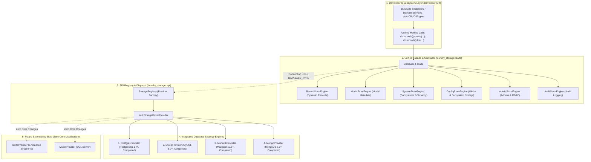

# Foundry Multi-Database & Pluggable Storage Architecture
# (Architecture Design & Implementation Roadmap)

> **Target Versions**: `v0.2.0` ~ `v0.3.0`  
> **Core Objective**: Decouple the hardcoded PostgreSQL binding by introducing an **SPI (Service Provider Interface) pluggable mechanism** and **Strategy Pattern**. Encapsulate raw drivers completely, expose clean method-based domain interfaces, support automatic database selection via a single environment variable or connection URL, and progressively implement database support strictly in sequence: **PostgreSQL (1st, Completed)**, **MySQL (2nd, Completed)**, **MariaDB (3rd, Completed)**, and **MongoDB (4th, Completed)**.  
> **Support Matrix & Sequence**:
> - **1. PostgreSQL (14+)**: Initial Integration [x] Completed
> - **2. MySQL (8.0+ / 8.4+)**: Second Integration [x] Completed
> - **3. MariaDB (10.5+)**: Third Integration [x] Completed
> - **4. MongoDB (6.0+)**: Fourth Integration [x] Completed
> - **Future Extensible Slots**: SQLite (embedded / single-file / unit tests), SQL Server (MSSQL), TiDB, etc.  
> *(Note: Oracle DB has been removed from the roadmap due to heavy client runtime dependencies and insufficient open-source Rust community maintenance.)*

---

## 📌 Status Legend
- [ ] **Pending**
- [/] **In Progress**
- [x] **Completed**

---

## 🧭 1. Core Architectural Philosophy & Four Principles

### 1. Method-Based & Driver-Agnostic
- Business subsystems, the AutoCRUD engine, domain services, and developer code **only invoke unified standard methods** (e.g., `db.records().create(...)`, `db.records().list(...)`, `db.configs().get(...)`).
- Never expose `sqlx::PgPool`, `sqlx::MySqlPool`, or database-specific connection types directly in business layers.
- The framework completely encapsulates lower-level SQL dialects and network driver peculiarities.

### 2. Database-Native Strategy (Reject "Lowest Common Denominator SQL")
- Different databases possess fundamentally different physical architectures and strengths. Forcing a generic SQL template degrades performance and wastes platform advantages:
  - **PostgreSQL**: Leverages `JSONB` + `USING GIN(data)` inverted indexes + partial indexes for genuine Zero-DDL dynamic storage.
  - **MySQL / MariaDB**: Unified relational strategy (99% code reuse). Overcomes the absence of full-JSON GIN inverted indexes by combining "Standard JSON column + Virtual Generated Columns + Secondary B-Tree Indexes". MariaDB is supported via dedicated `MariaDbProvider` and dialect initialization scripts.
  - **MongoDB**: Leverages native document capabilities to store schema-free BSON documents, naturally supporting massive dynamic records with Wildcard Indexes (`$**`) for arbitrary query acceleration. Maintains integer ID compatibility via atomic `_counters` sequences.

### 3. Smart Protocol Auto-Detection & Single Environment Variable Selection
- **Out-of-the-Box Zero Redundancy**: The engine automatically detects the connection protocol from `DATABASE_URL`:
  - `postgres://` or `postgresql://` $\rightarrow$ activates PostgreSQL engine
  - `mysql://` $\rightarrow$ activates MySQL engine
  - `mariadb://` $\rightarrow$ activates MariaDB engine
  - `mongodb://` or `mongodb+srv://` $\rightarrow$ activates MongoDB native document engine
- **Explicit Override Supported**: Users can also configure a single environment variable (e.g., `DATABASE_TYPE=mysql`, `DATABASE_TYPE=mariadb`, or `DATABASE_TYPE=mongodb`) during installation or deployment.
- **Provider-Managed Migrations**: Each engine implements a `run_migrations()` contract, automatically loading and running dialect-specific DDL scripts and distributed locks based on the chosen database.

### 4. Cargo Feature Modularization (Conditional Compilation)
- Rust is a statically compiled language. Bundling multiple database drivers into a single binary causes unnecessary binary bloat.
- All drivers are conditionally compiled using Cargo Feature Flags:
  - `default = ["postgres"]`
  - Optional features: `features = ["mysql"]`, `features = ["mariadb"]`, `features = ["mongodb"]`
  - If a user configures an uncompiled database driver at startup, the system halts with clear, actionable configuration instructions.

---

## 🏗️ 2. Target System Architecture



---

## 📁 3. Refactored Crate Layout & Directory Structure

The standardized layout for `crates/foundry_storage`:

```text
crates/foundry_storage/
├── Cargo.toml                         # Feature flags (postgres, mysql, mariadb, mongodb)
├── migrations/                        # Dialect-specific migrations and baseline scripts
│   ├── postgres/                      # PostgreSQL DDL (BIGSERIAL, JSONB, GIN, PL/pgSQL)
│   │   └── init.sql
│   ├── mysql/                         # MySQL DDL (AUTO_INCREMENT, JSON, composite indexes)
│   │   └── init.sql
│   └── mariadb/                       # MariaDB DDL (AUTO_INCREMENT, JSON, composite indexes)
│       └── init.sql
└── src/
    ├── lib.rs                         # Re-exports Database facade and all store traits
    ├── facade.rs                      # Database struct and unified builder / connect API
    ├── entities.rs                    # Common domain entities (System, Model, Record, Admin, AuditLog)
    ├── traits/                        # Business Trait contracts
    │   ├── mod.rs
    │   ├── records.rs                 # RecordStoreEngine: list, get_by_id, create, update, delete
    │   ├── models.rs                  # ModelStoreEngine: list_models, get_model, create_model...
    │   ├── systems.rs                 # SystemStoreEngine: list, get_by_slug, stats...
    │   ├── configs.rs                 # ConfigStoreEngine: list, get_aggregated, update...
    │   ├── admins.rs                  # AdminStoreEngine: list, get_by_username, create...
    │   └── audit.rs                   # AuditStoreEngine: insert, list...
    ├── spi/                           # SPI discovery and driver registration
    │   ├── mod.rs
    │   ├── provider.rs                # StorageDriverProvider trait definition
    │   └── registry.rs                # StorageRegistry: driver registration & URL resolution
    └── engines/                       # Database-native strategy implementations
        ├── mod.rs
        ├── postgres/                  # PostgreSQL strategy
        │   ├── mod.rs
        │   ├── provider.rs            # PostgresProvider
        │   ├── records.rs             # GIN index & JSONB query handling
        │   └── stores.rs              # models, systems, admins implementations
        ├── mysql/                     # MySQL strategy
        │   ├── mod.rs
        │   ├── provider.rs            # MySqlProvider
        │   ├── records.rs             # MySQL JSON operations, last_insert_id re-fetch
        │   └── stores.rs              # models, systems, admins implementations
        ├── mariadb/                   # MariaDB specialized strategy
        │   ├── mod.rs
        │   └── provider.rs            # MariaDbProvider
        └── mongodb/                   # MongoDB native document strategy
            ├── mod.rs
            ├── provider.rs            # MongoProvider
            ├── records.rs             # Native BSON CRUD & Wildcard index handling
            ├── counters.rs            # Atomic sequence counters for i64 ID compatibility
            └── stores.rs              # Document collections implementations
```

---

## 🧩 4. Core Trait & Interface Contracts

### 1. `StorageDriverProvider` (SPI Extension Contract)

```rust
#[async_trait]
pub trait StorageDriverProvider: Send + Sync {
    /// Unique driver identifier, e.g. "postgres", "mysql", "mariadb", "mongodb"
    fn driver_name(&self) -> &'static str;

    /// Checks if this provider supports the given connection URL
    fn supports(&self, connection_url: &str) -> bool;

    /// Initializes connection pool and constructs the complete set of store engines
    async fn create_engines(
        &self,
        connection_url: &str,
        max_connections: u32,
    ) -> AppResult<StorageEngineSet>;

    /// Executes database-specific initialization and migration scripts
    async fn run_migrations(&self, connection_url: &str) -> AppResult<()>;
}
```

### 2. `RecordStoreEngine` (Unified Dynamic Record Trait)

```rust
#[async_trait]
pub trait RecordStoreEngine: Send + Sync {
    async fn list(
        &self,
        system_slug: &str,
        model_slug: &str,
        query: RecordQuery,
    ) -> AppResult<PaginatedData<ModelRecordEntity>>;

    async fn get_by_id(
        &self,
        system_slug: &str,
        model_slug: &str,
        id: i64,
    ) -> AppResult<ModelRecordEntity>;

    async fn create(
        &self,
        system_slug: &str,
        model_slug: &str,
        data: serde_json::Value,
    ) -> AppResult<ModelRecordEntity>;

    async fn update(
        &self,
        system_slug: &str,
        model_slug: &str,
        id: i64,
        data: serde_json::Value,
    ) -> AppResult<ModelRecordEntity>;

    async fn delete(
        &self,
        system_slug: &str,
        model_slug: &str,
        id: i64,
    ) -> AppResult<()>;
}
```

### 3. `Database` (Unified Developer Facade)

```rust
#[derive(Clone)]
pub struct Database {
    records: Arc<dyn RecordStoreEngine>,
    models: Arc<dyn ModelStoreEngine>,
    systems: Arc<dyn SystemStoreEngine>,
    configs: Arc<dyn ConfigStoreEngine>,
    admins: Arc<dyn AdminStoreEngine>,
    audit: Arc<dyn AuditStoreEngine>,
}

impl Database {
    pub async fn connect(url: &str, max_connections: u32, auto_migrate: bool) -> AppResult<Self>;

    pub fn records(&self) -> &dyn RecordStoreEngine { self.records.as_ref() }
    pub fn models(&self) -> &dyn ModelStoreEngine { self.models.as_ref() }
    pub fn systems(&self) -> &dyn SystemStoreEngine { self.systems.as_ref() }
    pub fn configs(&self) -> &dyn ConfigStoreEngine { self.configs.as_ref() }
    pub fn admins(&self) -> &dyn AdminStoreEngine { self.admins.as_ref() }
    pub fn audit(&self) -> &dyn AuditStoreEngine { self.audit.as_ref() }
}
```

---

## 🎯 5. Database-Native Strategy Implementations

### 1. PostgreSQL Strategy (1st Integration - [x] Completed)
- **Table Structure**: `model_records` table with `data JSONB NOT NULL DEFAULT '{}'::jsonb`.
- **Indexes**:
  - `CREATE INDEX idx_lookup ON model_records(system_id, model_slug, created_at DESC) WHERE deleted_at IS NULL;` (partial index)
  - `CREATE INDEX idx_data_gin ON model_records USING GIN(data);` (inverted index on arbitrary JSON keys)
- **SQL Dialect**: `$1, $2` placeholders; write operations utilize `INSERT ... RETURNING *` to eliminate round-trip overhead.

### 2. MySQL 8.0+ Strategy (2nd Integration - [x] Completed)
- **Universal Single-Table Storage**: Avoids `CREATE TABLE` metadata locking (MDL) hazards and `.ibd` file descriptor leaks.
- **Integer Foreign Key Indexing**: Compact integer `model_id: BIGINT` as prefix in `idx_model_query (model_id, deleted_at, created_at DESC, id DESC)`, cutting index size by >75%.
- **Deferred Join Pagination**: Scans lightweight covering index first to acquire IDs, then joins back for heavy JSON payloads.
- **Atomic Insert & Re-Fetch**: Coordinates `INSERT` $\rightarrow$ `last_insert_id()` $\rightarrow$ `SELECT` in a single transaction.

### 3. MariaDB 10.5+ Strategy (3rd Integration - [x] Completed)
- **Dialect & Connection Isolation**: Dedicated `MariaDbProvider` supporting `mariadb://` URL scheme and `DATABASE_TYPE=mariadb`.
- **JSON Storage**: Uses MariaDB `JSON` type with native JSON functions and dedicated migration script (`migrations/mariadb/init.sql`).
- **Full Parity**: Reuses high-performance single-table relational algorithms while isolating MariaDB connection pool parameters and system variable behavior.

### 4. MongoDB Native Document Strategy (4th Integration - [x] Completed)
- **Document Mapping**:
  - `model_records` maps directly to native MongoDB collections:
    ```json
    {
      "_id": ObjectId("6651a..."),
      "id": 100001,
      "model_id": 1,
      "system_id": "carnival_2026",
      "model_slug": "products",
      "data": { "title": "Mechanical Keyboard", "price": 99, "tags": ["hardware"] },
      "created_at": ISODate("2026-09-26T12:00:00Z"),
      "updated_at": ISODate("2026-09-26T12:00:00Z"),
      "deleted_at": null
    }
    ```
- **ID Compatibility**: Uses atomic sequence counters in `_counters` collection (`find_one_and_update` with `$inc`) to satisfy public `id: i64` contract transparently.
- **Native Dynamic Indexing**: MongoDB Wildcard Index (`data.$**`) natively indexes arbitrary nested JSON properties without schema migrations.
- **Full Async Runtime**: Official `mongodb` driver crate with native Tokio runtime support.

---

## 🔮 6. Future Extensibility Example: Adding SQLite

Adding a new database engine requires **zero modifications to core code**:

1. **Step 1**: Implement `StorageDriverProvider` in `engines/sqlite/provider.rs`:
   ```rust
   pub struct SqliteProvider;
   #[async_trait]
   impl StorageDriverProvider for SqliteProvider {
       fn driver_name(&self) -> &'static str { "sqlite" }
       fn supports(&self, url: &str) -> bool { url.starts_with("sqlite://") }
       async fn create_engines(&self, url: &str, _) -> AppResult<StorageEngineSet> {
           let pool = sqlx::SqlitePool::connect(url).await?;
           Ok(StorageEngineSet {
               records: Arc::new(SqliteRecordEngine { pool: pool.clone() }),
               // ...
           })
       }
       async fn run_migrations(&self, url: &str) -> AppResult<()> { ... }
   }
   ```
2. **Step 2**: Register the provider:
   ```rust
   registry.register(Box::new(SqliteProvider));
   ```
3. **Step 3**: Configure `DATABASE_URL=sqlite://foundry.db`. The application immediately runs on SQLite!

---

## 📅 7. Implementation Roadmap & Milestones

```
[Phase 0: Core SPI & PostgreSQL (Completed)] ➔ [Phase 1: MySQL 8.0+ Engine (Completed)]
                                                         │
[Phase 4: Release & CLI Tooling] ⬅ [Phase 3: MongoDB (Completed)] ⬅ [Phase 2: MariaDB (Completed)]
```

### Phase 0: Core SPI Architecture & PostgreSQL Extraction (1st Integration - [x] Completed)
- [x] **0.1 Standard Domain Store Traits**: Define standard traits in `crates/foundry_storage/src/traits/`.
- [x] **0.2 SPI Registry**: Define `StorageDriverProvider` and `StorageRegistry` in `crates/foundry_storage/src/spi/`.
- [x] **0.3 Unified Database Facade & Protocol Sniffing**: Implement `Database` facade, supporting automatic URL scheme sniffing (`postgres://`, `mysql://`, `mariadb://`, `mongodb://`).
- [x] **0.4 Cargo Feature Modularization**: Configure `Cargo.toml` with feature flags (`postgres`, `mysql`, `mariadb`, `mongodb`).
- [x] **0.5 PostgreSQL Provider Extraction**: Extracted to `engines/postgres/` with 100% backward compatibility.

### Phase 1: MySQL 8.0+ Strategy Engine (2nd Integration - [x] Completed)
- [x] **1.1 Universal Single-Table Migrations**: Write `migrations/mysql/init.sql` with compact integer `model_id: BIGINT` covering index.
- [x] **1.2 Connection Management**: Implement `engines/mysql/` module using `sqlx::MySqlPool`.
- [x] **1.3 High-Performance Engine**: Covering index & deferred join pagination, atomic insert & re-fetch.
- [x] **1.4 Metadata Stores**: Implement MySQL stores for models, systems, configs, admins, and audit logs.
- [x] **1.5 Integration Testing**: Complete E2E integration test suite (`tests/mysql_integration_tests.rs`).

### Phase 2: MariaDB 10.5+ Dialect & Engine Adaptation (3rd Integration - [x] Completed)
- [x] **2.1 Dialect Isolation & Connection Management**: Dedicated `MariaDbProvider` supporting `mariadb://` URL protocol.
- [x] **2.2 Dedicated Migration Script**: Create `migrations/mariadb/init.sql` with MariaDB table definitions and seed superadmin.
- [x] **2.3 Integration Testing**: Complete E2E integration test suite (`tests/mariadb_integration_tests.rs`) verified against live MariaDB.

### Phase 3: MongoDB Native Document Engine Support (4th Integration - [x] Completed)
- [x] **3.1 Driver Integration**: Integrate official async `mongodb` driver crate under `features = ["mongodb"]`.
- [x] **3.2 BSON Document Mapping & Atomic Counters**: Implement `_counters` collection for sequential `i64` IDs and BSON serialization.
- [x] **3.3 Dynamic Indexing**: Automatic index creation including Wildcard Indexes (`data.$**`) and unique constraints.
- [x] **3.4 Full Platform Collections**: Document store implementations for records, models, systems, configs, admins, and audit logs.
- [x] **3.5 Integration Testing**: Complete E2E integration test suite (`tests/mongodb_integration_tests.rs`) verified against live MongoDB.

### Phase 4: Production-Readiness, CLI Tooling & Ecosystem Release
- [x] **4.1 Unified Multi-Database Migration Support**: Automated schema bootstrapping across PostgreSQL, MySQL, MariaDB, and MongoDB.
- [x] **4.2 Comprehensive Multi-Database Usage Guide**: Multi-database selection, configuration, and driver switching documentation.
- [x] **4.3 Full Test Coverage**: Strict Clippy validation and automated regression test suite across all four storage engines.
