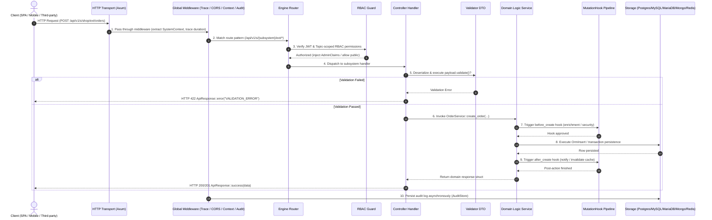

# 01. Architecture & Request Lifecycle

> **Chapter Objectives**:
> 1. Understand Foundry's "framework-application complete decoupling" philosophy;
> 2. Master application bootstrapping with `FoundryApp::builder()`;
> 3. Trace an HTTP request through middleware, routing, controllers, validation, ORM, and hooks;
> 4. Establish conceptual parity with ThinkPHP 8.0, Laravel, and Spring Boot.

---

## 1. Architectural Philosophy (ThinkPHP vs. Foundry)

In ThinkPHP 8.0, applications use Container, Facade, Service Providers, and Middleware to achieve separation of concerns.

Foundry expresses these patterns with Rust's memory safety and concurrency primitives:

```text
Foundry Framework Layer (crates/foundry, crates/foundry_core, crates/foundry_engine...)
    │  Provides generic infrastructure: Axum engine, response envelopes, multi-DB SPI, RBAC, Admin
    │  Consumed via standard Cargo dependency
    ▼
User Application (Standalone Git Repository)
    ├── src/main.rs             # Application entry point (equivalent to public/index.php)
    └── src/systems/            # Domain subsystems (equivalent to app/ directory)
        ├── shop/               # E-commerce subsystem (controllers, logic, DTOs, custom admin UI)
        └── billing/            # Billing subsystem
```

### Concept Comparison

| ThinkPHP 8.0 Concept | Foundry Equivalent | Description |
|---|---|---|
| **Entry File (`public/index.php`)** | **`src/main.rs` (`#[foundry::main]`)** | Bootstrapping entry point, reads `.env`, invokes `FoundryApp::builder()` |
| **Application Module (`app/`)** | **Subsystem (`SubsystemModule`)** | High-cohesion, self-contained business domain package |
| **Facade (`Facade`)** | **`use foundry::prelude::*;`** | Re-exports standard primitives, extractors, and macros |
| **Container / DI (`Container`)** | **`Extension<SystemContext>` / `AppState`** | State injection with zero runtime reflection overhead |
| **Route Definition (`Route::rule`)** | **`SubsystemModule::register_routes`** | Mounted automatically under subsystem namespace |
| **Controller (`Controller`)** | **Axum Handler Function** | Async function extracting params and returning `ApiResponse` |
| **Validator (`Validate`)** | **`#[derive(Validate)]` DTO** | Compile-time validation annotations, rejecting malformed input |
| **Query Builder (`Db::name`)** | **`EntitySchema` / `OrmSelect`** | Code-First schemas and dialect-adaptive query builders |
| **Model Events (`Event / Hook`)** | **`MutationHook` Pipeline** | Lifecycle pre/post mutation hooks (`before_create`, `after_create`) |

---

## 2. Full HTTP Request Lifecycle



---

## 3. Application Bootstrapping (`main.rs`)

Similar to how ThinkPHP instantiates `think\App`, Foundry uses a fluent Builder API:

```rust
// src/main.rs
pub mod systems;

use foundry::prelude::*;
use systems::shop::ShopSubsystem;

#[foundry::main]
async fn main() -> Result<(), Box<dyn std::error::Error>> {
    // 1. Read configuration from environment (.env)
    let config = FoundryConfig::from_env();

    // 2. Build Foundry Application instance
    let app = FoundryApp::builder()
        .config(config)
        .register_subsystem(ShopSubsystem)
        // .register_hook(ShopAuditHook)
        .build()
        .await?;

    info!("🚀 Server is ready and listening...");

    // 3. Start HTTP server loop
    app.run().await?;
    Ok(())
}
```

---

## 4. Unified Facade (`prelude`)

With a single import:
```rust
use foundry::prelude::*;
```
Your code gets access to:
* **Routing & Extractors**: `Router`, `Json`, `Query`, `Path`, `Extension`, `get`, `post`, `put`, `delete`
* **Response & Error Envelopes**: `ApiResponse`, `PaginatedData`, `AppResult`, `AppError`
* **ORM Query Builders**: `OrmSelect`, `OrmInsert`, `OrmUpdate`, `OrmDelete`, `Dialect`
* **Structured Logging**: `info!`, `warn!`, `error!`, `debug!`, `trace!`
* **Subsystems & Schemas**: `SubsystemModule`, `SystemContext`, `AppState`, `EntitySchema`, `ColumnDef`, `IndexDef`

Next chapter: [02. Routing System & Namespaces](./02-routing/)
