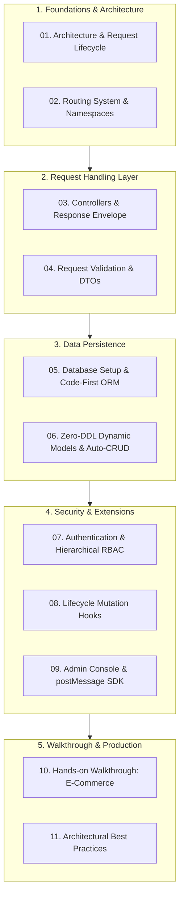

# Foundry System Development Tutorial Overview

> **Design Philosophy**: Inspired by the modular classification and developer experience of the [ThinkPHP 8.0 Official Manual](https://doc.thinkphp.cn/v8_0/architecture.html) and modern web framework conventions, this tutorial decouples system development into 11 focused chapters. It empowers developers coming from ThinkPHP, Laravel, Spring Boot, or Express to build enterprise-grade backend systems on Foundry efficiently.

Foundry adheres to **"total framework-application decoupling"**, **"convention over configuration"**, and **"high cohesion with loose coupling"**:
* **Independent User Applications**: Build inside your own independent Git repository, consume Foundry via standard Cargo dependencies, and upgrade upstream with zero merge conflicts.
* **Unified Facade**: Single import `use foundry::prelude::*;` brings routing, parameter extractors, ORM query builders, response envelopes, and logging macros.
* **Dual Storage Modes**: Code-First strongly-typed ORM for core transactional business, plus Zero-DDL dynamic models for schema-free rapid iteration.
* **Out-of-the-Box Admin Console**: All subsystems seamlessly integrate into an embedded React Admin console with sandboxed views and postMessage authentication.

---

## 🧭 Tutorial Chapters (ThinkPHP-Inspired Modular Structure)

### Chapter Quick Index

| Chapter | Title | Core Focus | ThinkPHP Equivalent |
|:---:|---|---|---|
| **01** | [Architecture & Request Lifecycle](./01-architecture-lifecycle/) | Decoupling model, HTTP sequence diagram, Facade | Architecture Overview, Lifecycle, Facade |
| **02** | [Routing System & Namespaces](./02-routing/) | Unified namespace table, subsystem route registration | Route Definition, Route Parameters, Groups |
| **03** | [Controllers & Response Envelope](./03-controllers/) | Axum Handlers, Extractors, `ApiResponse`, `AppError` | Controller Definition, Request Object, Response |
| **04** | [Request Validation & DTOs](./04-validation/) | `#[derive(Validate)]`, rule reference, HTTP 422 | Validate Class, Validation Rules |
| **05** | [Database Setup & Code-First ORM](./05-database-orm/) | Multi-DB SPI, EntitySchema, fluent ORM builder, soft deletes | Database Config, Query Builder, ORM Model |
| **06** | [Zero-DDL Dynamic Models & Auto-CRUD](./06-dynamic-models/) | Schema-free models, `RecordStore` API, auto REST endpoints | Dynamic Forms, MongoDB Collections |
| **07** | [Authentication & Hierarchical RBAC](./07-auth-security/) | IAM, Argon2id, JWT, 3-tier RBAC tenant isolation | User Auth, RBAC Guards, Middleware |
| **08** | [Lifecycle Mutation Hooks](./08-mutation-hooks/) | `MutationHook` pipeline, 6 lifecycle events, audit logging | Model Events (after_insert, etc.), Hooks |
| **09** | [Admin Console & postMessage SDK](./09-admin-integration/) | React Admin shell, sandboxed custom pages, postMessage | Admin Modules, View Rendering, SSO |
| **10** | [Walkthrough: E-Commerce System](./10-walkthrough-shop/) | End-to-end tutorial: DTO, Service, Controller, Subsystem, Test | Complete Practical E-Commerce Project |
| **11** | [Architectural Best Practices](./11-best-practices/) | Thin Controller/Fat Service, pool tuning, Docker production | Deployment, Performance Tuning, Security |

---

## 🎯 Conceptual Mapping (ThinkPHP / Laravel / Spring -> Foundry)

| Web Framework Concept | Foundry (Rust) Equivalent | Key Advantages |
|---|---|---|
| **`app/` Business Code** | **`src/systems/<slug>/` Subsystem** | High cohesion, strict domain boundary |
| **`route/app.php`** | **`SubsystemModule::register_routes`** | Auto-prefixed under `/api/v1/s/<slug>/ext/` |
| **`Controller` Classes** | **Axum Handler Functions** | Fearless concurrency, zero object overhead |
| **`$request->param()`** | **`Query` / `Json` / `Path` Extractors** | Compile-time strong deserialization |
| **`Validate` Classes** | **`#[derive(Validate)]` DTOs** | Compile-time validation annotations |
| **`Db::table()->where()->select()`** | **`OrmSelect::from_table()->...`** | Multi-dialect parameter binding (`$1` vs `?`) |
| **`Db::name()->insert()`** | **`OrmInsert::into_table()->...`** | Unified SQL injection prevention |
| **`Middleware`** | **Tower / Axum Middleware Layers** | High throughput request tracing & audit |
| **`Event` / Model Events** | **`MutationHook` Traits** | Pre/post mutation interceptor pipeline |

---

## 🚀 Recommended Learning Path

Begin your journey with [01. Architecture & Request Lifecycle](./01-architecture-lifecycle/)!
