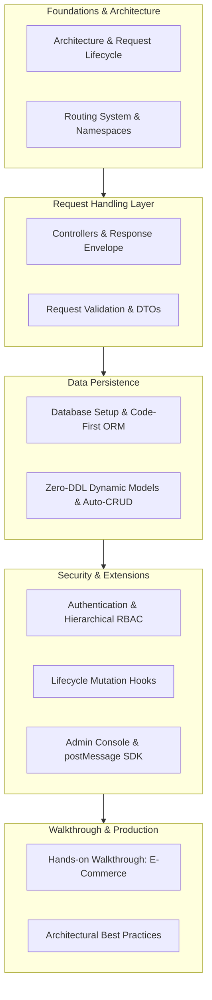

Foundry is built on three core principles:

* **Framework-Application Decoupling**: Build in your own Git repository, consume Foundry via Cargo, upgrade upstream with zero conflicts
* **Convention over Configuration**: Standard patterns for routing, validation, persistence, and security
* **High Cohesion, Loose Coupling**: Self-contained subsystems with clear boundaries

This tutorial organizes system development into 11 focused chapters, providing a structured guide for building enterprise-grade backend systems.

---

## Tutorial Chapters

### Quick Index

| Chapter | Title | Focus | Components |
|:---:|---|---|---|
| **01** | [Architecture & Request Lifecycle](./01-architecture-lifecycle/) | Decoupling, HTTP flow, Facade | Architecture, Lifecycle, Prelude |
| **02** | [Routing System & Namespaces](./02-routing/) | Unified namespace, route registration | Routes, Namespaces, Methods |
| **03** | [Controllers & Response Envelope](./03-controllers/) | Axum handlers, Extractors, ApiResponse | Handlers, Extractors, Output |
| **04** | [Request Validation & DTOs](./04-validation/) | Derive(Validate), HTTP 422 | Validators, Compile-time Rules |
| **05** | [Database Setup & Code-First ORM](./05-database-orm/) | Multi-DB SPI, EntitySchema, Query Builder | Multi-DB, Schema, Queries |
| **06** | [Zero-DDL Dynamic Models & Auto-CRUD](./06-dynamic-models/) | Schema-free models, RecordStore API | Dynamic Models, RecordStore, Auto-CRUD |
| **07** | [Authentication & Hierarchical RBAC](./07-auth-security/) | IAM, Argon2id, JWT, RBAC | IAM, Argon2id, JWT, RBAC |
| **08** | [Lifecycle Mutation Hooks](./08-mutation-hooks/) | MutationHook pipeline, 6 events | Pre/Post Hooks, Invalidation |
| **09** | [Admin Console & postMessage SDK](./09-admin-integration/) | React Admin, sandboxed views | Admin Shell, Sandboxed Views |
| **10** | [Walkthrough: E-Commerce System](./10-walkthrough-shop/) | End-to-end implementation | E-Commerce, Tests |
| **11** | [Architectural Best Practices](./11-best-practices/) | Layering, performance, Docker | Layering, Performance, Docker |

---

## Web Architecture Mapping

| Concept | Foundry | Advantages |
|---|---|---|
| **Application Module** | **`src/systems/<slug>/` Subsystem** | High cohesion, strict boundary |
| **Module Routes** | **`SubsystemModule::register_routes`** | Auto-prefixed namespace |
| **Controllers** | **Axum Handler Functions** | Fearless concurrency |
| **Request Input** | **`Query`/`Json`/`Path` Extractors** | Compile-time safety |
| **Validator DTOs** | **`#[derive(Validate)]` DTOs** | Compile-time annotations |
| **Query Builder** | **`OrmSelect::from_table()->...`** | Multi-dialect support |
| **Insert/Update** | **`OrmInsert` / `OrmUpdate`** | SQL injection prevention |
| **Middleware** | **Tower / Axum Middleware** | Request tracing & audit |
| **Lifecycle Hooks** | **`MutationHook` Traits** | Pre/post mutation pipeline |

---

## Recommended Learning Path

Begin with [Architecture & Request Lifecycle](./01-architecture-lifecycle/)
