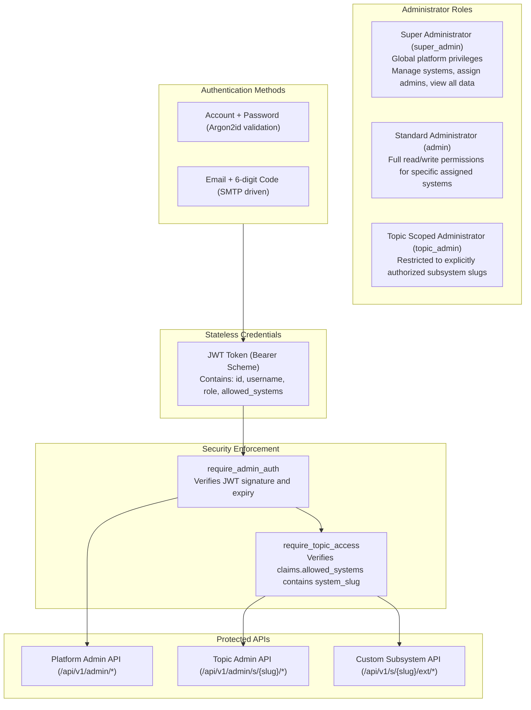
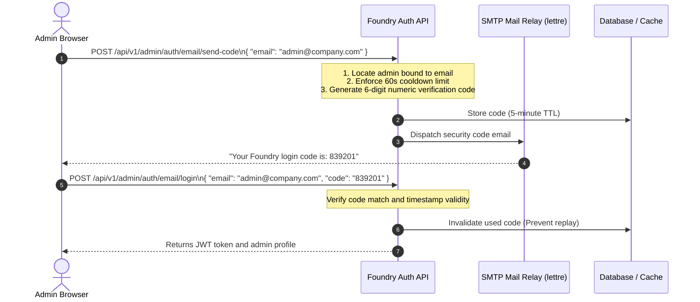

In modern multi-tenant enterprise platforms, **Authentication** and **Role-Based Access Control (RBAC)** are essential for protecting core data assets.

Foundry integrates enterprise-grade security infrastructure into the framework:
1. **Cryptographic Password Hashing**: Powered by **Argon2id** (the OWASP primary recommendation), defending against GPU brute-forcing and rainbow tables;
2. **Stateless JWT Tokens**: Signed with HMAC-SHA256, embedding administrator identity, roles, and allowed subsystem scopes;
3. **Email Verification Code Login**: Integrates enterprise SMTP to enable passwordless 6-digit dynamic verification code login and security email binding;
4. **Multi-Tenant Topic RBAC Middlewares**: Enforces data isolation between super administrators and tenant administrators via `require_admin_auth` and `require_topic_access`.

---

## 1. Security Architecture & RBAC Hierarchy



---

## 2. Password Security with Argon2id

Foundry strictly forbids legacy hashing algorithms like MD5, SHA-1, or plain SHA-256 for password storage. It uses the `argon2` standard:

- **Memory-Hard Defense**: Enforces dedicated physical memory allocation during hashing, neutralizing parallel attacks from ASICs and GPU clusters.
- **Automated Salting**: Generates high-entropy cryptographic salts for every password operation, ensuring identical passwords yield distinct hash strings.

### 2.1 Password Hashing & Verification API

```rust
use foundry::prelude::*;

// 1. Hash a plaintext password for database persistence
let raw_password = "MySecurePassword2026!";
let password_hash = hash_password(raw_password)?;
// Yields: $argon2id$v=19$m=19456,t=2,p=1$vB8...$4Q8...

// 2. Verify raw candidate against stored hash
let is_valid = verify_password(raw_password, &password_hash)?;
assert!(is_valid);
```

---

## 3. Stateless JWT Token Lifecycle & Claims

Upon successful login, Foundry issues a standard JSON Web Token. Clients transmit this token via the `Authorization: Bearer <TOKEN>` HTTP header.

### 3.1 Claims Structure (`AdminClaims`)

```rust
#[derive(Debug, Clone, Serialize, Deserialize)]
pub struct AdminClaims {
    /// Unique administrator ID in the database
    pub sub: i64,
    /// Administrator username
    pub username: String,
    /// Role identifier: "super_admin" | "admin" | "topic_admin"
    pub role: String,
    /// Whitelist of authorized subsystem slugs (e.g. ["shop", "blog"])
    /// If role == "super_admin", this may be empty as superadmins bypass checks
    pub allowed_systems: Vec<String>,
    /// Token expiration timestamp (UTC seconds)
    pub exp: usize,
}
```

### 3.2 Lifetime & Secret Configuration

- **Expiration**: Defaults to 168 hours (7 days). Can be adjusted using `FoundryBuilder::jwt_expiry_hours(48)`.
- **Secret Key**: Configured via the `JWT_SECRET` environment variable. **Must be rotated to a high-entropy secret in production.**

---

## 4. Email Verification Code & Two-Factor Authentication (SMTP)

To protect accounts against credential stuffing and brute-forcing, Foundry provides out-of-the-box support for **SMTP-based passwordless dynamic code login** and **email binding**.

### 4.1 Sequence Flow



### 4.2 Endpoint Reference

| Endpoint | Method | Auth Required | Purpose |
|---|---|---|---|
| `/api/v1/admin/auth/email/send-code` | `POST` | Public | Sends a 6-digit login verification code to target email |
| `/api/v1/admin/auth/email/login` | `POST` | Public | Authenticates via email + verification code, returns JWT |
| `/api/v1/admin/auth/bind-email/send-code` | `POST` | Admin | Sends confirmation code to a new email address |
| `/api/v1/admin/auth/bind-email/verify` | `POST` | Admin | Completes binding of administrator account to verified email |

---

## 5. Security Middlewares & Route Protection

### 5.1 Authentication Middleware (`require_admin_auth`)

Validates `Authorization: Bearer <TOKEN>` and inserts parsed `AdminClaims` into Axum's request extensions:

```rust
use axum::{Router, routing::get, middleware::from_fn_with_state};
use foundry::prelude::*;
use foundry_engine::middleware::require_admin_auth;

pub fn protected_routes(state: AppState) -> Router {
    Router::new()
        .route("/export-report", get(export_report_handler))
        .route_layer(from_fn_with_state(state.clone(), require_admin_auth))
}

async fn export_report_handler(
    Extension(claims): Extension<AdminClaims>,
) -> ApiResponse<String> {
    ApiResponse::ok(format!("Welcome admin: {}, ID: {}", claims.username, claims.sub))
}
```

### 5.2 Multi-Tenant Topic RBAC Middleware (`require_topic_access`)

Ensures the administrator has authorization to view or manipulate data belonging to the specific `system_slug`:

1. If `claims.role == "super_admin"`: Access granted immediately.
2. If `claims.allowed_systems` contains `system_slug`: Access granted.
3. Otherwise: **Terminated with `403 Forbidden ("Access denied to system: ...")`**.

---

## 6. Troubleshooting & Best Practices

| Status Code | Root Cause | Solution |
|---|---|---|
| `401 Unauthorized` | Missing `Authorization` header or missing `Bearer ` prefix | Ensure client includes `Authorization: Bearer <TOKEN>` header |
| `401 Unauthorized` | `Invalid signature` / `JWT expired` | Verify `JWT_SECRET` matches across cluster; refresh token |
| `403 Forbidden` | `Access denied to system: [slug]` | Administrator lacks permission for this subsystem. Grant access in Admin Console |
| `422 Unprocessable Entity` | DTO parameter validation failure | Check validation constraints on incoming request payload |

### Security Checklist

1. **Deploy with HTTPS/TLS in Production**: Guard tokens against interception.
2. **Never Log Plaintext Credentials**: Skip password fields in structured logs.
3. **Emergency Credential Revocation**: Rotating `JWT_SECRET` immediately invalidates all active tokens globally.
