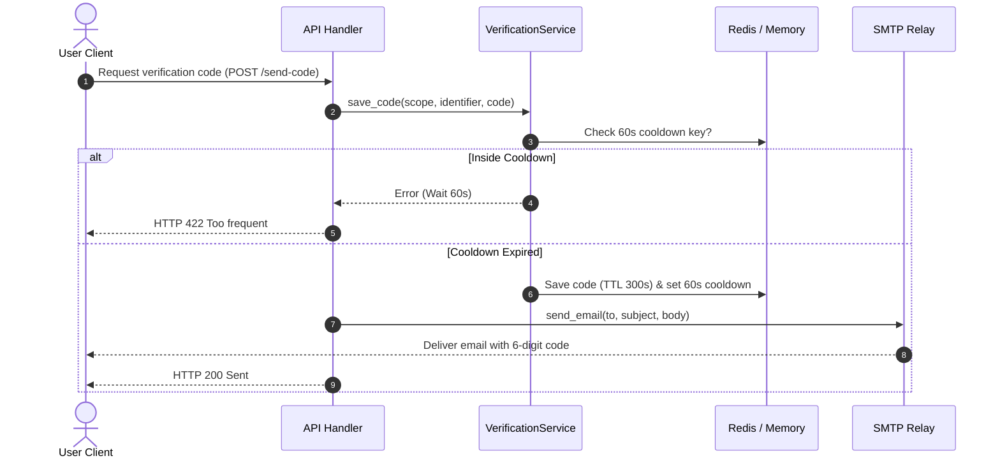

# Email & Verification Services

> **Overview**: Email notifications and verification codes are vital across enterprise web applications. Foundry's engine (`foundry_engine`) provides built-in **SMTP email delivery** and a production-grade **`VerificationService`**, eliminating external boilerplate.

---

## 1. Core Architecture

* **Standard SMTP**: Built upon `lettre`, compatible with SendGrid, AWS SES, Aliyun DirectMail, Tencent Mail, Gmail, etc.
* **Dual-Mode Verification Code Storage**: Leverages Redis when configured, with seamless, zero-crash fallback to in-memory `RwLock` storage.
* **60s Anti-Spam Cooldown**: Built-in protection against rapid re-sends.
* **5-Minute TTL Expiration (300s)**: Automated token invalidation.
* **Atomic Single-Use Invalidation**: Tokens are immediately destroyed upon successful verification to prevent replay attacks.



---

## 2. Environment Configuration

In `.env`:

```bash
SMTP_HOST=smtp.example.com
SMTP_PORT=587
SMTP_USER=no-reply@example.com
SMTP_PASS=your_secret_password
SMTP_FROM="Foundry Platform <no-reply@example.com>"
```

---

## 3. Usage Examples

### Sending Emails (`send_email`)

```rust
use foundry::prelude::*;
use foundry_engine::services::email::send_email;

pub async fn notify_user(email: &str) -> AppResult<()> {
    send_email(email, "Welcome", "Welcome to Foundry!").await?;
    Ok(())
}
```

### Verification Codes (`VerificationService`)

```rust
use foundry::prelude::*;
use foundry_engine::services::verification::VerificationService;

// Save code with cooldown
let verifier = VerificationService::new(state.redis.clone());
let code = VerificationService::generate_code();
verifier.save_code("register", user_email, &code).await?;

// Verify and atomically invalidate
let ok = verifier.verify_code("register", user_email, input_code).await?;
```
