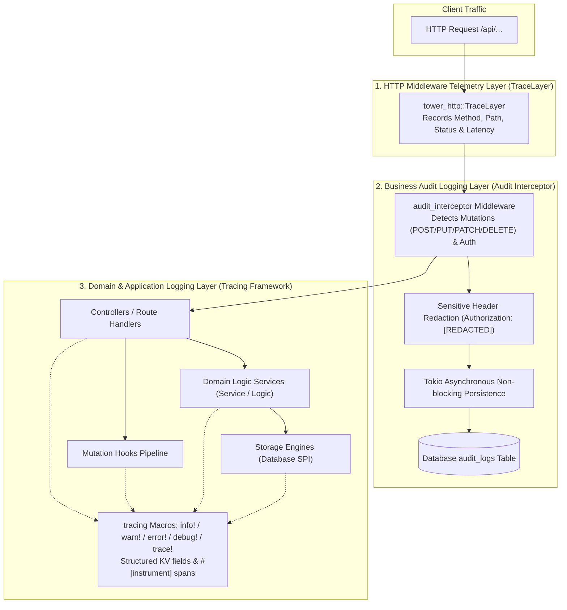

In modern high-concurrency backend systems and multi-tenant architectures, **Observability** is an essential pillar for safeguarding service stability, troubleshooting production anomalies rapidly, and maintaining an immutable record of business operations.

Foundry provides a modern, high-performance, layered observability solution:
1. **Structured Application Logging**: Built directly upon the Rust ecosystem's gold standard—the `tracing` framework—with out-of-the-box support for key-value pairs and contextual spans.
2. **HTTP Request Telemetry (TraceLayer)**: Automatically tracks incoming API requests, lifecycle latency, and HTTP response status codes.
3. **Business Operation Audit Logging**: Intercepts non-GET mutating actions and security-sensitive operations with automatic parameter redaction, latency measurement, and non-blocking asynchronous persistence.
4. **Extensible Architecture**: Supports dynamic log filtering via environment variables as well as full takeover of the subscriber pipeline to integrate with OpenTelemetry, Loki, ELK, or Datadog.

---

## 1. Observability Architecture Overview

Foundry's observability system is cleanly segmented into three distinct architectural layers:



---

## 2. Structured Application Logging Basics

### 2.1 Single Import & Macro Invocation

In a Foundry application, there is no need to manually add boilerplate logging crates to `Cargo.toml`. The official facade crate re-exports all primary `tracing` macros:

```rust
// Approach 1: Recommended, all-in-one import via prelude
use foundry::prelude::*;

// Approach 2: Dedicated namespace import
use foundry::log::{info, warn, error, debug, trace};
```

You can invoke logging macros directly inside any controller, domain service, hook, or custom middleware:

```rust
// Standard informational message
info!("Foundry business subsystem initialized successfully");

// Formatted message (standard print format syntax)
warn!("Tenant [{}] quota usage reached {}%", tenant_slug, usage_pct);

// Error logging with detailed diagnostics
if let Err(err) = sync_data().await {
    error!("Data synchronization failed: {:?}", err);
}

// Debug logging for troubleshooting
debug!("Parsed raw payload length: {} bytes", payload.len());

// Fine-grained tracing for locks and low-level loops
trace!("Traversing tag collection: index = {}", idx);
```

### 2.2 Log Level Guidelines

| Level | Macro | Intended Use Case | Production Recommendation |
|---|---|---|---|
| **ERROR** | `error!` | Unrecoverable failures, connection drops, payment webhook verification failures | **Always Enabled** |
| **WARN** | `warn!` | Unexpected boundary conditions, graceful degradation (e.g., Redis unavailable, continuing cacheless) | **Always Enabled** |
| **INFO** | `info!` | Key lifecycle milestones (server boot, port binding, subsystem mounted), major business events | **Recommended** |
| **DEBUG** | `debug!` | Detailed runtime execution state, request parameters, branch conditions | Development / Staging |
| **TRACE** | `trace!` | Nanosecond-level execution details, raw byte streams, lock acquisitions | Temporary troubleshooting only |

---

## 3. Structured Fields & Contextual KV Logging

Unlike legacy unstructured text logs formatted with `printf`, Foundry leverages `tracing`'s **Structured Key-Value Fields**. The emitted logs can be directly indexed as structured JSON fields by log ingestion pipelines like Vector, Fluentbit, Elasticsearch, ClickHouse, or Grafana Loki.

### 3.1 Key-Value Syntax

```rust
use foundry::prelude::*;

pub async fn process_order(ctx: &SystemContext, order_id: &str, amount: f64) {
    // 1. Basic Key-Value: key = value
    info!(
        order_id = order_id,
        amount = amount,
        "Processing customer order checkout"
    );

    // 2. Shorthand with % (Display formatting) and ? (Debug formatting)
    info!(
        %order_id,
        tenant = %ctx.system_slug,
        client_ip = ?ctx.client_ip,
        "Risk evaluation check passed"
    );

    // 3. Error diagnostics with structured context
    if amount < 0.0 {
        error!(
            %order_id,
            invalid_amount = amount,
            tenant = %ctx.system_slug,
            "Illegal negative order amount, aborting"
        );
    }
}
```

### 3.2 Output Format & Query Efficiency

When emitted as structured JSON, log events appear as:

```json
{
  "timestamp": "2026-10-14T10:15:30.123Z",
  "level": "INFO",
  "message": "Risk evaluation check passed",
  "target": "my_app::systems::shop::logic",
  "order_id": "ORD-20261014-001",
  "tenant": "mall",
  "client_ip": "192.168.1.108"
}
```

Site reliability engineers can query `tenant = "mall" AND order_id = "..."` instantly without fragile regex substring matching.

---

## 4. Function-Level Tracing Spans (`#[instrument]`)

Beyond manual logging, Foundry seamlessly supports `tracing`'s `#[instrument]` attribute macro. Annotating an asynchronous or synchronous function automatically constructs an execution **Span**, recording function arguments, execution duration, and panics.

```rust
use foundry::prelude::*;
use tracing::instrument;

// Automatically records input parameters and function latency
#[instrument(skip(db), fields(tenant = %ctx.system_slug))]
pub async fn calculate_user_discounts(
    ctx: &SystemContext,
    db: &Database,
    user_id: i64,
    items_count: usize,
) -> AppResult<DiscountResult> {
    info!("Calculating tiered promotional discounts");

    let result = execute_discount_rules(user_id, items_count).await?;

    info!(discount_rate = result.rate, "Discount calculation completed");
    Ok(result)
}
```

> [!TIP]
> **Data Privacy**: Always skip sensitive parameters such as passwords, auth tokens, or payment card numbers using `#[instrument(skip(password, token))]` to prevent credential leakage in log streams.

---

## 5. Log Levels & Dynamic Filtering (`RUST_LOG`)

Foundry initializes its subscriber via `tracing_subscriber::EnvFilter`. You can tune output verbosity per crate and per module without recompiling the project.

### 5.1 Default Filter Configuration

When `RUST_LOG` is unset, Foundry defaults to:

```text
info,foundry=debug,foundry_engine=debug
```

This ensures high-signal logging across dependencies while providing granular debug logs for Foundry's core routing and engine layers during development.

### 5.2 Environment Configuration Recipes

#### Local Development (Full Transparency)

To monitor executed SQL queries, HTTP lifecycle events, and your custom application logic:

```bash
RUST_LOG="info,my_app=debug,foundry=debug,foundry_engine=debug,tower_http=debug,sqlx=debug"
```

#### Production (High Throughput & Low I/O)

In high-concurrency production environments, avoid database driver noise and keep I/O minimal:

```bash
RUST_LOG="warn,my_app=info,foundry=info,foundry_engine=info"
```

#### Isolated Subsystem Debugging

To troubleshoot a single isolated subsystem (e.g., `shop`):

```bash
RUST_LOG="info,my_app::systems::shop=trace"
```

### 5.3 Common Dependency Recommendations

| Component | Recommended Level | Notes |
|---|---|---|
| `sqlx` | `warn` / `info` | Setting to `debug` logs every raw SQL statement and query time. Set to `warn` in production. |
| `tower_http` | `info` / `debug` | Setting to `debug` logs every request initiation and completion with latency. |
| `hyper` / `mio` | `warn` | Network I/O drivers. Keep at `warn` to suppress redundant TCP socket handshakes. |
| `mongodb` | `warn` | Internal MongoDB cluster monitoring and heartbeat logs. |

---

## 6. HTTP Request Telemetry (TraceLayer)

Foundry integrates Axum's `tower_http::trace::TraceLayer::new_for_http()` into the global middleware stack.

Every incoming HTTP request prints an automated telemetry trace:

```text
2026-10-14T10:20:00.102Z  INFO tower_http::trace::on_request: started processing request method=GET uri=/api/s/blog/posts version=HTTP/1.1
2026-10-14T10:20:00.115Z  INFO tower_http::trace::on_response: finished processing request latency=13ms status=200
```

- **Request Start**: Logs HTTP method, request URI, and protocol version.
- **Request Complete**: Calculates end-to-end processing latency (`latency`) and final HTTP status code (`status`).
- **Error Observability**: 5xx internal server errors are highlighted automatically, facilitating APM integration.

---

## 7. Business Operation Audit Logging (Audit Log)

While application logs serve developer debugging, the **Audit Log** system provides an immutable audit trail of mutating operations performed by administrators and authorized actors.

### 7.1 Audit Middleware Architecture

Foundry's built-in `audit_interceptor` features:

1. **Mutation Detection**:
   - Automatically intercepts mutating methods: `POST`, `PUT`, `PATCH`, `DELETE`.
   - Automatically intercepts authentication endpoints like `/api/admin/auth/login`.
   - Completely bypasses read-only `GET` requests to avoid unnecessary database writes.
2. **Context Resolution**:
   - Extracts admin credentials from `AdminClaims` (`admin_id`, `admin_username`).
   - Extracts tenant `system_slug`, client IP (respecting `X-Forwarded-For` and `X-Real-IP`), and `User-Agent` from `SystemContext`.
3. **Sensitive Data Redaction**:
   - HTTP `Authorization` headers are scrubbed and replaced with `"[REDACTED]"`.
4. **Asynchronous Non-Blocking Persistence**:
   - The audit log record is committed using `tokio::spawn` after the response has been returned, ensuring **zero added latency** to client requests.

### 7.2 Audit Log Entity Schema (`AuditLogEntity`)

```rust
pub struct AuditLogEntity {
    pub id: i64,
    pub admin_id: Option<i64>,          // Operator admin ID (None for unauthenticated actions)
    pub admin_username: Option<String>,  // Operator username
    pub system_slug: Option<String>,     // Target subsystem slug
    pub method: String,                  // HTTP verb (POST, PUT, DELETE, etc.)
    pub path: String,                    // Request path (/api/s/shop/orders)
    pub action_name: Option<String>,     // Human-readable description (e.g. "Create business record")
    pub headers: serde_json::Value,      // Redacted request headers as JSON
    pub query_params: Option<String>,    // Query string parameters
    pub body_params: Option<String>,     // Request body payload string
    pub ip_address: Option<String>,      // Client IP address
    pub user_agent: Option<String>,      // Client User-Agent string
    pub status_code: Option<i16>,        // HTTP response status code
    pub duration_ms: Option<i32>,        // Request processing latency in milliseconds
    pub created_at: DateTime<Utc>,       // Audit event timestamp
}
```

### 7.3 Querying Audit Logs

Foundry provides a paginated Admin API:

```http
GET /api/admin/audit-logs?page=1&page_size=20&system_slug=shop&admin_username=admin
Authorization: Bearer <ADMIN_JWT_TOKEN>
```

Sample JSON response:

```json
{
  "code": 0,
  "message": "success",
  "data": {
    "items": [
      {
        "id": 1024,
        "admin_username": "superadmin",
        "system_slug": "shop",
        "method": "POST",
        "path": "/api/s/shop/goods",
        "action_name": "新增业务数据记录",
        "ip_address": "127.0.0.1",
        "status_code": 200,
        "duration_ms": 12,
        "created_at": "2026-10-14T10:30:00Z"
      }
    ],
    "total": 1,
    "page": 1,
    "page_size": 20,
    "total_pages": 1
  }
}
```

The built-in Admin Console (`/admin` -> Audit Logs) includes full UI filtering and detail drawer view out of the box.

---

## 8. Custom Tracing Subscribers (OpenTelemetry & Files)

For advanced infrastructure deployments requiring structured JSON outputs or OpenTelemetry tracing, Foundry provides the `init_tracing(false)` option.

### 8.1 Disabling Default Tracing Initialization

```rust
use foundry::prelude::*;

#[tokio::main]
async fn main() -> anyhow::Result<()> {
    // 1. Initialize your custom tracing subscriber before building the app
    setup_custom_subscriber()?;

    // 2. Build the app with init_tracing(false)
    let app = FoundryApp::builder()
        .init_tracing(false)
        .build()
        .await?;

    app.run().await?;
    Ok(())
}
```

### 8.2 Recipe 1: Cloud-Native JSON Output (ELK / Loki)

```rust
use tracing_subscriber::{layer::SubscriberExt, util::SubscriberInitExt, EnvFilter};

fn setup_custom_subscriber() -> anyhow::Result<()> {
    let filter = EnvFilter::try_from_default_env()
        .unwrap_or_else(|_| "info,foundry=info".into());

    tracing_subscriber::registry()
        .with(filter)
        .with(tracing_subscriber::fmt::layer().json())
        .try_init()?;

    Ok(())
}
```

### 8.3 Recipe 2: Daily Rolling File Appender

```rust
use tracing_appender::rolling::{RollingFileAppender, Rotation};
use tracing_subscriber::{layer::SubscriberExt, util::SubscriberInitExt, EnvFilter};

fn setup_custom_subscriber() -> anyhow::Result<()> {
    let file_appender = RollingFileAppender::new(Rotation::DAILY, "./logs", "app.log");
    let (non_blocking, _guard) = tracing_appender::non_blocking(file_appender);

    let filter = EnvFilter::try_from_default_env()
        .unwrap_or_else(|_| "info,foundry=info".into());

    tracing_subscriber::registry()
        .with(filter)
        .with(tracing_subscriber::fmt::layer().with_writer(non_blocking))
        .try_init()?;

    Ok(())
}
```

---

## 9. Best Practices Summary

1. **Use the Unified Prelude**: Use `foundry::prelude::*` for logging macros to ensure clean imports and uniform syntax across your application.
2. **Always Use Structured KV Fields**: Replace string concatenations with `info!(tenant = %slug, user_id = %uid, "...")` for instant queryability in APM backends.
3. **Separate Operational Logs from Audit Logs**:
   - Use `tracing` for debugging, errors, and system events.
   - Rely on `audit_interceptor` for security, compliance, and user actions.
4. **Tune Production `RUST_LOG`**: Keep noisy drivers (`sqlx`, `tower_http`) at `warn` or `info` in production to reduce I/O overhead.
