# Foundry System Development Tutorial Hub

> **Major Upgrade Notice**:
> In alignment with the modular engineering principles of modern frameworks such as [ThinkPHP 8.0](https://doc.thinkphp.cn/v8_0/architecture.html), this development guide has been restructured and decoupled into **11 dedicated, focused chapters**.
>
> Say goodbye to endless single-page scrolling! You can now explore architecture, routing, controllers, validation, Code-First ORM, and admin integration in dedicated modules.

---

## 📚 Modular Chapter Navigation

```mermaid
flowchart TD
    Root["Foundry System Development Framework"]
    Root --> C1["01. Architecture & Lifecycle"]
    Root --> C2["02. Routing System & Namespaces"]
    Root --> C3["03. Controllers & Response Envelope"]
    Root --> C4["04. Request Validation & DTOs"]
    Root --> C5["05. Database Setup & Code-First ORM"]
    Root --> C6["06. Zero-DDL Dynamic Models & Auto-CRUD"]
    Root --> C7["07. Authentication & Hierarchical RBAC"]
    Root --> C8["08. Lifecycle Mutation Hooks"]
    Root --> C9["09. Admin Console & postMessage SDK"]
    Root --> C10["10. Hands-on Walkthrough: E-Commerce"]
    Root --> C11["11. Architectural Best Practices"]

    click C1 "/development/01-architecture-lifecycle/" "Read Architecture"
    click C2 "/development/02-routing/" "Read Routing"
    click C3 "/development/03-controllers/" "Read Controllers"
    click C4 "/development/04-validation/" "Read Validation"
    click C5 "/development/05-database-orm/" "Read ORM"
    click C6 "/development/06-dynamic-models/" "Read Dynamic Models"
    click C7 "/development/07-auth-security/" "Read Security"
    click C8 "/development/08-mutation-hooks/" "Read Mutation Hooks"
    click C9 "/development/09-admin-integration/" "Read Admin Integration"
    click C10 "/development/10-walkthrough-shop/" "Read Walkthrough"
    click C11 "/development/11-best-practices/" "Read Best Practices"
```

---

## 🚀 Direct Chapter Links

1. 🏗️ **[01. Architecture & Request Lifecycle](../../development/01-architecture-lifecycle/)**
2. 🛣️ **[02. Routing System & Namespaces](../../development/02-routing/)**
3. 🎮 **[03. Controllers & Response Envelope](../../development/03-controllers/)**
4. 🛡️ **[04. Request Validation & DTOs](../../development/04-validation/)**
5. 💾 **[05. Database Setup & Code-First ORM](../../development/05-database-orm/)**
6. ⚡ **[06. Zero-DDL Dynamic Models & Auto-CRUD](../../development/06-dynamic-models/)**
7. 🔐 **[07. Authentication & Hierarchical RBAC](../../development/07-auth-security/)**
8. 🪝 **[08. Lifecycle Mutation Hooks](../../development/08-mutation-hooks/)**
9. 🖥️ **[09. Admin Console & postMessage SDK](../../development/09-admin-integration/)**
10. 🛒 **[10. Hands-on Walkthrough: E-Commerce System](../../development/10-walkthrough-shop/)**
11. 🏆 **[11. Architectural Best Practices & Production](../../development/11-best-practices/)**

---

> [!TIP]
> 👉 **Get Started**: Visit the **[System Development Tutorial Overview](../../development/)** or dive straight into **[01. Architecture & Request Lifecycle](../../development/01-architecture-lifecycle/)**!
