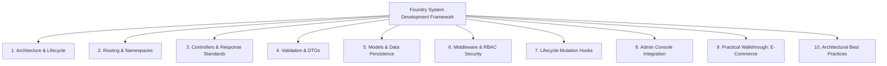
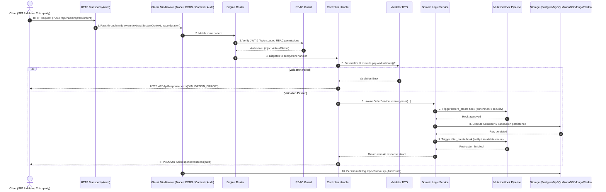
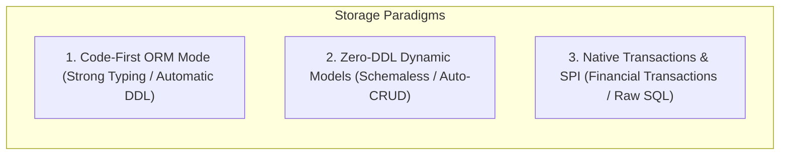

# Complete System Development Guide

> **Foreword**: Inspired by the structure and engineering philosophy of the [ThinkPHP 8.0 Official Manual](https://doc.thinkphp.cn/v8_0/base.html), this guide provides modern web developers (coming from ThinkPHP, Laravel, Spring Boot, NestJS, and Axum) with an end-to-end blueprint for building high-cohesion, robust, enterprise-grade backend systems on the Foundry platform.

Foundry adheres to **"total framework-application decoupling"**, **"convention over configuration"**, and **"high cohesion with loose coupling"**. Developers build inside their own independent Git repository, consume Foundry through standard Cargo dependencies, and immediately benefit from an embedded Admin Console, unified JWT/RBAC security, multi-database SPI engine transparent adaptation, Auto-CRUD REST endpoints, and lifecycle mutation hook pipelines.

---

## Guide Sitemap



---

## 1. Core Architecture & Request Lifecycle

### 1.1 Architectural Concepts (ThinkPHP vs. Foundry)

In frameworks like ThinkPHP, applications adopt MVC layering, decoupling components through Containers and Facades. Foundry maps these concepts into modern Rust idioms with memory safety and fearless concurrency:

| ThinkPHP 8.0 Concept | Foundry Equivalent | Description |
|---|---|---|
| **App / Multi-App Mode** | **Independent User Application** | Standalone Git repo & `Cargo.toml`, depending on `foundry` crate |
| **Module / Extension** | **Subsystem (`SubsystemModule`)** | High-cohesion domain packages (e.g., `shop`, `billing`, `cms`) |
| **Facade (`Db`, `Route`, etc.)** | **`foundry::prelude::*` / `Database`** | Unified facade structs and re-exports hiding underlying database drivers |
| **Route (`Route`)** | **Axum Router & Engine Dispatcher** | Automatic namespace routing (`/api/v1/s/{subsystem}/...`) |
| **Controller (`Controller`)** | **Axum Handler Function** | Processes HTTP requests, extracts parameters, calls domain services |
| **Validator (`Validate`)** | **DTO with `#[derive(Validate)]`** | Compile-time validation annotations, rejecting malformed input |
| **Model (`Model / Db`)** | **ORM Entity / `OrmSelect` / `RecordStore`** | Dual-engine: strongly-typed Code-First ORM + Zero-DDL dynamic models |
| **Middleware (`Middleware`)** | **Tower / Axum Middleware Layers** | Request tracing, CORS, context extraction, and audit interceptors |
| **Event / Hook (`Event / Hook`)**| **`MutationHook` Pipeline** | Lifecycle pre/post hooks (`before_create`, `after_create`, etc.) |

### 1.2 Full HTTP Request Lifecycle

Understanding how requests travel through Foundry is essential for architectural design and troubleshooting:



---

## 2. Project Structure & Organization Conventions

### 2.1 Standard Directory Layout

Generated via `foundry new <project_name>`, applications follow a clean three-tiered layout:

```text
my-app/
├── Cargo.toml                  # Foundry dependency & crate configurations
├── .env                        # Environment variables (Database, Redis, JWT)
├── migrations/                 # (Optional) Exported SQL scripts from `foundry ddl`
│   └── init.sql
└── src/
    ├── main.rs                 # Application bootstrap entry (FoundryApp::builder)
    └── systems/                # Subsystems container
        ├── mod.rs              # Subsystems registry
        └── shop/               # Example: E-Commerce Subsystem
            ├── mod.rs          # Implements SubsystemModule trait
            ├── controllers/    # HTTP handlers (Axum Router)
            │   └── mod.rs
            ├── logic/          # Domain services (Business rules & persistence)
            │   └── mod.rs
            ├── dto/            # Data Transfer Objects & validator annotations
            │   └── mod.rs
            └── custom_pages/   # Embedded Admin studio pages (HTML / React / Vue)
                └── order_studio.html
```

---

## 3. Routing & Subsystem Namespaces

Foundry manages route namespaces to prevent collisions across independent subsystems:

### 3.1 Global Route Namespace Matrix

| Route Prefix | Purpose | Description |
|---|---|---|
| `/health` | Liveness / Readiness Probe | Container orchestrator health check (returns `OK`) |
| `/api/v1/admin/*` | Platform & Admin APIs | Admin login, subsystem management, audit logs, admins |
| `/api/v1/s/{subsystem}/{model}` | **Auto-CRUD Engine Route** | Zero-code, dynamic RESTful CRUD endpoints |
| `/api/v1/s/{subsystem}/ext/*` | **Subsystem Extension Route** | Custom API handlers mounted via `register_routes()` |
| `/admin/*` | Visual Admin Dashboard | Embedded SPA or static frontend console |

### 3.2 Subsystem Route Registration

In `src/systems/shop/mod.rs`, implement `SubsystemModule::register_routes`:

```rust
use axum::Router;
use foundry::prelude::*;
use std::path::PathBuf;
use tower_http::services::ServeDir;

pub struct ShopSubsystem;

impl SubsystemModule for ShopSubsystem {
    fn slug(&self) -> &'static str {
        "shop"
    }

    fn display_name(&self) -> &'static str {
        "E-Commerce Store"
    }

    fn description(&self) -> &'static str {
        "Product catalog, checkout, and order lifecycle management"
    }

    // Mounts custom extension routes under /api/v1/s/shop/ext/*
    fn register_routes(&self, router: Router) -> Router {
        let mut r = router.merge(crate::systems::shop::controllers::build_routes());

        // Serve custom admin studio pages
        let custom_dir = PathBuf::from("src/systems/shop/custom_pages");
        if custom_dir.exists() {
            r = r.nest_service("/custom-pages", ServeDir::new(custom_dir));
        }

        r
    }
}
```

---

## 4. Controllers, Parameter Extraction & Responses

Controllers receive HTTP requests, parse inputs, delegate to domain logic, and return standardized responses.

### 4.1 Standardized Response Format (`ApiResponse`)

Foundry provides `ApiResponse<T>` to ensure uniform JSON responses across all endpoints:

```rust
use foundry::prelude::*;

// 1. Success with payload
ApiResponse::success(data)

// 2. Resource Created (HTTP 201)
ApiResponse::created(new_resource)

// 3. Paginated list
ApiResponse::paginated(items, PageMeta { page: 1, limit: 20, total: 100 })

// 4. Business error
ApiResponse::error("ORDER_ALREADY_PAID", "Order has already been completed")
```

JSON representation:
```json
{
  "success": true,
  "code": "OK",
  "message": "Success",
  "data": { ... },
  "meta": null
}
```

### 4.2 Standard Controller Handlers

In `src/systems/shop/controllers/mod.rs`:

```rust
use axum::{
    Json, Router,
    extract::{Extension, Path, Query},
    routing::{get, post},
};
use foundry::prelude::*;
use validator::Validate;

use crate::systems::shop::dto::{CreateOrderRequest, OrderListQuery, OrderResponse};
use crate::systems::shop::logic::OrderService;

pub fn build_routes() -> Router {
    Router::new()
        .route("/orders", post(create_order).get(list_orders))
        .route("/orders/{id}", get(get_order_by_id))
}

/// Create Order Handler
pub async fn create_order(
    Extension(ctx): Extension<SystemContext>,
    Extension(state): Extension<AppState>,
    Json(payload): Json<CreateOrderRequest>,
) -> AppResult<Json<ApiResponse<OrderResponse>>> {
    // 1. Validate payload (similar to ThinkPHP $validate->check($data))
    payload.validate()?;

    // 2. Invoke domain logic service
    let order = OrderService::create_order(&ctx, &state, payload).await?;

    // 3. Return standardized response
    Ok(Json(ApiResponse::created(order)))
}

/// List Orders with Pagination Handler
pub async fn list_orders(
    Extension(ctx): Extension<SystemContext>,
    Extension(state): Extension<AppState>,
    Query(query): Query<OrderListQuery>,
) -> AppResult<Json<ApiResponse<Vec<OrderResponse>>>> {
    let (orders, meta) = OrderService::list_orders(&ctx, &state, query).await?;
    Ok(Json(ApiResponse::paginated(orders, meta)))
}

/// Get Order by ID Handler
pub async fn get_order_by_id(
    Extension(ctx): Extension<SystemContext>,
    Extension(state): Extension<AppState>,
    Path(id): Path<i64>,
) -> AppResult<Json<ApiResponse<OrderResponse>>> {
    let order = OrderService::get_order(&ctx, &state, id).await?;
    Ok(Json(ApiResponse::success(order)))
}
```

### 4.3 Error Handling (`AppError` & `AppResult`)

Errors are propagated cleanly using `AppError` and the Rust `?` operator without manual `try/catch` boilerplate:

| Error Variant | Cause | HTTP Status Code |
|---|---|---|
| `AppError::Validation(msg)` | DTO validation rule failed | `422 Unprocessable Entity` |
| `AppError::NotFound(msg)` | Target record not found | `404 Not Found` |
| `AppError::Unauthorized(msg)` | Missing or invalid JWT credentials | `401 Unauthorized` |
| `AppError::Forbidden(msg)` | Insufficient RBAC role permissions | `403 Forbidden` |
| `AppError::Conflict(msg)` | Unique key conflict or state conflict | `409 Conflict` |
| `AppError::Database(msg)` | Database driver or query failure | `500 Internal Server Error` |
| `AppError::Internal(msg)` | Unexpected internal runtime failure | `500 Internal Server Error` |

---

## 5. Input Validation & DTOs (Validator)

Similar to ThinkPHP's `Validate` classes, Foundry uses declarative annotations on DTO structs powered by the `validator` crate.

In `src/systems/shop/dto/mod.rs`:

```rust
use serde::{Deserialize, Serialize};
use validator::Validate;

#[derive(Debug, Clone, Deserialize, Validate)]
pub struct CreateOrderItem {
    #[validate(range(min = 1, max = 999999, message = "Product ID must be a positive integer"))]
    pub product_id: i64,

    #[validate(range(min = 1, max = 100, message = "Quantity must be between 1 and 100"))]
    pub quantity: i32,
}

#[derive(Debug, Clone, Deserialize, Validate)]
pub struct CreateOrderRequest {
    #[validate(length(min = 2, max = 64, message = "Customer name must be 2-64 characters"))]
    pub customer_name: String,

    #[validate(email(message = "A valid email address is required"))]
    pub customer_email: String,

    #[validate(length(min = 5, max = 255, message = "Shipping address must be 5-255 characters"))]
    pub shipping_address: String,

    #[validate(length(min = 1, message = "Order must contain at least one item"))]
    pub items: Vec<CreateOrderItem>,
}

#[derive(Debug, Clone, Deserialize)]
pub struct OrderListQuery {
    pub status: Option<String>,
    pub page: Option<u64>,
    pub limit: Option<u64>,
}

#[derive(Debug, Clone, Serialize)]
pub struct OrderResponse {
    pub id: i64,
    pub order_no: String,
    pub customer_name: String,
    pub total_amount: f64,
    pub status: String,
    pub created_at: chrono::DateTime<chrono::Utc>,
}
```

---

## 6. Models & Data Persistence

Foundry provides three complementary storage paradigms:



### 6.1 Paradigm 1: Code-First ORM Schemas (Recommended for Core Domains)

Subsystems define strongly-typed schemas via `SubsystemModule::orm_models()`. Running `cargo run` (with `AUTO_MIGRATE=true`) or `foundry migrate` automatically generates dialect DDL for PostgreSQL, MySQL, and MariaDB:

```rust
use foundry::prelude::*;

impl SubsystemModule for ShopSubsystem {
    fn slug(&self) -> &'static str { "shop" }
    fn display_name(&self) -> &'static str { "E-Commerce Store" }

    fn orm_models(&self) -> Vec<EntitySchema> {
        vec![
            // Orders Table
            EntitySchema::new("shop_orders")
                .column(ColumnDef::bigint("id").primary_key().auto_increment())
                .column(ColumnDef::varchar("system_id", 32).not_null())
                .column(ColumnDef::varchar("order_no", 64).not_null().unique())
                .column(ColumnDef::varchar("customer_name", 64).not_null())
                .column(ColumnDef::varchar("customer_email", 128).not_null())
                .column(ColumnDef::decimal("total_amount", 12, 2).not_null())
                .column(ColumnDef::varchar("status", 24).not_null()) // pending, paid, shipped, cancelled
                .column(ColumnDef::json("items_payload").default_empty_json())
                .column(ColumnDef::datetime("created_at").default_current_timestamp())
                .column(ColumnDef::datetime("updated_at").default_current_timestamp())
                .index(IndexDef::new("idx_orders_sys_status", &["system_id", "status"])),

            // Products Table
            EntitySchema::new("shop_products")
                .column(ColumnDef::bigint("id").primary_key().auto_increment())
                .column(ColumnDef::varchar("title", 128).not_null())
                .column(ColumnDef::decimal("price", 10, 2).not_null())
                .column(ColumnDef::integer("stock").not_null())
                .column(ColumnDef::boolean("is_active"))
                .column(ColumnDef::datetime("created_at").default_current_timestamp())
        ]
    }
}
```

### 6.2 Paradigm 2: ThinkPHP-Style Chainable Query Builders (ORM Query Builder)

For developers familiar with ThinkPHP's `Db::table('...')->where(...)->select()`, Foundry offers dialect-adaptive query builders that handle placeholder syntax (`$1` vs. `?`) automatically:

```rust
use foundry::prelude::*;

// 1. Paginated Select (similar to Db::name('shop_orders')->where(...)->order(...)->limit(...)->select())
let (sql, binds) = OrmSelect::from_table("shop_orders")
    .column("id")
    .column("order_no")
    .column("total_amount")
    .column("status")
    .column("created_at")
    .where_eq("system_id", "shop")
    .where_eq("status", "pending")
    .order_by_desc("created_at")
    .limit(20)
    .offset(0)
    .to_sql(Dialect::Postgres); // or Dialect::MySql

// 2. Insert Record (similar to Db::name('shop_orders')->insert($data))
let (insert_sql, insert_binds) = OrmInsert::into_table("shop_orders")
    .value("system_id", "shop")
    .value("order_no", "ORD-20261012-001")
    .value("customer_name", "Alice")
    .value("customer_email", "alice@example.com")
    .value("total_amount", 299.00)
    .value("status", "pending")
    .to_sql(Dialect::Postgres);

// 3. Conditional Update (similar to Db::name('shop_orders')->where('order_no', '...')->update([...]))
let (update_sql, update_binds) = OrmUpdate::into_table("shop_orders")
    .set("status", "paid")
    .where_eq("order_no", "ORD-20261012-001")
    .to_sql(Dialect::Postgres);

// 4. Delete Record (similar to Db::name('shop_orders')->where('id', 10)->delete())
let (delete_sql, delete_binds) = OrmDelete::from_table("shop_orders")
    .where_eq("id", 10)
    .to_sql(Dialect::Postgres);
```

### 6.3 Paradigm 3: Zero-DDL Dynamic Models (Rapid Prototyping & Auto-CRUD)

For fast-moving features or schemaless requirements, dynamic records store arbitrary JSON documents with strict tenant isolation:

```rust
use foundry::prelude::*;
use serde_json::json;

// Create dynamic record
let record = state.db.records().create(
    "shop",
    "customer_feedback",
    json!({
        "score": 5,
        "content": "Super fast delivery!",
        "tags": ["express", "authentic"]
    })
).await?;
```

Auto-CRUD endpoints are automatically available at:
* `GET /api/v1/s/shop/customer_feedback` (pagination and search)
* `POST /api/v1/s/shop/customer_feedback` (create record)
* `GET /api/v1/s/shop/customer_feedback/{id}` (fetch record)
* `PUT /api/v1/s/shop/customer_feedback/{id}` (update record)
* `DELETE /api/v1/s/shop/customer_feedback/{id}` (delete record)

### 6.4 Strongly-Typed Configuration Center (`get_typed_config`)

Subsystem configurations modified in the Admin Console can be loaded directly into typed Rust structs:

```rust
use serde::Deserialize;

#[derive(Debug, Deserialize)]
pub struct ShopConfig {
    pub currency: String,
    pub auto_cancel_unpaid_minutes: u32,
    pub free_shipping_threshold: f64,
}

// Strongly-typed config extraction
let shop_cfg: ShopConfig = state.db.get_typed_config("shop").await?;
```

---

## 7. Middleware & Fine-Grained RBAC Security

### 7.1 Three-Tier Role Hierarchy

Foundry natively supports three tiers of administrative access:
1. `super_admin`: Full global control over all platform systems, admins, and configs.
2. `admin`: General platform administration across standard resources.
3. `topic_admin`: **Subsystem-scoped administrator**, strictly confined to authorized subsystems via `allowed_systems`.

### 7.2 Securing Subsystem Routes

Protect private endpoints in controller handlers:

```rust
use axum::extract::Extension;
use foundry::prelude::*;

pub async fn admin_only_action(
    Extension(claims): Extension<AdminClaims>,
    Extension(ctx): Extension<SystemContext>,
) -> AppResult<Json<ApiResponse<String>>> {
    // Verify that the admin is allowed to access this subsystem
    check_system_access(&claims, &ctx.system_slug)?;

    // Optional check for super_admin
    if claims.role != "super_admin" {
        return Err(AppError::Forbidden("Super admin permission required".into()));
    }

    Ok(Json(ApiResponse::success("Operation executed successfully".into())))
}
```

---

## 8. Lifecycle Mutation Hooks (`MutationHook`)

Similar to ThinkPHP's model events (`after_insert`, `before_update`), Foundry provides a hook pipeline for entity lifecycle events:

```rust
use async_trait::async_trait;
use foundry::prelude::*;
use serde_json::Value;

pub struct ShopAuditHook;

#[async_trait]
impl MutationHook for ShopAuditHook {
    // Pre-create interception: enrich data or enforce rules
    async fn before_create(
        &self,
        ctx: &SystemContext,
        model_slug: &str,
        data: &mut Value,
    ) -> AppResult<()> {
        if ctx.system_slug == "shop" && model_slug == "orders" {
            tracing::info!("Pre-processing order creation for: {:?}", data.get("customer_name"));
            if let Some(obj) = data.as_object_mut() {
                obj.insert("risk_checked".to_string(), serde_json::json!(true));
            }
        }
        Ok(())
    }

    // Post-create trigger: dispatch notifications or update counters
    async fn after_create(
        &self,
        ctx: &SystemContext,
        model_slug: &str,
        record_id: i64,
        data: &Value,
    ) -> AppResult<()> {
        if ctx.system_slug == "shop" && model_slug == "orders" {
            tracing::info!("Order #{} created. Triggering notification workflow...", record_id);
        }
        Ok(())
    }
}
```

Register in `src/main.rs`:
```rust
let app = FoundryApp::builder()
    .config(config)
    .register_subsystem(ShopSubsystem)
    .register_hook(ShopAuditHook)
    .build()
    .await?;
```

---

## 9. Admin Console Integration & postMessage Bridge

Subsystems can register custom administration views (HTML/React/Vue) that embed seamlessly into the visual Admin Shell.

### 9.1 Registering Custom Admin Pages

In `src/systems/shop/mod.rs`:

```rust
impl SubsystemModule for ShopSubsystem {
    // ...
    fn custom_admin_pages(&self) -> Vec<CustomAdminPageSpec> {
        vec![CustomAdminPageSpec {
            key: "order_studio".to_string(),
            title: "Order Studio".to_string(),
            icon: "ShoppingCart".to_string(), // Lucide icon identifier
            page_type: "iframe".to_string(),
            entry: "/api/v1/s/shop/ext/custom-pages/order_studio.html".to_string(),
            required_role: None, // Inherits subsystem permissions
        }]
    }
}
```

### 9.2 Frontend postMessage Authentication Bridge

In `src/systems/shop/custom_pages/order_studio.html`:

```html
<!DOCTYPE html>
<html lang="en">
<head>
    <meta charset="UTF-8">
    <title>Order Studio</title>
</head>
<body class="p-6 font-sans">
    <h1 id="title" class="text-2xl font-bold">Loading...</h1>
    <div id="stats" class="mt-4"></div>

    <script>
        // Listen for handshake and token injection from Foundry Admin Shell
        window.addEventListener('message', (event) => {
            const { type, token, user, system, theme } = event.data || {};
            if (type === 'FOUNDRY_AUTH_INIT' || type === 'FOUNDRY_THEME_CHANGE') {
                console.log('Received auth context from Admin Shell:', { user, system, theme });
                document.getElementById('title').innerText = `Welcome to ${system} Dashboard`;

                // Make authenticated API requests using the injected Bearer token
                fetchOrders(token);
            }
        });

        async function fetchOrders(token) {
            const res = await fetch('/api/v1/s/shop/ext/orders', {
                headers: {
                    'Authorization': `Bearer ${token}`
                }
            });
            const json = await res.json();
            document.getElementById('stats').innerText = `Total Orders: ${json.data ? json.data.length : 0}`;
        }
    </script>
</body>
</html>
```

---

## 10. Practical Walkthrough: Building an E-Commerce Subsystem

Here is a complete, working walkthrough implementing an e-commerce order system with validation, business logic, ORM models, and handlers.

### Step 1: Input Validation & DTOs (`src/systems/shop/dto/mod.rs`)

```rust
use serde::{Deserialize, Serialize};
use validator::Validate;

#[derive(Debug, Clone, Deserialize, Validate)]
pub struct CreateOrderRequest {
    #[validate(length(min = 2, max = 32, message = "Customer name must be 2-32 characters"))]
    pub customer_name: String,

    #[validate(email(message = "Invalid email format"))]
    pub customer_email: String,

    #[validate(range(min = 1, message = "Quantity must be at least 1"))]
    pub quantity: i32,

    pub product_id: i64,
}

#[derive(Debug, Clone, Serialize)]
pub struct OrderResponse {
    pub id: i64,
    pub order_no: String,
    pub customer_name: String,
    pub total_amount: f64,
    pub status: String,
    pub created_at: chrono::DateTime<chrono::Utc>,
}
```

### Step 2: Domain Logic Service (`src/systems/shop/logic/mod.rs`)

```rust
use crate::systems::shop::dto::{CreateOrderRequest, OrderResponse};
use chrono::Utc;
use foundry::prelude::*;

pub struct OrderService;

impl OrderService {
    pub async fn create_order(
        ctx: &SystemContext,
        state: &AppState,
        req: CreateOrderRequest,
    ) -> AppResult<OrderResponse> {
        let order_no = format!("ORD-{}-{}", Utc::now().format("%Y%m%d%H%M%S"), req.product_id);
        let unit_price = 99.00;
        let total_amount = unit_price * (req.quantity as f64);

        // Build query using chainable OrmInsert
        let (sql, _binds) = OrmInsert::into_table("shop_orders")
            .value("system_id", &ctx.system_slug)
            .value("order_no", &order_no)
            .value("customer_name", &req.customer_name)
            .value("customer_email", &req.customer_email)
            .value("total_amount", total_amount)
            .value("status", "pending")
            .to_sql(Dialect::Postgres);

        tracing::info!("Executing persistence SQL: {}", sql);

        let resp = OrderResponse {
            id: Utc::now().timestamp_millis(),
            order_no,
            customer_name: req.customer_name,
            total_amount,
            status: "pending".to_string(),
            created_at: Utc::now(),
        };

        Ok(resp)
    }
}
```

### Step 3: Controller Router (`src/systems/shop/controllers/mod.rs`)

```rust
use axum::{Json, Router, extract::Extension, routing::post};
use foundry::prelude::*;
use validator::Validate;

use crate::systems::shop::dto::{CreateOrderRequest, OrderResponse};
use crate::systems::shop::logic::OrderService;

pub fn build_routes() -> Router {
    Router::new().route("/orders", post(handle_create_order))
}

pub async fn handle_create_order(
    Extension(ctx): Extension<SystemContext>,
    Extension(state): Extension<AppState>,
    Json(payload): Json<CreateOrderRequest>,
) -> AppResult<Json<ApiResponse<OrderResponse>>> {
    // 1. Validate payload
    payload.validate()?;

    // 2. Invoke service
    let order = OrderService::create_order(&ctx, &state, payload).await?;

    // 3. Return 201 Created
    Ok(Json(ApiResponse::created(order)))
}
```

### Step 4: Subsystem Assembly (`src/systems/shop/mod.rs`)

```rust
pub mod controllers;
pub mod dto;
pub mod logic;

use axum::Router;
use foundry::prelude::*;

pub struct ShopSubsystem;

impl SubsystemModule for ShopSubsystem {
    fn slug(&self) -> &'static str {
        "shop"
    }

    fn display_name(&self) -> &'static str {
        "E-Commerce Store Center"
    }

    fn description(&self) -> &'static str {
        "Complete catalog, checkout, and transaction management"
    }

    fn register_routes(&self, router: Router) -> Router {
        router.merge(controllers::build_routes())
    }

    fn orm_models(&self) -> Vec<EntitySchema> {
        vec![
            EntitySchema::new("shop_orders")
                .column(ColumnDef::bigint("id").primary_key().auto_increment())
                .column(ColumnDef::varchar("system_id", 32).not_null())
                .column(ColumnDef::varchar("order_no", 64).not_null().unique())
                .column(ColumnDef::varchar("customer_name", 64).not_null())
                .column(ColumnDef::varchar("customer_email", 128).not_null())
                .column(ColumnDef::decimal("total_amount", 12, 2).not_null())
                .column(ColumnDef::varchar("status", 24).not_null())
                .column(ColumnDef::datetime("created_at").default_current_timestamp())
                .index(IndexDef::new("idx_shop_orders_sys", &["system_id"]))
        ]
    }
}
```

### Step 5: Bootstrap Application (`src/main.rs`)

```rust
pub mod systems;

use foundry::prelude::*;
use systems::shop::ShopSubsystem;

#[tokio::main]
async fn main() -> anyhow::Result<()> {
    tracing_subscriber::fmt::init();

    let config = FoundryConfig::from_env();

    let app = FoundryApp::builder()
        .config(config)
        .register_subsystem(ShopSubsystem)
        .build()
        .await?;

    tracing::info!("Foundry application successfully built. Starting server...");
    app.run().await?;
    Ok(())
}
```

---

## 11. Architectural Best Practices

### 11.1 Layered Architecture Principles
* **Keep Controllers Thin**: Restrict controllers to HTTP parameter extraction, validation triggers, and response formatting. Keep domain rules out of controllers.
* **Encapsulate Logic in Service Layers**: Keep multi-model coordination, business constraints, and transactions in dedicated services for easy testing and reuse.
* **Enforce Explicit Validation**: Always invoke `payload.validate()?` before passing input to domain services.

### 11.2 Database Connection Pools & Performance
* **Tune Pool Sizes**: Configure `DB_MAX_CONNECTIONS=50` to prevent socket exhaustion under high concurrency.
* **Compound Indexes**: Always include `system_id` / `system_slug` as the leading column in multi-tenant composite indexes.
* **Cursor-Based Deep Pagination**: For tables with millions of rows, avoid high `OFFSET` values; prefer cursor pagination (`WHERE id > $last_id LIMIT $n`).

### 11.3 Caching Strategies
* **Cache Read-Heavy Hotspots**: Cache aggregated configs and catalog data in Redis via `state.redis`.
* **Guard Against Cache Stampedes**: Apply randomized TTL jitter and cache sentinel placeholders for non-existent keys.

### 11.4 Production Security
* **Strict Parameterized Queries**: Always use parameter binding (`to_sql()` or `bind()`). Never concatenate strings into raw SQL statements.
* **Secrets Management**: Inject `JWT_SECRET` and database credentials strictly through environment variables or dedicated secret management systems (e.g., HashiCorp Vault, AWS KMS).
* **Tenant Isolation Checks**: Ensure every query explicitly includes `WHERE system_id = $system_slug` to prevent cross-tenant data leakage.

### 11.5 Deployment & Migrations
* **Release Mode Compilation**: Always deploy binaries compiled via `cargo build --release`.
* **Migration Strategy Selection**:
  * **Development & CI/CD**: Use `AUTO_MIGRATE=true` for friction-free automated schema synchronization.
  * **Production Environments**: Set `AUTO_MIGRATE=false`, export dialect DDL using `foundry ddl --db <type>`, and submit to DBA pipelines.
