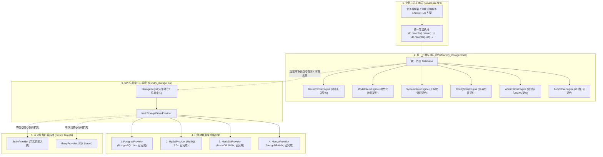

> **版本定位**：`v0.2.0` ~ `v0.3.0`  
> **核心目标**：解耦单一 PostgreSQL 绑定，引入 **SPI (Service Provider Interface) 插件化机制** 与 **策略模式 (Strategy Pattern)**，实现底层驱动全面封装、上层纯方法调用，支持通过单一环境变量或连接串自动切换数据库，并全面落地支持 **PostgreSQL（第一，已完成）**、**MySQL（第二，已完成）**、**MariaDB（第三，已完成）** 与 **MongoDB（第四，已完成）**。  
> **支持矩阵与接入状态**：
> - **1. PostgreSQL (14+)**：第一接入 [x] 已完成
> - **2. MySQL (8.0+ / 8.4+)**：第二接入 [x] 已完成
> - **3. MariaDB (10.5+)**：第三接入 [x] 已完成
> - **4. MongoDB (6.0+)**：第四接入 [x] 已完成
> - **未来预留扩展插槽**：SQLite (嵌入式/单机/单元测试), SQL Server (MSSQL), TiDB 等  
> *(注：经架构评审，Oracle DB 鉴于其过重的运行时依赖、繁琐的 C 动态库前置条件以及 Rust 开源社区支持不足，已正式从路线图中移除。)*

---

## 📌 状态图例
- [ ] **待开始 (Pending)**
- [/] **进行中 (In Progress)**
- [x] **已完成 (Completed)**

---

## 🧭 一、 核心设计哲学与四大原则

### 1. 面向纯方法调用，驱动零泄露 (Method-Based & Driver-Agnostic)
- 业务子系统、AutoCRUD 引擎、领域服务以及开发者代码**只调用统一标准方法**（例如 `db.records().create(...)`、`db.records().list(...)`、`db.configs().get(...)`）。
- 严禁在业务层直接暴露 `sqlx::PgPool`、`sqlx::MySqlPool` 或任何特定数据库的连接对象。
- 系统彻底屏蔽底层 SQL 方言细节与网络驱动差异。

### 2. 因地制宜的特化策略，拒绝“最低公倍数 SQL” (Database-Native Strategy)
- 不同的数据库具备截然不同的物理特性与优势，强求单一 SQL 模板会抹杀各数据库的独特优势：
  - **PostgreSQL**：利用 `JSONB` + `USING GIN(data)` 倒排索引 + 部分索引实现真正的极致 Zero-DDL。
  - **MySQL / MariaDB**：针对无 GIN 倒排索引的物理限制，采用“标准 JSON 列 + 虚拟生成列 (Virtual Generated Columns) + 局部二级 B-Tree 索引”组合策略，兼顾无锁扩展与检索性能。MariaDB 拥有独立 `MariaDbProvider` 与专用初始化脚本。
  - **MongoDB**：利用原生文档数据库本能，免 Schema 存储 BSON Document，天然适配海量动态记录，利用 Wildcard 索引 (`$**`) 实现任意深度的动态查询加速，并通过原子 `_counters` 序列保证全局整数 ID 兼容。

### 3. 智能协议探测 + 单一环境变量切换 (Smart URL Auto-Detection)
- **开箱即用，零冗余配置**：系统优先根据 `DATABASE_URL` 的协议前缀自动路由到对应数据库驱动：
  - `postgres://` 或 `postgresql://` $\rightarrow$ 自动激活 PostgreSQL 引擎
  - `mysql://` $\rightarrow$ 自动激活 MySQL 引擎
  - `mariadb://` $\rightarrow$ 自动激活 MariaDB 引擎
  - `mongodb://` 或 `mongodb+srv://` $\rightarrow$ 自动激活 MongoDB 原生文档引擎
- **支持显式指定**：用户在安装部署时，也可以通过单一环境变量（如 `DATABASE_TYPE=mysql`、`DATABASE_TYPE=mariadb` 或 `DATABASE_TYPE=mongodb`）显式指定数据库类型。
- **方言特化迁移生命周期**：各引擎实现 `run_migrations()` 契约，自动根据所选数据库类型加载并执行特化的初始化脚本与防重锁。

### 4. Cargo Feature 按需编译，杜绝依赖膨胀 (Conditional Compilation)
- Rust 是静态编译语言，将所有驱动全部塞入单一二进制包会导致编译缓慢与产物体积膨胀。
- 为保证生产环境轻量化，所有驱动全部采用 Cargo Feature Flags 进行模块化解耦：
  - `default = ["postgres"]`
  - 可选特性：`features = ["mysql"]`, `features = ["mariadb"]`, `features = ["mongodb"]`
  - 如果用户配置了未启用的数据库驱动，启动阶段会给出清爽明确的配置指引与报错拦截。

### 5. 全系统严格软删除与零物理 DELETE 权限运行保障 (Strict Soft-Delete Policy)
- **零物理 DELETE 核心契约**：系统所有模块（子系统专题、业务数据记录、数据模型与字段元数据、系统全局配置、后台管理员账号）全部采用标准软删除标记（`deleted_at: Option<DateTime<Utc>>`）。
- **杜绝数据灭失**：底层所有引擎方法（`delete()`, `delete_model()` 等）严格执行 `UPDATE ... SET deleted_at = NOW(6)`，底层禁止执行任何 `DELETE FROM`。
- **数据库账号最小权限支持**：即便生产环境 DBA 回收了应用数据库账号的物理 `DELETE` 权限（仅开放 `SELECT, INSERT, UPDATE`），整个系统的所有功能模块均可 100% 顺畅正常运行。

### 6. 差异化 DDL 与子系统独立分表体系 (针对 MySQL / MariaDB)
- **MongoDB**：原生 BSON 文档型数据库，天然具备 Schemaless 特性，集合随第一条数据写入自动生成，实现纯粹的 0-DDL。
- **PostgreSQL**：在 Mode A（0-DDL）模式下，依托 `JSONB` 二进制存储 + `GIN` 倒排索引 + 分区表，单表汇聚海量多专题仍具备卓越检索性能。
- **MySQL / MariaDB**：鉴于缺乏原生 GIN 倒排索引，单表存储海量 JSON 数据在并发和 B+Tree 深度上存在明显瓶颈。因此对于 MySQL / MariaDB，**推荐使用 `foundry system new <slug> --with-table` 为每个业务子系统拆分为独立的物理表**，并输出专属 DDL 脚本。
- **开发与生产交付解耦**：开发阶段执行 `foundry migrate` 自动扫描 `migrations/<dialect>/*.sql` 同步；生产阶段提供独立 SQL 文件供 DBA 离线审计与手动执行。

---

## 🏗️ 二、 目标系统架构全景



---

## 📁 三、 目录与代码工程重构规范

`crates/foundry_storage` 模块的标准布局：

```text
crates/foundry_storage/
├── Cargo.toml                         # Feature Flags 控制 (postgres, mysql, mariadb, mongodb)
├── migrations/                        # 各引擎特化的全量初始化与方言迁移脚本
│   ├── postgres/                      # PostgreSQL 方言脚本 (BIGSERIAL, JSONB, GIN, PL/pgSQL)
│   │   └── init.sql
│   ├── mysql/                         # MySQL 方言脚本 (AUTO_INCREMENT, JSON, 复合索引)
│   │   └── init.sql
│   └── mariadb/                       # MariaDB 方言脚本 (AUTO_INCREMENT, JSON, 复合索引)
│       └── init.sql
└── src/
    ├── lib.rs                         # 统一导出门面 Database 与全部业务 Store Traits
    ├── facade.rs                      # Database 结构体与统一 API 暴露
    ├── entities.rs                    # 通用实体模型 (System, Model, Record, Admin, AuditLog)
    ├── traits/                        # 【业务契约层】面向开发者的方法 Trait
    │   ├── mod.rs
    │   ├── records.rs                 # RecordStoreEngine: list, get_by_id, create, update, delete
    │   ├── models.rs                  # ModelStoreEngine: list_models, get_model, create_model...
    │   ├── systems.rs                 # SystemStoreEngine: list, get_by_slug, stats...
    │   ├── configs.rs                 # ConfigStoreEngine: list, get_aggregated, update...
    │   ├── admins.rs                  # AdminStoreEngine: list, get_by_username, create...
    │   └── audit.rs                   # AuditStoreEngine: insert, list...
    ├── spi/                           # 【SPI 扩展层】驱动发现与接入契约
    │   ├── mod.rs
    │   ├── provider.rs                # StorageDriverProvider trait 定义
    │   └── registry.rs                # StorageRegistry: 驱动注册与根据连接串查找
    ├── orm/                           # 【ORM 优先架构层】Prisma 风格强类型模型与查询构建器
    │   ├── mod.rs
    │   ├── compiler.rs                # 动态方言 DDL 编译器 (PostgreSQL, MySQL, MariaDB)
    │   ├── dialect.rs                 # 方言枚举与参数占位符 ($1 vs ?)
    │   ├── models.rs                  # 7 大核心平台表的 EntitySchema 规范定义
    │   ├── query.rs                   # 封装的 CRUD 查询构建器 (OrmSelect, OrmInsert, OrmUpdate, OrmDelete)
    │   └── registry.rs                # 线程安全全局 ORM 模型注册表 (OrmRegistry)
    └── engines/                       # 【具体策略实现层】各个数据库的特化方言与驱动实现
        ├── mod.rs
        ├── postgres/                  # PostgreSQL 引擎实现
        │   ├── mod.rs
        │   ├── provider.rs            # PostgresProvider (ORM 编译 DDL)
        │   ├── records.rs             # ORM 查询构建器 CRUD、GIN 索引与 JSONB 操作
        │   └── stores.rs              # models, systems, admins 等实现
        ├── mysql/                     # MySQL 引擎实现
        │   ├── mod.rs
        │   ├── provider.rs            # MySqlProvider (ORM 编译 DDL)
        │   ├── records.rs             # ORM 查询构建器 CRUD、自增主键与延迟关联分页
        │   └── stores.rs              # 各基础表实现
        ├── mariadb/                   # MariaDB 专属引擎实现
        │   ├── mod.rs
        │   └── provider.rs            # MariaDbProvider (ORM 编译 DDL)
        └── mongodb/                   # MongoDB 原生文档引擎 (Fallback 策略)
            ├── mod.rs
            ├── provider.rs            # MongoProvider (init.js 脚本)
            ├── records.rs             # 原生 BSON 文档 CRUD 与 Wildcard 动态索引
            ├── counters.rs            # 保证外部 i64 主键兼容的原子计数器序列
            └── stores.rs              # 集合存储实现
```

---

## 🧩 四、 核心代码接口设计

### 1. `StorageDriverProvider` (SPI 扩展契约)

```rust
#[async_trait]
pub trait StorageDriverProvider: Send + Sync {
    /// 驱动标识，如 "postgres", "mysql", "mariadb", "mongodb"
    fn driver_name(&self) -> &'static str;

    /// 判断连接字符串是否归当前 Provider 处理 (例如 starts_with("mysql://"))
    fn supports(&self, connection_url: &str) -> bool;

    /// 初始化连接池并构建全套仓储引擎
    async fn create_engines(
        &self,
        connection_url: &str,
        max_connections: u32,
    ) -> AppResult<StorageEngineSet>;

    /// 执行该数据库特有的初始化与方言迁移脚本
    async fn run_migrations(&self, connection_url: &str) -> AppResult<()>;

    /// 获取由代码 ORM 动态编译或内嵌在二进制驱动中的基准方言 DDL / 初始化脚本
    fn get_baseline_ddl(&self) -> String;

    /// 默认迁移脚本文件名 (如 init.sql 或 init.js)
    fn default_migration_filename(&self) -> &'static str {
        "init.sql"
    }
}
```

### 2. `RecordStoreEngine` (统一动态记录操作 Trait)

```rust
#[async_trait]
pub trait RecordStoreEngine: Send + Sync {
    async fn list(
        &self,
        system_slug: &str,
        model_slug: &str,
        query: RecordQuery,
    ) -> AppResult<PaginatedData<ModelRecordEntity>>;

    async fn get_by_id(
        &self,
        system_slug: &str,
        model_slug: &str,
        id: i64,
    ) -> AppResult<ModelRecordEntity>;

    async fn create(
        &self,
        system_slug: &str,
        model_slug: &str,
        data: serde_json::Value,
    ) -> AppResult<ModelRecordEntity>;

    async fn update(
        &self,
        system_slug: &str,
        model_slug: &str,
        id: i64,
        data: serde_json::Value,
    ) -> AppResult<ModelRecordEntity>;

    async fn delete(
        &self,
        system_slug: &str,
        model_slug: &str,
        id: i64,
    ) -> AppResult<()>;
}
```

### 3. `Database` (面向开发者的纯方法调用门面)

```rust
#[derive(Clone)]
pub struct Database {
    records: Arc<dyn RecordStoreEngine>,
    models: Arc<dyn ModelStoreEngine>,
    systems: Arc<dyn SystemStoreEngine>,
    configs: Arc<dyn ConfigStoreEngine>,
    admins: Arc<dyn AdminStoreEngine>,
    audit: Arc<dyn AuditStoreEngine>,
}

impl Database {
    pub async fn connect(url: &str, max_connections: u32, auto_migrate: bool) -> AppResult<Self>;

    pub fn records(&self) -> &dyn RecordStoreEngine { self.records.as_ref() }
    pub fn models(&self) -> &dyn ModelStoreEngine { self.models.as_ref() }
    pub fn systems(&self) -> &dyn SystemStoreEngine { self.systems.as_ref() }
    pub fn configs(&self) -> &dyn ConfigStoreEngine { self.configs.as_ref() }
    pub fn admins(&self) -> &dyn AdminStoreEngine { self.admins.as_ref() }
    pub fn audit(&self) -> &dyn AuditStoreEngine { self.audit.as_ref() }
}
```

---

## 🎯 五、 各数据库策略特化实现细节

### 1. PostgreSQL 策略（第一接入 - [x] 已完成）
- **表结构**：保持 `model_records`，字段 `data JSONB NOT NULL DEFAULT '{}'::jsonb`。
- **索引**：
  - `CREATE INDEX idx_lookup ON model_records(system_id, model_slug, created_at DESC) WHERE deleted_at IS NULL;`（部分索引加速主干检索）
  - `CREATE INDEX idx_data_gin ON model_records USING GIN(data);`（对任意 JSON 内部键值的倒排索引）
- **SQL 方言**：占位符 `$1, $2`；写入利用 `INSERT ... RETURNING *` 一次网络 IO 获取自增与生成数据。

### 2. MySQL 8.0+ 策略（第二接入 - [x] 已完成）
- **单表全量通用存储 (Universal Single-Table JSON Engine)**：避免频繁 `CREATE TABLE` 引起的 MDL 元数据锁争用与文件句柄膨胀。
- **紧凑整数 `model_id` 区分所属模型**：二级索引前缀采用 `model_id: BIGINT`，索引体积压缩 75% 以上，内存缓冲池命中率极高。
- **延迟关联分页 (Deferred Join)**：先扫描紧凑覆盖索引拿到分页 ID，再回表提取大 JSON 载荷，解决千万级深度分页性能瓶颈。
- **事务内原子重查 (Atomic Insert & Re-Fetch)**：通过短事务原子串联 `INSERT` $\rightarrow$ `last_insert_id()` $\rightarrow$ `SELECT`，规避脏读。

### 3. MariaDB 10.5+ 特化策略（第三接入 - [x] 已完成）
- **方言与连接层隔离**：独立提供 `MariaDbProvider`，原生处理 `mariadb://` 协议路由，支持 `DATABASE_TYPE=mariadb` 显式切换。
- **独立迁移脚本**：专享 `migrations/mariadb/init.sql` 初始方言脚本，确保对 MariaDB 系统变量与连接特征的最佳适配。
- **行为兼容**：复用高效单表通用关系存储内核，经过本地 MariaDB 实例端到端测试严格验证。

### 4. MongoDB 原生文档策略（第四接入 - [x] 已完成）
- **文档映射**：
  - `model_records` 直接映射为 MongoDB 集合中的原生 Document：
    ```json
    {
      "_id": ObjectId("6651a..."),
      "id": 100001,
      "model_id": 1,
      "system_id": "carnival_2026",
      "model_slug": "products",
      "data": { "title": "Mechanical Keyboard", "price": 99, "tags": ["hardware"] },
      "created_at": ISODate("2026-09-26T12:00:00Z"),
      "updated_at": ISODate("2026-09-26T12:00:00Z"),
      "deleted_at": null
    }
    ```
- **自增 ID 保证**：维护一个轻量级 `_counters` 集合，利用原子 `$inc` 操作生成全局单调递增 `i64` 主键，保证对上层业务统一契约 100% 兼容。
- **原生动态索引**：利用 MongoDB 的 `Wildcard Index` (`data.$**`)，天然支持对任意 JSON 路径进行索引加速，完全免去 DDL 烦恼。
- **全异步驱动**：官方 `mongodb` crate 纯异步 Tokio 支持。

---

## 🔮 六、 未来扩展演示：如何接入新数据库（以 SQLite 为例）

当未来需要接入 SQLite 时，**现有核心代码 0 修改**，只需 3 步：

1. **步骤 1**：编写 `engines/sqlite/provider.rs` 实现 `StorageDriverProvider`。
2. **步骤 2**：在驱动注册入口处注册：`registry.register(Box::new(SqliteProvider));`。
3. **步骤 3**：环境变量配置 `DATABASE_URL=sqlite://foundry.db`，系统即可全自动运行在 SQLite 上！

---

## 📅 七、 实施落地路线图

```text
[阶段 0: 核心 SPI 与 PostgreSQL (已完成)] ➔ [阶段 1: MySQL 8.0+ 引擎 (已完成)]
                                                 │
[阶段 4: 生态发布与 CLI 工具链] ⬅ [阶段 3: MongoDB (已完成)] ⬅ [阶段 2: MariaDB (已完成)]
```

### 阶段 0: 核心 SPI 架构解耦与 PostgreSQL 提取（第一接入 - [x] 已完成）
- [x] **0.1 业务 Store Traits 抽象**：在 `crates/foundry_storage/src/traits/` 中定义标准业务 Trait。
- [x] **0.2 SPI 与注册中心**：在 `crates/foundry_storage/src/spi/` 中定义 `StorageDriverProvider` 契约与全局驱动注册中心 `StorageRegistry`。
- [x] **0.3 统一 Database 门面与协议自动嗅探**：支持从 `DATABASE_URL` 协议前缀自动激活 Provider，并保留 `DATABASE_TYPE` 环境变量显式覆盖支持。
- [x] **0.4 Cargo Feature Flags 模块化**：改造 `crates/foundry_storage/Cargo.toml`，设立 `postgres`, `mysql`, `mariadb`, `mongodb` Feature Flags。
- [x] **0.5 PostgreSQL 提取与既有系统无缝兼容**：100% 行为向后兼容。

### 阶段 1: 落地 MySQL 8.0+ 策略引擎 (第二接入 - [x] 已完成)
- [x] **1.1 单表通用迁移脚本**：编写 `migrations/mysql/init.sql`，落地单表全量存储架构。
- [x] **1.2 驱动与连接管理**：编写 `engines/mysql/` 策略模块，基于 `sqlx::MySqlPool` 实现连接池管理。
- [x] **1.3 MySQL 方言 RecordStoreEngine 深度性能调优**：覆盖索引与延迟关联分页，原子重查，虚拟列二级索引加速。
- [x] **1.4 元数据表适配**：实现 `models`, `systems`, `configs`, `admins`, `audit_logs` 的 MySQL 引擎实现。
- [x] **1.5 端到端 CI 测试**：完成 `tests/mysql_integration_tests.rs` 全量集成测试。

### 阶段 2: 独立适配 MariaDB 10.5+ 方言与特化引擎 (第三接入 - [x] 已完成)
- [x] **2.1 方言特化与连接层隔离**：独立提供 `MariaDbProvider`，支持 `mariadb://` URL 协议自动探测与连接参数隔离。
- [x] **2.2 独立迁移脚本**：编写 `migrations/mariadb/init.sql`，验证初始化脚本与超管账号注入。
- [x] **2.3 端到端集成测试**：编写 `tests/mariadb_integration_tests.rs` 并在真实 MariaDB 环境下回归验证通过。

### 阶段 3: 落地 MongoDB 原生文档策略引擎 (第四接入 - [x] 已完成)
- [x] **3.1 引入官方驱动**：在 `features = ["mongodb"]` 条件下引入官方异步驱动 `mongodb`。
- [x] **3.2 BSON 文档映射与主键兼容**：原子 `_counters` 集合生成自增 `i64` 主键，原生 BSON Document 与实体无损映射。
- [x] **3.3 动态索引与集合自动初始化**：利用 MongoDB 的 `Wildcard Index` (`$**`) 对动态数据进行无锁动态索引加速。
- [x] **3.4 全套业务集合落地**：在 MongoDB 中完整实现 `records`, `models`, `systems`, `configs`, `admins`, `audit_logs`。
- [x] **3.5 端到端集成测试**：编写 `tests/mongodb_integration_tests.rs` 并在真实 MongoDB 7.0/8.0 环境下验证通过。

### 阶段 4: 生产就绪、CLI 工具链升级与生态发布
- [x] **4.1 CLI 迁移与多库感知**：支持自动根据当前环境连接串识别 PostgreSQL、MySQL、MariaDB、MongoDB。
- [x] **4.2 完善中英文多数据库运维与配置指南**：在 `docs` 网站发布多数据库选型、生产部署指南。
- [x] **4.3 自动化测试与 Clippy 保证**：全工作区通过零 Warning 的 Clippy 代码检测与全面单元/集成测试。
