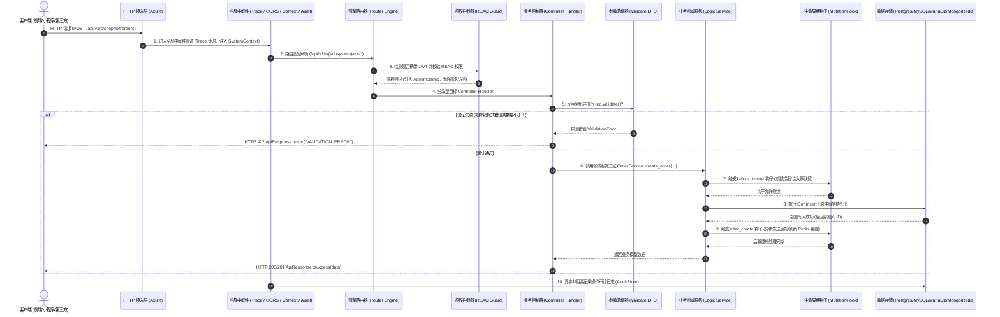

# 基础架构与请求生命周期

本章内容：
1. 理解 Foundry “平台与业务完全解耦”的核心架构哲学；
2. 掌握 `FoundryApp::builder()` 应用引导与服务启动过程；
3. 熟悉 HTTP 请求从入站到响应的全流程（中间件、路由、控制器、验证、ORM、钩子）；
4. 掌握核心组件分层与职责边界。

---

## 1. 架构分层理念

Foundry 采用现代 Rust 的内存安全与高并发运行时设计，将整个系统清晰划分为平台层与应用层：

```text
Foundry 框架层 (crates/foundry, crates/foundry_core, crates/foundry_engine...)
    │  提供通用基础设施：Axum 引擎、统一响应/错误信封、多数据库 SPI、RBAC、动态模型、后台控制台
    │  通过标准 Cargo 依赖对外提供
    ▼
用户独立应用工程 (独立 Git 仓库)
    ├── src/main.rs             # 应用引导与服务启动入口
    └── src/systems/            # 业务子系统聚合目录
        ├── shop/               # 商城子系统 (完全内聚控制器、领域逻辑、DTO校验与后台大屏)
        └── billing/            # 计费子系统
```

### 核心组件职责表

| 核心组件 | Foundry 实现 | 说明与职责 |
|---|---|---|
| **应用引导入口** | **`src/main.rs` (`#[foundry::main]`)** | 应用引导启动入口，加载 `.env`，调用 `FoundryApp::builder()` |
| **业务子系统** | **`SubsystemModule` 特征实现** | 实现高内聚、自包含的领域业务单元 |
| **核心预导入门面** | **`use foundry::prelude::*;`** | 统一暴露最常用的核心类型、提取器与宏，开箱即用 |
| **状态上下文注入** | **`Extension<SystemContext>` / `AppState`** | Axum 状态注入与线程安全跨请求共享，强类型且零运行时反射开销 |
| **路由注册引擎** | **`SubsystemModule::register_routes`** | 模块自声明路由，由路由引擎统一挂载到指定子系统命名空间 |
| **控制器处理器** | **Axum Handler 异步函数** | 处理 HTTP 请求，负责入参提取、服务调度与返回 `ApiResponse` |
| **请求验证器** | **`#[derive(Validate)]` DTO** | 编译期强类型声明式校验，入参格式非法自动截断 |
| **实体与查询构造器** | **`EntitySchema` / `OrmSelect`** | Code-First 实体声明与全数据库自适应链式查询构造器 |
| **生命周期钩子** | **`MutationHook` 突变钩子** | 实体生命周期前置与后置拦截管道 (`before_create`, `after_create` 等) |

---

## 2. HTTP 全请求生命周期 (Request Flow)

理解 HTTP 请求在系统内部的流转路径，是理解框架机制与排查线上问题的核心：



---

## 3. 应用引导与启动流程 (`main.rs`)

Foundry 使用清晰直观的流式 Builder API 完成应用构建与启动：

```rust
// src/main.rs
pub mod systems;

use foundry::prelude::*;
use systems::shop::ShopSubsystem;

#[foundry::main]
async fn main() -> Result<(), Box<dyn std::error::Error>> {
    // 1. 读取环境配置 (自动读取根目录下 .env 环境变量)
    let config = FoundryConfig::from_env();

    // 2. 流式构建 Foundry 应用程序实例
    let app = FoundryApp::builder()
        .config(config)                     // 绑定配置
        .register_subsystem(ShopSubsystem)  // 注册业务子系统
        // .register_hook(ShopAuditHook)    // (可选) 注册生命周期突变钩子
        .build()                            // 完成校验、数据库连接与自迁移
        .await?;

    info!("🚀 服务已就绪，正在监听端口...");

    // 3. 启动 HTTP 异步服务循环
    app.run().await?;
    Ok(())
}
```

### 引导阶段执行的核心任务：
1. **环境与日志初始化**：自动根据 `RUST_LOG` 环境变量初始化 `tracing` 结构化日志输出；
2. **数据库 SPI 驱动连接**：根据 `.env` 中的 `DATABASE_URL` 协议头自动连接目标数据库（PostgreSQL, MySQL, MariaDB 或 MongoDB），并建立连接池；
3. **Redis 缓存连接**：检测并初始化 Redis 连接池（若未配置则安全降级为内存模式）；
4. **数据库自迁移 (`AUTO_MIGRATE`)**：若配置为 `AUTO_MIGRATE=true`，系统自动检测基础表结构是否存在，自动执行方言初始化并注入默认超管账号（`admin` / `admin123456`）；
5. **子系统与路由装配**：收集所有注册的 `SubsystemModule`，加载静态自定义大屏页面，挂载扩展路由与 Auto-CRUD 引擎路由；
6. **启动 HTTP 监听**：绑定 `HOST:PORT` 开始对外提供服务。

---

## 4. 门面体系与全局依赖导入

Foundry 秉持极简开发体验，提供统一门面导入：

```rust
use foundry::prelude::*;
```

一旦引入 `prelude`，你的代码便自动拥有了以下核心原语，无需在 `Cargo.toml` 中引用零散三方依赖：

* **Web 路由与提取器**：`Router`、`Json`、`Query`、`Path`、`Extension`、`get`、`post`、`put`、`delete`；
* **响应与错误模型**：`ApiResponse`、`PaginatedData`、`AppResult`、`AppError`；
* **ORM 查询构造器**：`OrmSelect`、`OrmInsert`、`OrmUpdate`、`OrmDelete`、`Dialect`；
* **日志追踪宏**：`info!`、`warn!`、`error!`、`debug!`、`trace!`；
* **子系统与实体定义**：`SubsystemModule`、`SystemContext`、`AppState`、`EntitySchema`、`ColumnDef`、`IndexDef`。

---

## 5. 核心开发约定与避坑建议

> [!WARNING]
> **1. 利用好 Axum 依赖提取机制**：
> Axum 的提取器（Extractors）是通过函数参数类型驱动的。如果你的控制器需要数据库或当前子系统上下文，只需在参数中声明 `Extension(ctx): Extension<SystemContext>` 和 `Extension(state): Extension<AppState>` 即可，框架会自动完成注入。
> 
> **2. 始终使用 `AppResult<ApiResponse<T>>` 返回数据**：
> `ApiResponse<T>` 已经自动实现了 Axum 的 `IntoResponse`。在控制器中可以直接返回 `Ok(ApiResponse::ok(data))`，无需再显式嵌套 `Ok(Json(ApiResponse::ok(data)))`。

下一节：[02. 路由系统与子系统路由](./02-routing/)
