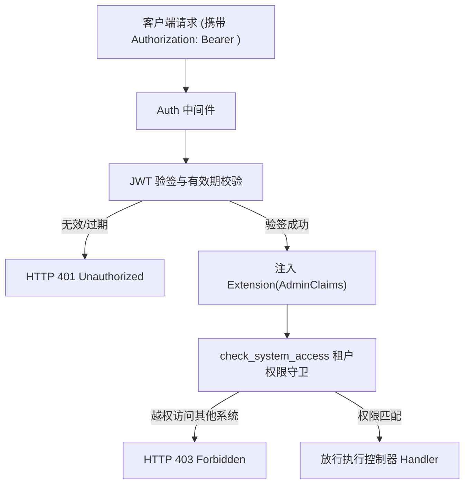

本章内容：
1. 理解 Foundry 平台分层安全认证（IAM）架构；
2. 掌握基于 Argon2id 的现代密码哈希与 JWT 令牌验签机制；
3. 熟悉三级角色层级（`super_admin`、`admin`、`topic_admin`）；
4. 学会在自定义控制器中保护受限路由并执行租户权限隔离。

---

## 1. 认证安全架构总览

Foundry 在框架层内聚了现代化的 **身份识别与访问管理 (IAM)** 体系：



---

## 2. 三级 RBAC 角色层级体系

为满足多业务团队协同开发与数据隔离的要求，Foundry 原生支持三级角色体系：

| 角色标识 (`role`) | 角色名称 | 权限范围与数据边界 |
|---|---|---|
| **`super_admin`** | **超级管理员** | 对平台全局拥有最高控制权。可管理所有子系统、创建管理员账号、查看审计日志、分配系统权限。 |
| **`admin`** | **平台管理员** | 拥有多数全局资源的读取与管理权限，受平台规则管控。 |
| **`topic_admin`** | **专题/子系统管理员** | **租户强隔离角色**。只能访问被授权绑定的子系统（由其账号的 `allowed_systems` 数组限定，如 `["shop", "billing"]`）。 |

---

## 3. 在控制器中保护业务路由

### 3.1 提取当前管理员凭据 (`AdminClaims`)

只需在 Handler 参数中声明 `Extension(claims): Extension<AdminClaims>`，如果请求未携带合法 JWT 或已过期，框架会自动拒绝并返回 `401 Unauthorized`：

```rust
use foundry::prelude::*;

/// 仅限已登录管理员访问的订单管理接口
pub async fn admin_manage_order(
    Extension(claims): Extension<AdminClaims>,
    Extension(ctx): Extension<SystemContext>,
    Path(order_id): Path<i64>,
) -> AppResult<ApiResponse<String>> {
    // 打印当前操作者身份 (用于审计)
    info!(
        admin_id = claims.sub,
        username = %claims.username,
        role = %claims.role,
        "管理员正在审查订单: {}", order_id
    );

    Ok(ApiResponse::ok("审查操作完成".into()))
}
```

### 3.2 严格租户隔离校验 (`check_system_access`)

如果当前操作者是 `topic_admin`，必须防止其越权调用其他子系统的私有接口：

```rust
use foundry::prelude::*;

pub async fn sensitive_operation(
    Extension(claims): Extension<AdminClaims>,
    Extension(ctx): Extension<SystemContext>,
) -> AppResult<ApiResponse<()>> {
    // 1. 自动校验当前管理员是否有权访问当前子系统 (ctx.system_slug)
    // 若无权访问，立即返回 HTTP 403 Forbidden
    check_system_access(&claims, &ctx.system_slug)?;

    // 2. 亦可进一步校验是否具备超级管理员权限
    if claims.role != "super_admin" {
        return Err(AppError::Forbidden("需要超级管理员权限方可执行此敏感操作".into()));
    }

    Ok(ApiResponse::ok(()))
}
```

---

## 4. 密码安全与哈希机制

Foundry 底层全面采用行业最安全的 **Argon2id** 算法进行密码哈希与校验（杜绝 MD5 / SHA1 等已过时算法）。

在管理控制台新建管理员时，密码由服务端自动加盐并进行 Argon2id 哈希后落库存储，即使数据库发生泄露也无法通过彩虹表反查明文。

---

## 5. 初学者避坑指南 (Beginner Gotchas)

> [!WARNING]
> **1. 生产环境务必替换 `JWT_SECRET`**：
> 在 `.env` 中，默认的 `JWT_SECRET` 仅供本地开发测试。部署到生产环境前，必须通过 `openssl rand -hex 32` 生成高强度的 256 位随机私钥，防止 JWT 伪造！
> 
> **2. 明确公开路由与管理路由的区别**：
> 面向最终消费者端（如商品浏览、访客下单）的 API，Handler 中**不要**声明 `Extension<AdminClaims>`，即可允许匿名访问；面向运营人员的操作接口则必须声明。

下一节：[08. 生命周期突变钩子 (Mutation Hook)](./08-mutation-hooks/)
