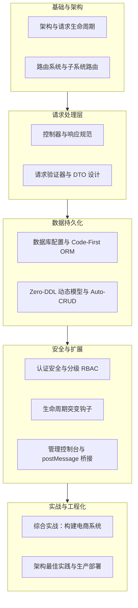
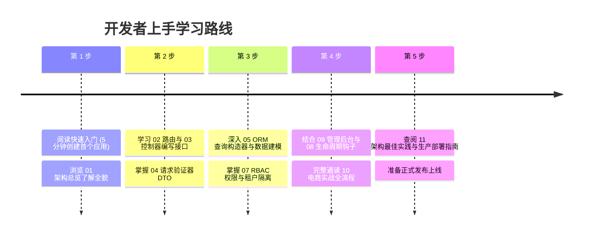

Foundry 秉持 **“平台与业务完全解耦”、“约定优于配置”** 与 **“高内聚低耦合”** 的现代工程哲学：
* **业务完全独立**：业务开发者在自己的独立 Git 仓库中通过标准 Cargo 依赖引入 `foundry`，升级框架仅需 `cargo update`，绝无上游代码合并冲突；
* **极简单门面**：只需单行 `use foundry::prelude::*;`，路由、请求提取器、ORM 构造器、响应信封与日志宏全套就绪；
* **双模存储引擎**：严谨关系业务采用 Code-First 强类型 ORM，敏捷多变业务采用 Zero-DDL 免建表动态模型；
* **开箱即用控制台**：所有子系统自动融入解耦的 React Admin 控制台，支持免密 postMessage 鉴权与沙箱大屏。

本教程采用高度结构化的模块化分类，将架构、路由、控制器、验证器、ORM、安全、钩子和后台集成解耦为独立章节，帮助开发者以最高效的方式掌握在 Foundry 平台构建企业级业务系统的精髓。

---

## 教程章节结构

教程按照系统开发的标准流程划分为 11 个递进模块：

### 章节快速索引

| 章节 | 名称 | 核心内容 | 关键组件 |
|:---:|---|---|---|
|  | [架构与请求生命周期](./01-architecture-lifecycle/) | 平台解耦理念、HTTP 全流程、门面体系 | 架构、生命周期、Prelude |
|  | [路由系统与子系统路由](./02-routing/) | 统一路由规划、子系统路由、参数提取 | 路由定义、命名空间、方法绑定 |
|  | [控制器与响应规范](./03-controllers/) | Axum 控制器、请求提取器、ApiResponse | Handler、提取器、统一输出 |
|  | [请求验证器与 DTO 设计](./04-validation/) | Validate 注解、常用规则、HTTP 422 | 验证 DTO、强类型规则、参数截断 |
|  | [数据库配置与 Code-First ORM](./05-database-orm/) | 多数据库 SPI、EntitySchema、查询构造器 | 数据库连接、Schema、查询构造 |
|  | [Zero-DDL 动态模型与 Auto-CRUD](./06-dynamic-models/) | 免 DDL 动态模型、RecordStore API | 动态表单、RecordStore、自动 CRUD |
|  | [认证安全与分级 RBAC](./07-auth-security/) | IAM、Argon2id、JWT、RBAC 租户隔离 | 身份认证、JWT 令牌、权限守卫 |
|  | [生命周期突变钩子](./08-mutation-hooks/) | MutationHook 管道、6 大事件、审计 | 生命周期、字段注入、异步通知 |
|  | [管理控制台与 postMessage 桥接](./09-admin-integration/) | React Admin 外壳、沙箱大屏、postMessage | 控制台、沙箱、免密鉴权 |
|  | [综合实战：构建电商系统](./10-walkthrough-shop/) | 从 DTO 到 main.rs 全流程 | 完整电商、单元测试、集成测试 |
|  | [架构最佳实践与生产部署](./11-best-practices/) | Thin Controller、连接池调优、Docker | 架构分层、性能、安全与部署 |

---

## Web 架构到 Foundry 的概念映射

如果你熟悉现代分层 Web 架构，下表能帮助你快速建立与 Foundry 核心原语的概念对应：

| 通用 Web 架构概念 | Foundry (Rust) 实现 | 优势与设计考量 |
|---|---|---|
| **业务应用模块 (Module)** | **`src/systems/<slug>/` 子系统** | 领域高内聚，子系统间强隔离，可插拔管理 |
| **模块路由注册 (Route Registration)** | **`SubsystemModule::register_routes`** | 自动加上 `/api/v1/s/<slug>/ext/` 命名空间前缀 |
| **控制器与操作 (Controller Handler)** | **Axum Handler 异步函数** | 无畏并发、零对象分配开销、强类型提取 |
| **请求参数提取 (Input Extraction)** | **`Query` / `Json` / `Path` 提取器** | 编译期强类型反序列化，非法格式自动拦截 |
| **参数验证器 (Validator DTO)** | **`#[derive(Validate)]` DTO** | 编译期验证注解，在 Handler 顶层直接校验 |
| **关系查询构造器 (Query Builder)** | **`OrmSelect::from_table()->...`** | 链式强类型构造，底层自动适配 `$1` 与 `?` 占位符 |
| **记录写入构造器 (Insert Builder)** | **`OrmInsert::into_table()->...`** | 统一参数化防注入，支持多方言输出 |
| **管道中间件 (Middleware)** | **Tower / Axum Layer 中间件** | 高性能异步管道，负责链路耗时与审计入库 |
| **实体生命周期事件 (Lifecycle Event)** | **`MutationHook` 钩子特征** | 支持实体创建、更新、删除前后的异步非阻塞拦截 |

---

## 推荐学习路径

建议首先阅读 [01. 基础架构与请求生命周期](./01-architecture-lifecycle/)，开启你的 Foundry 开发之旅！
