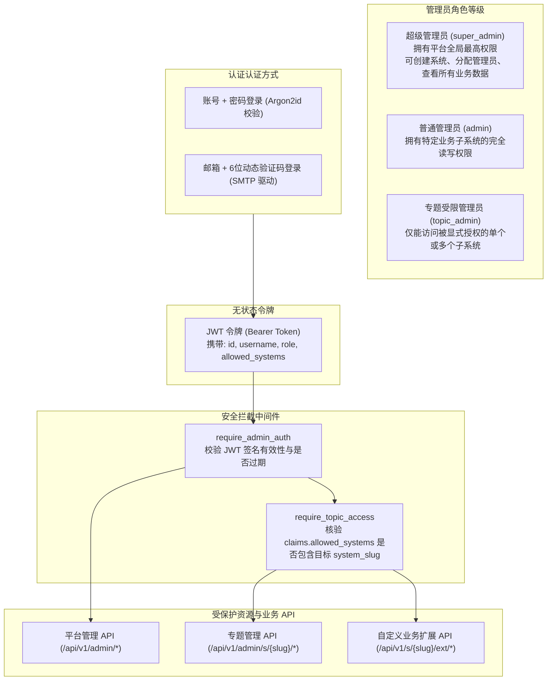
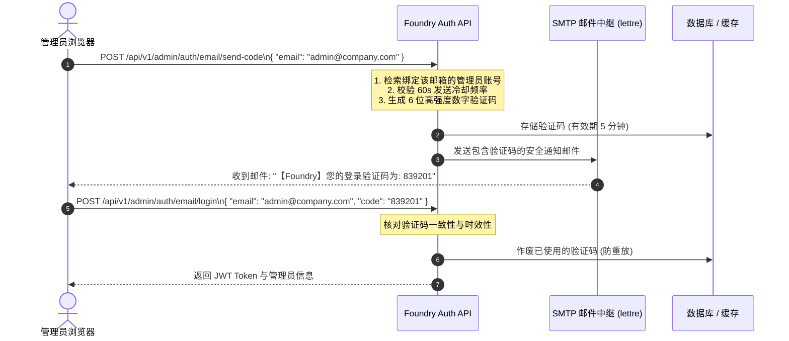

在现代多租户企业级平台中，**身份认证 (Authentication)** 与 **细粒度访问控制 (Authorization / RBAC)** 是守护数据资产的核心防线。

Foundry 在框架层封装了开箱即用的安全基础设施：
1. **密码学级密码哈希**：基于现代密码学权威标准的 **Argon2id** 算法，抵御 GPU 彩虹表与暴力碰撞攻击；
2. **无状态 JWT 身份令牌**：基于 HMAC-SHA256 签名，携带管理员身份标识、角色与授权系统清单；
3. **邮箱验证码与多因素登录**：集成企业级 SMTP 邮件服务，支持动态 6 位验证码登录与安全邮箱绑定；
4. **多租户专题隔离与 RBAC 中间件**：通过 `require_admin_auth` 与 `require_topic_access`，实现超级管理员与专题管理员的严格数据物理与逻辑隔离。

---

## 1. 安全架构与角色权限模型

Foundry 的权限控制模型围绕以下实体与角色展开：



---

## 2. 密码学安全与 Argon2id 哈希

Foundry 严禁使用过时的 MD5、SHA-1 或单纯的 SHA-256 存储用户密码。系统深度集成标准 `argon2` 算法（OWASP 官方推荐的第一密码哈希算法）：

- **内存消耗防破解 (Memory-Hard)**：要求计算硬件分配特定物理内存，彻底瓦解专用 ASIC 矿机与 GPU 集群的并行破解可能。
- **自动 Salt 加盐**：每次生成哈希时均自动注入高强度随机盐（Salt），即使两个管理员密码完全相同，生成的哈希字符串也绝不相同。

### 2.1 框架内的哈希与校验接口

通过 `foundry::prelude::*` 可以直接调用密码工具函数：

```rust
use foundry::prelude::*;

// 1. 生成安全密码哈希（存储到数据库）
let raw_password = "MySecurePassword2026!";
let password_hash = hash_password(raw_password)?;
// 输出形如: $argon2id$v=19$m=19456,t=2,p=1$vB8...$4Q8...

// 2. 校验明文密码是否匹配
let is_valid = verify_password(raw_password, &password_hash)?;
assert!(is_valid);
```

---

## 3. JWT 身份令牌机制与 Claims 规范

当管理员登录成功后，Foundry 签发标准的 JSON Web Token (JWT)。客户端在后续请求中通过 `Authorization: Bearer <TOKEN>` 请求头携带该凭证。

### 3.1 Claims 载荷结构 (`AdminClaims`)

```rust
#[derive(Debug, Clone, Serialize, Deserialize)]
pub struct AdminClaims {
    /// 管理员在数据库中的唯一主键 ID
    pub sub: i64,
    /// 管理员用户名
    pub username: String,
    /// 角色标识: "super_admin" | "admin" | "topic_admin"
    pub role: String,
    /// 被允许访问的业务子系统 slug 列表（如 ["shop", "blog"]）
    /// 若 role == "super_admin"，此列表可为空，默认通配全部子系统
    pub allowed_systems: Vec<String>,
    /// 令牌过期时间戳 (UTC 秒)
    pub exp: usize,
}
```

### 3.2 令牌生命周期与秘钥配置

- **有效期**：默认为 168 小时（7 天）。可通过 `FoundryBuilder::jwt_expiry_hours(48)` 按需调整。
- **签名私钥**：由 `JWT_SECRET` 环境变量提供。**生产环境必须配置高强度随机密钥**，防止伪造 Token 造成越权提权。

---

## 4. 邮箱验证码登录与双因素安全 (SMTP)

为了防止管理员弱密码被撞库，Foundry 原生支持 **基于 SMTP 邮件中继的免密动态验证码登录** 与 **安全邮箱绑定**。

### 4.1 核心业务流程



### 4.2 相关 API 端点清单

| 接口地址 | 请求方法 | 鉴权要求 | 说明 |
|---|---|---|---|
| `/api/v1/admin/auth/email/send-code` | `POST` | 公开 | 请求向指定邮箱发送登录 6 位验证码 |
| `/api/v1/admin/auth/email/login` | `POST` | 公开 | 提交邮箱与验证码完成登录并换取 JWT |
| `/api/v1/admin/auth/bind-email/send-code` | `POST` | 需管理员登录 | 请求向待绑定的新邮箱发送确认验证码 |
| `/api/v1/admin/auth/bind-email/verify` | `POST` | 需管理员登录 | 提交验证码，完成管理员账号与该邮箱的绑定 |

---

## 5. 权限控制中间件与路由保护

Foundry 采用模块化、可组合的 Axum 中间件来守护 API 路由安全。

### 5.1 身份认证中间件 (`require_admin_auth`)

校验请求头中的 `Authorization: Bearer <TOKEN>`。校验通过后，自动将解析出的 `AdminClaims` 挂载至 Axum 请求扩展 (`Extensions`) 中供后续 Handler 获取：

```rust
use axum::{Router, routing::get, middleware::from_fn_with_state};
use foundry::prelude::*;
use foundry_engine::middleware::require_admin_auth;

pub fn protected_routes(state: AppState) -> Router {
    Router::new()
        .route("/export-report", get(export_report_handler))
        .route_layer(from_fn_with_state(state.clone(), require_admin_auth))
}

// 在 Handler 中直接提取当前登录管理员身份
async fn export_report_handler(
    Extension(claims): Extension<AdminClaims>,
) -> ApiResponse<String> {
    ApiResponse::ok(format!("欢迎管理员: {}, ID: {}", claims.username, claims.sub))
}
```

### 5.2 多租户/专题隔离中间件 (`require_topic_access`)

对于管理特定子系统（如 `/api/v1/admin/s/{system_slug}/*`）的路由，仅核验证书有效性还不够，必须确保该管理员有权操作当前 `system_slug` 所属的数据。

`require_topic_access` 中间件的判定规则如下：
1. 若 `claims.role == "super_admin"`：直接放行（超级管理员拥有全系统管辖权）；
2. 若 `claims.allowed_systems` 包含当前请求提取出的 `system_slug`：放行；
3. 其余情况：**立即阻断并抛出 `403 Forbidden ("Access denied to system: ...")`**，彻底杜绝越权访问漏洞（BOLA / IDOR）。

---

## 6. 在自定义业务子系统中实现权限控制

当你在开发独立子系统扩展（`SubsystemModule`）时，可以针对不同的 API 分支应用不同的安全策略：

```rust
use axum::{Router, routing::{get, post}, middleware::from_fn_with_state};
use foundry::prelude::*;
use foundry_engine::middleware::{require_admin_auth, require_topic_access};

pub struct ShopSubsystem;

impl SubsystemModule for ShopSubsystem {
    fn slug(&self) -> &'static str { "shop" }
    fn display_name(&self) -> &'static str { "商城子系统" }

    fn register_routes(&self, router: Router) -> Router {
        // 1. 公开对外接口（顾客浏览商品、获取配置等）
        let public_routes = Router::new()
            .route("/goods", get(list_public_goods));

        // 2. 商家管理接口（必须具备管理员凭证且拥有本子系统权限）
        // 该路由被挂载到: /api/v1/s/shop/ext/manage/*
        let protected_manage_routes = Router::new()
            .route("/manage/orders/ship", post(ship_order_handler))
            .route("/manage/stats", get(get_sales_stats_handler));

        router
            .merge(public_routes)
            .merge(protected_manage_routes)
    }
}
```

---

## 7. 安全开发最佳实践与排查指南

| 常见 HTTP 状态码 | 根本原因分析 | 快速排查思路 |
|---|---|---|
| `401 Unauthorized` | 缺少 `Authorization` 请求头，或格式未遵循 `Bearer <token>` | 检查客户端是否正确在请求头中附带 Token，或 Token 是否已超过有效时限 |
| `401 Unauthorized` | `Invalid signature` / `JWT expired` | 确认客户端与服务端使用的 `JWT_SECRET` 是否一致，或重新执行登录流程刷新 Token |
| `403 Forbidden` | `Access denied to system: [slug]` | 当前登录管理员非 `super_admin`，且其 `allowed_systems` 中未包含当前子系统标识。请联系超级管理员在控制台勾选授权 |
| `422 Unprocessable Entity` | 请求体 JSON 参数校验未通过 | 查看响应中的详细错误列表，核对 DTO 中的 `validator` 正则或长度限制 |

### 安全加固建议

1. **生产网络启用 TLS/HTTPS**：避免 JWT 令牌在公网传输过程中被中间人（MITM）嗅探截获。
2. **敏感字段日志脱敏**：在业务日志中记录日志时，涉及密码、密钥、身份证号等信息，务必跳过或使用星号脱敏。
3. **定期轮转管理员秘钥**：如怀疑密钥发生泄漏，应立即更换环境变量 `JWT_SECRET` 并重启应用，所有旧 Token 将瞬间全局失效。
