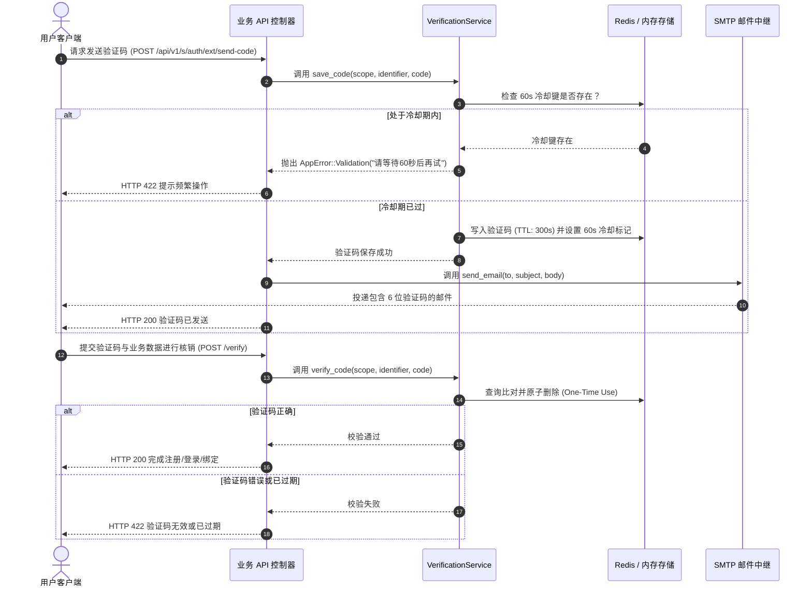

# 邮件服务与验证码中心

> **导读**：在各类企业级后端系统与用户管理平台中，邮件通知与身份验证码是极其常见的核心能力。Foundry 在引擎层（`foundry_engine`）原生内聚了开箱即用的 **SMTP 邮件发送服务** 与高可靠的 **`VerificationService` 验证码中心**，业务工程无需手动组装复杂的邮件与防刷逻辑。

---

## 1. 核心架构与功能特性

Foundry 邮件与验证码系统具备以下设计亮点：
* **标准 SMTP 协议支持**：基于 Rust 生态主流的 `lettre` 邮件库，全面兼容主流邮件服务商（阿里云邮件推送、腾讯企业邮、SendGrid、Gmail、163 等）；
* **双模验证码存储**：配置 Redis 时优先使用 Redis 集中式存储（天然支持分布式多实例部署与自动过期）；若未配置 Redis，系统自动优雅降级为带并发读写锁（`RwLock`）的内存缓存模式；
* **内置 60 秒冷却防刷机制**：防止恶意用户高频轰炸；
* **5 分钟安全有效期 (300s TTL)**：验证码超时自动失效；
* **原子核销验证**：验证通过后立即从存储中核销清理，彻底防止重放攻击。



---

## 2. 环境变量配置清单

在 `.env` 文件中配置以下参数即可激活 SMTP 邮件发送服务：

```bash
# ==============================================================================
# SMTP 邮件服务配置
# ==============================================================================
# SMTP 服务器地址 (如 smtp.aliyun.com / smtp.exmail.qq.com / smtp.sendgrid.net)
SMTP_HOST=smtp.example.com

# SMTP 端口 (TLS 通常为 465 或 587，普通端口为 25)
SMTP_PORT=587

# SMTP 认证用户名 (通常为发件邮箱完整地址)
SMTP_USER=no-reply@example.com

# SMTP 认证授权码 / 密码
SMTP_PASS=your_secret_smtp_password

# 默认发件人地址与显示名称
SMTP_FROM="Foundry Platform <no-reply@example.com>"
```

> [!NOTE]
> **自动探测状态**：
> 可以随时在业务代码中调用 `foundry_engine::services::email::is_smtp_configured()` 判断当前环境是否已配置 SMTP 服务。若未配置，调用 `send_email` 会返回明确的 `AppError::BadRequest` 拦截并记录警告日志。

---

## 3. 在业务子系统中发送邮件 (`send_email`)

```rust
use foundry::prelude::*;
use foundry_engine::services::email::send_email;

pub async fn notify_order_shipped(
    customer_email: &str,
    order_no: &str,
) -> AppResult<()> {
    let subject = format!("您的订单 #{} 已正式发货", order_no);
    let body = format!(
        "尊敬的客户：\n\n您的订单 {} 已经移交顺丰速运发出。感谢您的选购！\n\nFoundry 团队",
        order_no
    );

    // 异步发送邮件
    send_email(customer_email, &subject, &body).await?;
    info!("发货通知邮件已投递至: {}", customer_email);
    Ok(())
}
```

---

## 4. 验证码服务实战 (`VerificationService`)

`VerificationService` 支持任意作用域（`scope`，如 `"register"`、`"login"`、`"reset_password"`）与标识符（如邮箱地址或手机号）。

### 4.1 发送并存储验证码

```rust
use foundry::prelude::*;
use foundry_engine::services::email::send_email;
use foundry_engine::services::verification::VerificationService;

pub async fn handle_send_register_code(
    state: &AppState,
    target_email: &str,
) -> AppResult<ApiResponse<String>> {
    // 1. 初始化验证码服务 (优先使用 Redis，无则自动回退内存)
    let verifier = VerificationService::new(state.redis.clone());

    // 2. 生成 6 位随机安全数字验证码 (100000..=999999)
    let code = VerificationService::generate_code();

    // 3. 校验 60s 冷却期并存入 (TTL: 5 分钟)
    // scope: 业务作用域, identifier: 用户标识
    verifier.save_code("register", target_email, &code).await?;

    // 4. 发送验证码邮件
    let subject = "【Foundry】注册安全验证码";
    let body = format!("您好！您的注册验证码为：{}。该验证码 5 分钟内有效，请勿泄露给他人。", code);
    send_email(target_email, &subject, &body).await?;

    Ok(ApiResponse::ok("验证码已成功发送".into()))
}
```

### 4.2 校验核销验证码

```rust
pub async fn handle_verify_register_code(
    state: &AppState,
    target_email: &str,
    input_code: &str,
) -> AppResult<ApiResponse<()>> {
    let verifier = VerificationService::new(state.redis.clone());

    // 原子核销验证码：校验成功后立即销毁，防止重放
    let is_valid = verifier.verify_code("register", target_email, input_code).await?;

    if !is_valid {
        return Err(AppError::Validation("验证码错误或已失效，请重新获取".into()));
    }

    info!("用户 {} 邮箱验证通过，继续后续业务", target_email);
    Ok(ApiResponse::ok(()))
}
```

---

## 5. 初学者避坑指南 (Beginner Gotchas)

> [!WARNING]
> **1. 多实例部署必须配置 Redis**：
> 如果你的后端服务在 Kubernetes 或云平台上部署了多个 Pod/容器实例，必须在 `.env` 中配置 `REDIS_URL`。否则多个实例各用各的内存缓存，会导致用户在 A 实例获取验证码，在 B 实例核销失败！
> 
> **2. 避免在主请求线程中阻塞等待超大邮件发送**：
> 若需要给成千上万个订阅者发送大批量群发邮件，建议结合后台异步任务队列（如基于 Redis 的 Tokio 异步任务），在主控制器中先返回 `ApiResponse::ok("邮件任务已排队")`，由后台异步处理。
