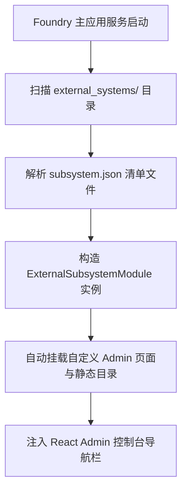

# 动态外部子系统扩展

> **导读**：在构建大型 SaaS 平台或企业级集成平台时，经常需要支持第三方厂商或插件开发者以非侵入方式接入系统，甚至无需重新编译主程序即可挂载新的业务运营大屏和控制台菜单。Foundry 提供了 **动态外部子系统 (External Standalone Subsystems)** 机制，允许通过文件系统清单（`subsystem.json`）动态发现并挂载独立子系统。

---

## 1. 架构定位与对比

| 维度 | 代码优先子系统 (`SubsystemModule`) | 动态外部子系统 (`ExternalSubsystemModule`) |
|---|---|---|
| **定义形式** | Rust 代码编译期打包在二进制中 | 文件系统独立目录与 JSON 清单 |
| **重新编译** | 需要执行 `cargo build` | **零编译，运行时自动扫描加载** |
| **适用人群** | 核心业务研发团队 | 插件作者、生态伙伴、独立第三方运营团队 |
| **自定义大屏** | 支持内嵌静态页面与 postMessage | **完全支持内嵌静态大屏与 postMessage 鉴权协议** |
| **路由挂载** | 具备 Rust Axum 扩展 API (`/ext/*`) | 以可视化大屏、动态模型与 Auto-CRUD 驱动 |



---

## 2. 外部子系统目录结构规范

在项目根目录下创建 `external_systems/` 目录（或通过环境变量指定目录）。每个子系统拥有一个专属目录：

```text
my-app/
├── Cargo.toml
├── src/main.rs
└── external_systems/                   # 外部子系统根目录
    └── analytics/                      # 示例：数据分析子系统
        ├── subsystem.json              # 子系统清单规范文件 (必须)
        └── custom_pages/               # 专属运营看板与大屏
            ├── dashboard.html          # 大屏单页
            └── realtime.html
```

---

## 3. 清单文件规范 (`subsystem.json`)

在 `external_systems/analytics/subsystem.json` 中定义子系统的元数据与后台菜单规范：

```json
{
  "slug": "analytics",
  "display_name": "大数据运营看板",
  "description": "实时交易分析、漏斗转化率与访客流量多维洞察大屏",
  "version": "1.0.0",
  "custom_pages": [
    {
      "key": "traffic_dashboard",
      "title": "实时流量大屏",
      "icon": "BarChart3",
      "page_type": "iframe",
      "entry": "/api/v1/s/analytics/ext/custom-pages/dashboard.html",
      "required_role": null
    },
    {
      "key": "realtime_monitor",
      "title": "异常监控看板",
      "icon": "Activity",
      "page_type": "iframe",
      "entry": "/api/v1/s/analytics/ext/custom-pages/realtime.html",
      "required_role": "super_admin"
    }
  ]
}
```

### 清单字段说明：
* `slug`：子系统的全局唯一英文标识（小写字母、数字与下划线）；
* `display_name`：在管理后台左侧导航栏与系统切换器中显示的中文名称；
* `description`：子系统功能简述；
* `version`：语义化版本号（如 `1.0.0`）；
* `custom_pages`：声明需要嵌入 Admin 控制台的页面规格列表（包含图标、标题与静态资源访问路径）。

---

## 4. 在应用中启用外部子系统扫描

Foundry 引擎提供了扫描与加载函数 `load_external_subsystems`。在 `src/main.rs` 中：

```rust
use foundry::prelude::*;
use foundry_engine::external::load_external_subsystems;
use std::path::PathBuf;

#[foundry::main]
async fn main() -> Result<(), Box<dyn std::error::Error>> {
    let config = FoundryConfig::from_env();

    // 1. 指定外部子系统的搜索目录 (支持多个搜索路径)
    let extra_dirs = vec![
        PathBuf::from("./external_systems"),
        PathBuf::from("/etc/foundry/plugins"),
    ];

    // 2. 动态扫描并解析所有合规的外部子系统模块
    let external_modules = load_external_subsystems(&extra_dirs);

    // 3. 构建应用并批量注入
    let mut builder = FoundryApp::builder().config(config);

    for module in external_modules {
        info!("成功装载动态外部子系统: [{}]", module.slug());
        builder = builder.register_boxed_subsystem(module);
    }

    let app = builder.build().await?;
    app.run().await?;
    Ok(())
}
```

---

## 5. 动态大屏的 postMessage 鉴权

虽然外部子系统没有在宿主 Rust 进程中编译原生控制器，但其自定义 HTML 大屏与内嵌 SPA 可以完全享受与原生子系统一致的 **`postMessage` 免密握手鉴权** 与 **Auto-CRUD RESTful API**：

```javascript
// 在 external_systems/analytics/custom_pages/dashboard.html 中
window.addEventListener('message', async (event) => {
    const { type, token, user } = event.data || {};
    if (type === 'FOUNDRY_AUTH_INIT') {
        console.log('外部插件已通过 Admin 外壳鉴权:', user);

        // 调用该系统的 Auto-CRUD 动态模型接口或公共 API
        const res = await fetch('/api/v1/s/analytics/events', {
            headers: { 'Authorization': `Bearer ${token}` }
        });
        const data = await res.json();
        renderChart(data);
    }
});
```

---

## 6. 初学者避坑指南 (Beginner Gotchas)

> [!WARNING]
> **1. 目录命名与 slug 保持一致**：
> 外部子系统文件夹的目录名建议与 `subsystem.json` 中的 `slug` 保持严格一致（例如文件夹名 `analytics` 与 `"slug": "analytics"`），避免静态资源路径映射混乱。
> 
> **2. 静态页面必须位于 `custom_pages/` 目录**：
> 框架仅自动扫描并托管子系统根目录下的 `custom_pages/` 子目录，请勿直接将 HTML 文件平铺在子系统根目录。
