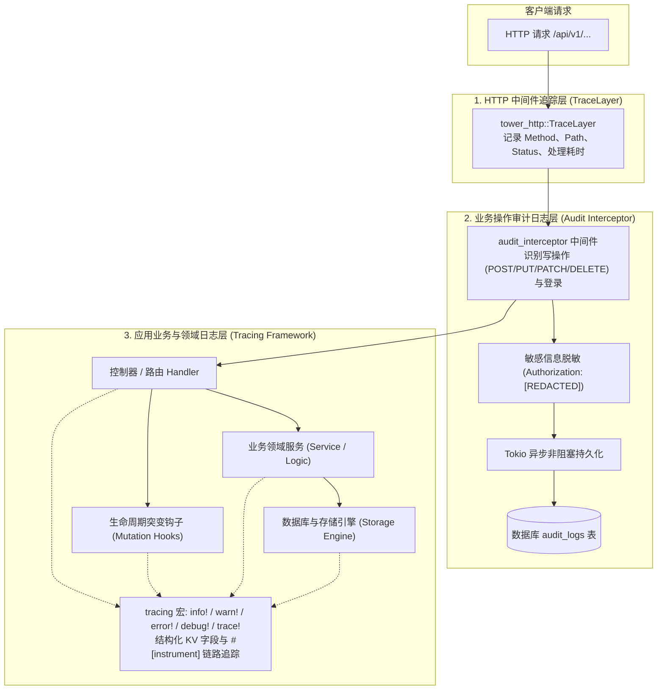

在现代高并发后端系统与多租户架构中，**可观测性 (Observability)** 是保障服务稳定性、快速排查线上故障以及追踪业务操作不可或缺的基础设施。

Foundry 提供了现代化、高性能且分层的可观测性解决方案：
1. **结构化业务日志 (Application Logging)**：基于 Rust 生态事实标准的 `tracing` 框架，开箱即用，支持结构化键值对与上下文透传。
2. **HTTP 请求链路追踪 (HTTP TraceLayer)**：自动追踪所有入站 API 请求的生命周期、处理耗时与 HTTP 响应状态码。
3. **业务操作审计日志 (Audit Logging)**：自动拦截非 GET 写操作与安全敏感操作，实现参数安全脱敏、请求耗时记录与异步非阻塞入库。
4. **灵活的高度可定制性**：支持通过环境变量动态调节过滤粒度，亦允许接管日志初始化以无缝集成 OpenTelemetry、Loki、ELK 等企业级日志系统。

---

## 1. 可观测性分层架构

Foundry 的日志与可观测性体系在架构上清晰划分为三个层级：



---

## 2. 结构化业务日志基础使用

### 2.1 单行导入与标准宏调用

在 Foundry 应用中，无需繁琐地在 `Cargo.toml` 中添加额外的日志依赖。官方门面 crate 已将 `tracing` 完整的核心宏重导出：

```rust
// 方式 1: 推荐方式，通过 prelude 一站式导入
use foundry::prelude::*;

// 方式 2: 通过专用命名空间导入
use foundry::log::{info, warn, error, debug, trace};
```

在任何控制器、服务逻辑、钩子管道或自定义中间件中，即可直接调用日志宏：

```rust
// 普通文本日志
info!("Foundry 业务子系统初始化完成");

// 格式化输出 (标准 print 格式语法)
warn!("租户 [{}] 当前配额占用已达 {}%", tenant_slug, usage_pct);

// 错误日志输出 (配合 thiserror 或 anyhow 错误)
if let Err(err) = sync_data().await {
    error!("数据同步异常失败: {:?}", err);
}

// 调试日志 (开发排查使用，生产级别可过滤)
debug!("解析到的原始报文长度: {} 字节", payload.len());

// 追踪详细过程 (深入微循环、锁与细节)
trace!("正在遍历用户标签集合: index = {}", idx);
```

### 2.2 日志级别规范

| 级别 | 宏 | 适用场景 | 生产环境推荐 |
|---|---|---|---|
| **ERROR** | `error!` | 系统发生不可恢复的故障、数据库连接中断、第三方支付通知校验失败等异常 | **始终开启** |
| **WARN** | `warn!` | 预期外的边界情况、配置降级（如 Redis 连接失败降级为无缓存模式）、凭证即将过期 | **始终开启** |
| **INFO** | `info!` | 系统关键生命周期事件（服务启动、端口监听、子系统挂载）、重要的业务里程碑（订单完成创建） | **推荐开启** |
| **DEBUG** | `debug!` | 详细的业务流转信息、请求入参内容、分支流转条件等 | 本地开发/测试环境开启 |
| **TRACE** | `trace!` | 极细粒度的底层执行细节（锁获取、字节流解码、SQL 单行遍历等） | 深度问题定位时临时开启 |

---

## 3. 结构化键值对与上下文透传

相比传统的 `printf` 式无结构字符串日志，Foundry 深度集成 `tracing` 的 **结构化键值对 (Structured Fields)** 能力。输出不仅包含人眼可读的信息，还可以直接解析为 JSON 字段，极其便于投递到 Elasticsearch、ClickHouse 或 Grafana Loki 进行筛选分析。

### 3.1 键值对记录语法

```rust
use foundry::prelude::*;

pub async fn process_order(ctx: &SystemContext, order_id: &str, amount: f64) {
    // 1. 基础键值对：字段名 = 变量值
    info!(
        order_id = order_id,
        amount = amount,
        "正在处理用户下单结算"
    );

    // 2. 缩写语法：使用 % 强制采用 Display 特征格式化
    info!(
        %order_id,
        tenant = %ctx.system_slug,
        client_ip = ?ctx.client_ip, // 使用 ? 采用 Debug 特征格式化
        "结算前风控检查通过"
    );

    // 3. 错误捕获与结构化输出
    if amount < 0.0 {
        error!(
            %order_id,
            invalid_amount = amount,
            tenant = %ctx.system_slug,
            "订单金额非法，终止执行"
        );
    }
}
```

### 3.2 优势与可检索性

当日志投递到收集服务或控制台时，结构化字段会被独立解析：

```json
{
  "timestamp": "2026-10-14T10:15:30.123Z",
  "level": "INFO",
  "message": "结算前风控检查通过",
  "target": "my_app::systems::shop::logic",
  "order_id": "ORD-20261014-001",
  "tenant": "mall",
  "client_ip": "192.168.1.108"
}
```

团队在运维告警平台可以直接按 `tenant = "mall" AND order_id = "..."` 毫秒级检索，无需编写复杂的正则表达式去切割字符串。

---

## 4. 函数级链路追踪与耗时统计 (`#[instrument]`)

除了手动打点，Foundry 完整支持 `tracing` 的 `#[instrument]` 属性宏。为函数添加该宏即可**自动创建追踪 Span**，自动记录函数入参、调用耗时，并在出现 Panic 或错误时输出清晰的调用栈。

```rust
use foundry::prelude::*;
use tracing::instrument;

// 自动捕获函数入参（可针对敏感参数如密码进行跳过）
#[instrument(skip(db), fields(tenant = %ctx.system_slug))]
pub async fn calculate_user_discounts(
    ctx: &SystemContext,
    db: &Database,
    user_id: i64,
    items_count: usize,
) -> AppResult<DiscountResult> {
    info!("开始计算会员优惠折扣梯度");

    // 模拟复杂耗时计算
    let result = execute_discount_rules(user_id, items_count).await?;

    info!(discount_rate = result.rate, "折扣计算完成");
    Ok(result)
}
```

> [!TIP]
> **参数安全脱敏**：对于密码、Token、卡号等敏感参数，务必使用 `#[instrument(skip(password, token))]` 明确跳过，防止敏感信息泄漏到日志日志管道中。

---

## 5. 日志级别与过滤规则 (`RUST_LOG`)

Foundry 在启动时通过 `tracing_subscriber::EnvFilter` 动态读取系统的 `RUST_LOG` 环境变量。你**无需重新编译代码**，仅需修改环境变量或 `.env` 文件即可按模块、按级别精确控制输出内容。

### 5.1 默认配置

若未显式指定 `RUST_LOG`，Foundry 默认使用以下稳健规则：

```text
info,foundry=debug,foundry_engine=debug
```

这意味着：全局输出 `INFO` 级别及以上日志，而框架核心 (`foundry`) 与请求引擎 (`foundry_engine`) 开启 `DEBUG` 级别，以便在开发阶段观察请求匹配与内部状态。

### 5.2 环境变量配置语法与范例

#### 场景 1：本地开发环境（全面洞察）

想要查看完整的 SQL 查询语句、HTTP 请求生命周期以及自己编写的应用代码日志：

```bash
# 在 .env 文件或启动命令中设置
RUST_LOG="info,my_app=debug,foundry=debug,foundry_engine=debug,tower_http=debug,sqlx=debug"
```

#### 场景 2：生产环境推荐（高性能、静默冗余日志）

生产环境中数据库高频查询与底层库的 Debug 日志会产生大量 I/O 损耗，建议全局开启 `info`，屏蔽驱动层琐碎信息：

```bash
RUST_LOG="warn,my_app=info,foundry=info,foundry_engine=info"
```

#### 场景 3：针对特定子系统或文件单独调试

如果线上排查特定模块（例如订单系统 `shop` 模块）的偶发问题：

```bash
# 仅针对 shop 模块开启 trace，其它模块保持 info
RUST_LOG="info,my_app::systems::shop=trace"
```

### 5.3 常用开源组件的过滤推荐

| 目标组件 | 推荐级别 | 说明 |
|---|---|---|
| `sqlx` | `warn` / `info` | 设为 `debug` 会打印每一条 SQL 及其执行耗时；生产环境务必设为 `warn` |
| `tower_http` | `info` / `debug` | 设为 `debug` 会详细记录每次 HTTP 请求的发起与完成耗时 |
| `hyper` / `mio` | `warn` | 底层网络 I/O 驱动，通常保持 `warn` 避免输出冗余 Socket 握手细节 |
| `mongodb` | `warn` | MongoDB 原生驱动底层心跳与会话日志，通常保持 `warn` |

---

## 6. HTTP 请求链路追踪 (TraceLayer)

在 Foundry 内部，路由引擎已默认挂载 `tower_http::trace::TraceLayer::new_for_http()`。

每当客户端向 Foundry 服务端发起任何请求，控制台都会自动打印一条标准链路日志：

```text
2026-10-14T10:20:00.102Z  INFO tower_http::trace::on_request: started processing request method=GET uri=/api/v1/s/blog/posts version=HTTP/1.1
2026-10-14T10:20:00.115Z  INFO tower_http::trace::on_response: finished processing request latency=13ms status=200
```

- **开始处理**：打印客户端请求方法、请求 URI、HTTP 协议版本。
- **处理完成**：自动计算请求在整个中间件栈与控制器内部的端到端耗时（`latency`）以及最终返回的 HTTP 状态码（`status`）。
- **统一异常捕获**：当服务端发生 500 内部错误时，状态码将真实呈现，方便接入监控大屏（如 Prometheus / Grafana）。

---

## 7. 业务操作审计日志系统 (Audit Logging)

普通业务调试日志主要供研发人员排查代码 Bug，而**操作审计日志 (Audit Log)** 则是企业级系统针对管理员与用户“写操作”的合规留痕审计。

### 7.1 审计日志中间件特性

Foundry 内置了专属的 `audit_interceptor` 中间件，具有以下企业级特性：

1. **智能识别写操作**：
   - 自动拦截所有 `POST`、`PUT`、`PATCH`、`DELETE` 请求。
   - 自动拦截 `/api/v1/admin/auth/login` 等关键鉴权入口。
   - 对幂等的 `GET` 请求自动放行，杜绝无谓的数据库写入压力。
2. **多租户与操作者自动提取**：
   - 从 `AdminClaims` 中提取管理员 ID 与账号名。
   - 从 `SystemContext` 中提取租户 `system_slug`、客户端 IP（支持 `X-Forwarded-For`、`X-Real-IP`）与 `User-Agent`。
3. **数据安全脱敏 (Security Redaction)**：
   - 请求头中的 `Authorization` Token 会被自动脱敏为 `"[REDACTED]"`，防止敏感 Token 落地泄漏。
4. **异步非阻塞入库 (Zero-Latency Overhead)**：
   - 审计日志持久化操作在响应返回下游后，通过 `tokio::spawn` 异步送入存储引擎的 `audit_logs` 表，**绝不阻塞主 HTTP 请求线程**。

### 7.2 审计日志实体定义 (`AuditLogEntity`)

存储层中记录的审计模型包含完整的请求与响应上下文：

```rust
pub struct AuditLogEntity {
    pub id: i64,
    pub admin_id: Option<i64>,          // 操作管理员 ID（未登录操作为 None）
    pub admin_username: Option<String>,  // 管理员用户名
    pub system_slug: Option<String>,     // 关联的业务子系统标识
    pub method: String,                  // HTTP 动词 (POST, PUT, DELETE 等)
    pub path: String,                    // 请求完整路径 (/api/v1/s/shop/orders)
    pub action_name: Option<String>,     // 人类可读的操作描述 (如 "创建业务记录", "管理员登录")
    pub headers: serde_json::Value,      // 脱敏后的请求头 JSON
    pub query_params: Option<String>,    // Query 查询字符串
    pub body_params: Option<String>,     // 提交的请求载荷 (JSON 字符串)
    pub ip_address: Option<String>,      // 客户端真实 IP
    pub user_agent: Option<String>,      // 客户端浏览器 / API 标识
    pub status_code: Option<i16>,        // 响应 HTTP 状态码 (如 200, 422)
    pub duration_ms: Option<i32>,        // 请求执行耗时 (毫秒)
    pub created_at: DateTime<Utc>,       // 操作触发时间
}
```

### 7.3 查询审计日志

Foundry 提供了开箱即用的审计日志管理 API（需具备管理员鉴权）：

```http
GET /api/v1/admin/audit-logs?page=1&page_size=20&system_slug=shop&admin_username=admin
Authorization: Bearer <ADMIN_JWT_TOKEN>
```

响应结果：

```json
{
  "code": 0,
  "message": "success",
  "data": {
    "items": [
      {
        "id": 1024,
        "admin_username": "superadmin",
        "system_slug": "shop",
        "method": "POST",
        "path": "/api/v1/s/shop/goods",
        "action_name": "新增业务数据记录",
        "ip_address": "127.0.0.1",
        "status_code": 200,
        "duration_ms": 12,
        "created_at": "2026-10-14T10:30:00Z"
      }
    ],
    "total": 1,
    "page": 1,
    "page_size": 20,
    "total_pages": 1
  }
}
```

在 Foundry 管理控制台界面（`/admin` -> 审计日志）亦可直接使用可视化表格进行多条件检索、展开查看请求体与耗时分析。

---

## 8. 高级定制：接管日志初始化 (Custom Tracing Subscriber)

对于有高级架构需求的企业用户（例如需要将日志输出为纯 JSON 格式投递到 Kafka/Loki、按天切割日志文件，或接入 OpenTelemetry 进行分布式追踪），Foundry 提供了 `init_tracing(false)` 构建选项，允许开发者在启动前完全接管日志系统的初始化。

### 8.1 禁用默认日志初始化

通过 `FoundryApp::builder().init_tracing(false)` 告知框架跳过内置的 Subscriber 初始化：

```rust
use foundry::prelude::*;

#[tokio::main]
async fn main() -> anyhow::Result<()> {
    // 1. 在构建应用之前，初始化你自定义的 tracing-subscriber
    setup_custom_logging()?;

    // 2. 传入 init_tracing(false)
    let app = FoundryApp::builder()
        .init_tracing(false)
        .build()
        .await?;

    app.run().await?;
    Ok(())
}
```

### 8.2 案例 1：生产环境 JSON 格式化输出 (ELK / CloudWatch)

在云原生容器（K8s / Docker）中，将日志格式化为单行 JSON 便于日志收集代理（如 Fluentbit、Vector）直接采集：

```rust
use tracing_subscriber::{layer::SubscriberExt, util::SubscriberInitExt, EnvFilter};

fn setup_custom_logging() -> anyhow::Result<()> {
    let filter = EnvFilter::try_from_default_env()
        .unwrap_or_else(|_| "info,foundry=info".into());

    // 使用 json 格式化输出到标准输出 (stdout)
    tracing_subscriber::registry()
        .with(filter)
        .with(tracing_subscriber::fmt::layer().json())
        .try_init()?;

    Ok(())
}
```

### 8.3 案例 2：滚动文件日志输出 (File Appender)

如果应用部署在物理机或传统虚拟机上，需要按小时或按天将日志写入磁盘文件，可结合 `tracing-appender`：

```rust
use tracing_appender::rolling::{RollingFileAppender, Rotation};
use tracing_subscriber::{layer::SubscriberExt, util::SubscriberInitExt, EnvFilter};

fn setup_custom_logging() -> anyhow::Result<()> {
    // 每天自动切割日志文件，存储在 ./logs/app.2026-10-14.log
    let file_appender = RollingFileAppender::new(Rotation::DAILY, "./logs", "app.log");
    let (non_blocking, _guard) = tracing_appender::non_blocking(file_appender);

    let filter = EnvFilter::try_from_default_env()
        .unwrap_or_else(|_| "info,foundry=info".into());

    tracing_subscriber::registry()
        .with(filter)
        .with(tracing_subscriber::fmt::layer().with_writer(non_blocking))
        .try_init()?;

    // 注意：_guard 需要保留在 main 函数的生命周期内以确保存储缓冲区平稳 flush
    Ok(())
}
```

---

## 9. 最佳实践总结

1. **优先使用统一门面**：业务代码中统一通过 `use foundry::prelude::*;` 使用日志宏，保证代码整洁一致。
2. **善用结构化字段**：关键业务点切勿使用纯字符串拼接，优先采用 `info!(tenant = %slug, user_id = %uid, "...")`，为日后大规模日志分析打好基础。
3. **区分普通日志与审计日志**：
   - 调试、故障排查、常规流程记录使用 `tracing` 宏；
   - 涉及数据修改、用户授权、关键资产变更的操作，依靠系统的 `audit_interceptor` 自动留痕入库，两套体系互为补充。
4. **合理配置生产环境 `RUST_LOG`**：在生产环境中将驱动库（如 `sqlx`, `tower_http`）的级别保持在 `warn` 或 `info`，有效控制日志体积并大幅降低 I/O 损耗。
