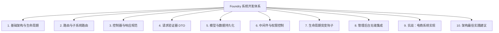
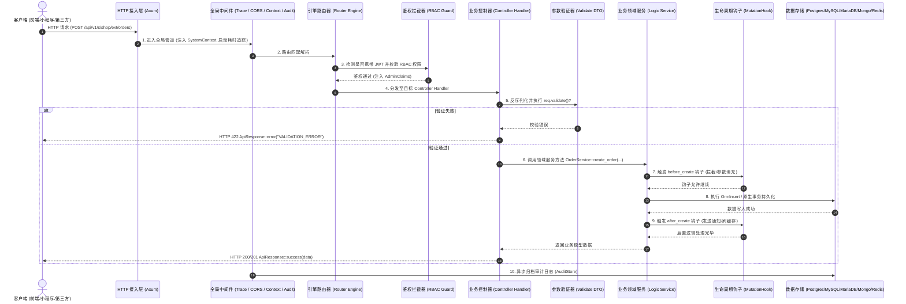
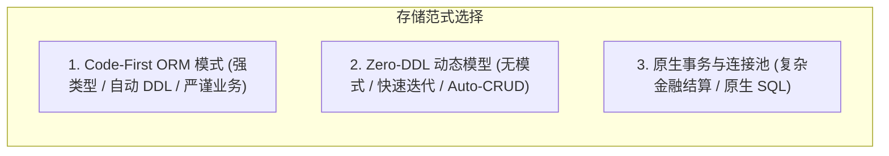

# Foundry 系统开发完全指南

> **导读**：本指南参考了 [ThinkPHP 8.0 官方手册](https://doc.thinkphp.cn/v8_0/base.html) 的结构设计与工程思想，旨在帮助熟悉现代 Web 开发（如 ThinkPHP、Laravel、Spring、NestJS 等）的开发者快速掌握如何在 Foundry 框架上从零构建出高内聚、高可靠、企业级且可维护的完整业务系统。

Foundry 秉持 **“平台与业务完全解耦”、“约定优于配置”** 与 **“高内聚低耦合”** 的设计理念。业务开发者在自己的独立 Git 仓库中构建应用程序，通过标准 Cargo 依赖引入 Foundry，即可享受内嵌的管理控制台、统一鉴权与 RBAC、多数据库驱动透明适配、Auto-CRUD 引擎以及生命周期钩子管道。

---

## 目录导航



---

## 1. 基础概念与请求生命周期

### 1.1 架构分层理念 (对比 ThinkPHP)

在 ThinkPHP 中，应用通常采用 MVC 分层，通过容器（Container）与门面（Facade）解耦组件。Foundry 采用现代 Rust 的无畏并发与类型系统，将分层结构映射为更具领域边界的模块化体系：

| ThinkPHP 8.0 概念 | Foundry 对应概念 | 说明 |
|---|---|---|
| **应用 (App) / 多应用模式** | **独立工程 (User Application)** | 业务项目拥有独立 Git 仓库与 `Cargo.toml`，依赖 `foundry` crate |
| **模块 (Module) / 扩展** | **业务子系统 (`SubsystemModule`)** | 高内聚的业务领域包（如 `shop`, `billing`, `cms`） |
| **门面 (`Facade`)** | **`foundry::prelude::*` / `Database`** | 统一暴露门面方法与核心类型，隐藏底层具体网络驱动 |
| **路由 (`Route`)** | **Axum Router + 引擎路由分发** | 自动化命名空间路由挂载 (`/api/v1/s/{subsystem}/...`) |
| **控制器 (`Controller`)** | **Axum Handler 异步函数** | 处理 HTTP 请求、提取参数并调用业务领域服务 |
| **验证器 (`Validate`)** | **验证 DTO (`#[derive(Validate)]`)** | 编译期强类型验证注解，自动截断非法输入 |
| **模型 (`Model / Db`)** | **ORM Entity / `OrmSelect` / `RecordStore`** | 提供强类型代码优先 ORM 与免 DDL 动态模型双引擎 |
| **中间件 (`Middleware`)** | **Tower / Axum Middleware** | 审计、鉴权、跨域与请求上下文注入流水线 |
| **事件 / 行为钩子 (`Event / Hook`)**| **`MutationHook` 管道** | 实体生命周期前置与后置拦截 (`before_create`, `after_create` 等) |

### 1.2 HTTP 请求全生命周期

了解请求在框架中的流动路径，是进行系统设计与排查问题的基石：



---

## 2. 工程骨架与目录组织规范

### 2.1 标准工程结构

使用 `foundry new <project_name>` 脚手架创建的项目具备清晰的组织架构：

```text
my-app/
├── Cargo.toml                  # 依赖 foundry 及相关生态
├── .env                        # 数据库、Redis、JWT 等环境变量
├── migrations/                 # (可选) 由 foundry ddl 或 foundry migrate 导出的物理 SQL
│   └── init.sql
└── src/
    ├── main.rs                 # 应用启动引导入口 (FoundryApp::builder)
    └── systems/                # 业务子系统聚合目录
        ├── mod.rs              # 子系统汇总导出
        └── shop/               # 示例：商城子系统
            ├── mod.rs          # 实现 SubsystemModule Trait
            ├── controllers/    # HTTP 控制器 (Axum Handlers)
            │   └── mod.rs
            ├── logic/          # 纯领域业务逻辑服务 (Service / Domain)
            │   └── mod.rs
            ├── dto/            # 数据传输对象与验证规则 (DTO & Validator)
            │   └── mod.rs
            └── custom_pages/   # 嵌入管理后台的专属运营看板 (HTML / React / Vue)
                └── order_studio.html
```

---

## 3. 路由与子系统路由设计

Foundry 统一管理应用路由空间，为多系统提供天然的隔离：

### 3.1 统一路由空间规划

| 路由前缀 | 用途 | 说明 |
|---|---|---|
| `/health` | 系统健康检查 | 容器编排存活探针 (返回 `OK`) |
| `/api/v1/admin/*` | 平台与控制台管理接口 | 包含管理员登录、子系统管理、审计日志等 |
| `/api/v1/s/{subsystem}/{model}` | **Auto-CRUD 引擎路由** | 无需写任何代码，零 DDL 模型的标准 RESTful 接口 |
| `/api/v1/s/{subsystem}/ext/*` | **业务子系统扩展路由** | 由子系统的 `register_routes()` 挂载的自定义 API |
| `/admin/*` | 管理后台可视化控制台 | 内置 SPA 控制台或挂载静态产物 |

### 3.2 子系统路由注册

在 `src/systems/shop/mod.rs` 中，通过实现 `SubsystemModule::register_routes` 挂载路由：

```rust
use foundry::prelude::*;
use std::path::PathBuf;

pub struct ShopSubsystem;

impl SubsystemModule for ShopSubsystem {
    fn slug(&self) -> &'static str {
        "shop"
    }

    fn display_name(&self) -> &'static str {
        "电子商务商城"
    }

    fn description(&self) -> &'static str {
        "商品目录、购物车、结算与订单全流程管理"
    }

    // 挂载当前子系统的扩展路由：最终访问路径为 /api/v1/s/shop/ext/*
    fn register_routes(&self, router: Router) -> Router {
        let mut r = router.merge(crate::systems::shop::controllers::build_routes());

        // 挂载静态自定义大屏页面
        let custom_dir = PathBuf::from("src/systems/shop/custom_pages");
        if custom_dir.exists() {
            r = r.nest_service("/custom-pages", ServeDir::new(custom_dir));
        }

        r
    }
}
```

---

## 4. 控制器、参数提取与响应规范

控制器负责接收外部请求、校验入参、调度领域服务并返回标准结果。

### 4.1 统一响应结构 (`ApiResponse`)

Foundry 内置了标准统一响应结构体 `ApiResponse<T>`，所有 HTTP 接口均建议遵循该规范输出：

```rust
use foundry::prelude::*;

// 1. 成功返回数据
ApiResponse::success(data)

// 2. 成功创建资源 (HTTP 201)
ApiResponse::created(new_resource)

// 3. 分页列表数据
ApiResponse::paginated(items, PageMeta { page: 1, limit: 20, total: 100 })

// 4. 业务失败返回
ApiResponse::error("ORDER_ALREADY_PAID", "该订单已支付，无法重复支付")
```

输出的 JSON 格式标准化：
```json
{
  "success": true,
  "code": "OK",
  "message": "Success",
  "data": { ... },
  "meta": null
}
```

### 4.2 编写标准控制器 Handler

在 `src/systems/shop/controllers/mod.rs` 中：

```rust
use axum::{
    Json, Router,
    extract::{Extension, Path, Query},
    routing::{get, post},
};
use foundry::prelude::*;
use validator::Validate;

use crate::systems::shop::dto::{CreateOrderRequest, OrderListQuery, OrderResponse};
use crate::systems::shop::logic::OrderService;

pub fn build_routes() -> Router {
    Router::new()
        .route("/orders", post(create_order).get(list_orders))
        .route("/orders/{id}", get(get_order_by_id))
}

/// 创建订单控制器
pub async fn create_order(
    Extension(ctx): Extension<SystemContext>,
    Extension(state): Extension<AppState>,
    Json(payload): Json<CreateOrderRequest>,
) -> AppResult<Json<ApiResponse<OrderResponse>>> {
    // 1. 参数强校验 (类似 ThinkPHP $validate->check($data))
    payload.validate()?;

    // 2. 业务逻辑调度
    let order = OrderService::create_order(&ctx, &state, payload).await?;

    // 3. 返回统一响应
    Ok(Json(ApiResponse::created(order)))
}

/// 分页查询订单控制器
pub async fn list_orders(
    Extension(ctx): Extension<SystemContext>,
    Extension(state): Extension<AppState>,
    Query(query): Query<OrderListQuery>,
) -> AppResult<Json<ApiResponse<Vec<OrderResponse>>>> {
    let (orders, meta) = OrderService::list_orders(&ctx, &state, query).await?;
    Ok(Json(ApiResponse::paginated(orders, meta)))
}

/// 根据 ID 获取订单详情
pub async fn get_order_by_id(
    Extension(ctx): Extension<SystemContext>,
    Extension(state): Extension<AppState>,
    Path(id): Path<i64>,
) -> AppResult<Json<ApiResponse<OrderResponse>>> {
    let order = OrderService::get_order(&ctx, &state, id).await?;
    Ok(Json(ApiResponse::success(order)))
}
```

### 4.3 统一错误处理 (`AppError` 与 `AppResult`)

在 Foundry 中，无需编写繁琐的 `try/catch` 逻辑。所有错误通过统一枚举 `AppError` 表达，并通过 `?` 运算符向上传播：

| 错误变体 | 触发场景 | 映射 HTTP 状态码 |
|---|---|---|
| `AppError::Validation(msg)` | DTO 校验未通过 | `422 Unprocessable Entity` |
| `AppError::NotFound(msg)` | 目标实体未找到 | `404 Not Found` |
| `AppError::Unauthorized(msg)` | 未登录或凭证无效 | `401 Unauthorized` |
| `AppError::Forbidden(msg)` | 角色权限不足 | `403 Forbidden` |
| `AppError::Conflict(msg)` | 唯一索引冲突或状态冲突 | `409 Conflict` |
| `AppError::Database(msg)` | 底层数据库连接异常或执行失败 | `500 Internal Server Error` |
| `AppError::Internal(msg)` | 未预期系统内部异常 | `500 Internal Server Error` |

---

## 5. 请求验证器与 DTO (Validator)

类似 ThinkPHP 中的独立验证器（`Validate` 类），Foundry 采用 `validator` 宏在 DTO 结构体上通过元属性声明规则。

在 `src/systems/shop/dto/mod.rs` 中：

```rust
use serde::{Deserialize, Serialize};
use validator::Validate;

#[derive(Debug, Clone, Deserialize, Validate)]
pub struct CreateOrderItem {
    #[validate(range(min = 1, max = 999999, message = "商品 ID 必须为合法正整数"))]
    pub product_id: i64,

    #[validate(range(min = 1, max = 100, message = "单项购买数量必须在 1 到 100 之间"))]
    pub quantity: i32,
}

#[derive(Debug, Clone, Deserialize, Validate)]
pub struct CreateOrderRequest {
    #[validate(length(min = 2, max = 64, message = "收件人姓名长度须在 2-64 字符之间"))]
    pub customer_name: String,

    #[validate(email(message = "必须提供合法的电子邮箱地址"))]
    pub customer_email: String,

    #[validate(length(min = 5, max = 255, message = "收货地址长度须在 5-255 字符之间"))]
    pub shipping_address: String,

    #[validate(length(min = 1, message = "订单必须至少包含一件商品"))]
    pub items: Vec<CreateOrderItem>,
}

#[derive(Debug, Clone, Deserialize)]
pub struct OrderListQuery {
    pub status: Option<String>,
    pub page: Option<u64>,
    pub limit: Option<u64>,
}

#[derive(Debug, Clone, Serialize)]
pub struct OrderResponse {
    pub id: i64,
    pub order_no: String,
    pub customer_name: String,
    pub total_amount: f64,
    pub status: String,
    pub created_at: chrono::DateTime<chrono::Utc>,
}
```

---

## 6. 模型与数据持久化

Foundry 提供三套针对不同业务场景的数据持久化范式：



### 6.1 范式一：Code-First ORM 实体定义 (推荐核心业务使用)

子系统可以在 `SubsystemModule::orm_models()` 中声明其实体结构。框架在执行 `foundry migrate` 或 `cargo run`（当 `AUTO_MIGRATE=true` 时）会自动将其编译为当前选定数据库方言的 DDL 并创建表和索引：

```rust
use foundry::prelude::*;

impl SubsystemModule for ShopSubsystem {
    fn slug(&self) -> &'static str { "shop" }
    fn display_name(&self) -> &'static str { "电子商务商城" }

    fn orm_models(&self) -> Vec<EntitySchema> {
        vec![
            // 订单主表
            EntitySchema::new("shop_orders")
                .column(ColumnDef::bigint("id").primary_key().auto_increment())
                .column(ColumnDef::varchar("system_id", 32).not_null())
                .column(ColumnDef::varchar("order_no", 64).not_null().unique())
                .column(ColumnDef::varchar("customer_name", 64).not_null())
                .column(ColumnDef::varchar("customer_email", 128).not_null())
                .column(ColumnDef::decimal("total_amount", 12, 2).not_null())
                .column(ColumnDef::varchar("status", 24).not_null()) // pending, paid, shipped, cancelled
                .column(ColumnDef::json("items_payload").default_empty_json())
                .column(ColumnDef::datetime("created_at").default_current_timestamp())
                .column(ColumnDef::datetime("updated_at").default_current_timestamp())
                .column(ColumnDef::datetime("deleted_at").nullable())
                .index(IndexDef::new("idx_orders_sys_status", &["system_id", "deleted_at", "status"])),

            // 商品表
            EntitySchema::new("shop_products")
                .column(ColumnDef::bigint("id").primary_key().auto_increment())
                .column(ColumnDef::varchar("title", 128).not_null())
                .column(ColumnDef::decimal("price", 10, 2).not_null())
                .column(ColumnDef::integer("stock").not_null())
                .column(ColumnDef::boolean("is_active"))
                .column(ColumnDef::datetime("created_at").default_current_timestamp())
                .column(ColumnDef::datetime("deleted_at").nullable())
        ]
    }
}
```

> 💡 **CLI 自动生成提示**：执行 `foundry system new <slug> --with-table` 即可一键生成以上包含 `deleted_at` 软删除、ORM 实体模型、增删改查 DTO 以及方言 DDL SQL 文件的完整业务骨架！

### 6.2 范式二：ThinkPHP 风格的链式查询构造器 (ORM Query Builder)

对于熟悉 ThinkPHP `Db::table('...')->where(...)->select()` 的开发者，Foundry 提供了完全自适应各数据库方言（自动替换 `$1` 与 `?` 占位符）的链式构造器：

```rust
use foundry::prelude::*;

// 1. 链式分页查询 (自动过滤软删除：类似 Db::name('shop_orders')->whereNull('deleted_at')->select())
let (sql, binds) = OrmSelect::from_table("shop_orders")
    .column("id")
    .column("order_no")
    .column("total_amount")
    .column("status")
    .column("created_at")
    .where_eq("system_id", "shop")
    .where_eq("status", "pending")
    .where_null("deleted_at")
    .order_by_desc("created_at")
    .limit(20)
    .offset(0)
    .to_sql(Dialect::Postgres); // 或 Dialect::MySql

// 2. 链式新增记录 (类似 Db::name('shop_orders')->insert($data))
let (insert_sql, insert_binds) = OrmInsert::into_table("shop_orders")
    .value("system_id", "shop")
    .value("order_no", "ORD-20261012-001")
    .value("customer_name", "张三")
    .value("customer_email", "zhangsan@example.com")
    .value("total_amount", 299.00)
    .value("status", "pending")
    .to_sql(Dialect::Postgres);

// 3. 链式条件更新 (类似 Db::name('shop_orders')->where('order_no', '...')->update(['status' => 'paid']))
let (update_sql, update_binds) = OrmUpdate::into_table("shop_orders")
    .set("status", "paid")
    .set_now("updated_at")
    .where_eq("order_no", "ORD-20261012-001")
    .where_null("deleted_at")
    .to_sql(Dialect::Postgres);

// 4. 链式安全软删除 (严格标记删除，绝无物理 DELETE FROM，零 DELETE 权限亦可平稳运行)
let (soft_del_sql, soft_del_binds) = OrmUpdate::into_table("shop_orders")
    .set_now("deleted_at")
    .where_eq("order_no", "ORD-20261012-001")
    .where_null("deleted_at")
    .to_sql(Dialect::Postgres);

// 5. 链式物理删除 (仅用于临时缓存/清理测试数据；生产业务统一推荐使用上述第 4 点软删除)
let (delete_sql, delete_binds) = OrmDelete::from_table("shop_orders")
    .where_eq("id", 10)
    .to_sql(Dialect::Postgres);
```

### 6.3 范式三：Zero-DDL 动态模型 (快速业务与 Auto-CRUD)

如果业务需求多变、处于敏捷实验期，可以直接使用免 DDL 动态模型：
```rust
use foundry::prelude::*;
use serde_json::json;

// 创建记录：自动租户隔离，并在底层持久化为 JSONB / JSON
let record = state.db.records().create(
    "shop",
    "customer_feedback",
    json!({
        "score": 5,
        "content": "发货非常迅速，服务很好！",
        "tags": ["快递好", "正品"]
    })
).await?;
```
定义了该模型后，前端可直接调用：
* `GET /api/v1/s/shop/customer_feedback` (自动分页与关键字过滤)
* `POST /api/v1/s/shop/customer_feedback` (自动新增)
* `GET /api/v1/s/shop/customer_feedback/{id}` (详情)
* `PUT /api/v1/s/shop/customer_feedback/{id}` (修改)
* `DELETE /api/v1/s/shop/customer_feedback/{id}` (删除)

### 6.4 强类型配置中心 (`get_typed_config`)

无需写死配置，在管理后台动态修改，代码中强类型安全读取：

```rust
use serde::Deserialize;

#[derive(Debug, Deserialize)]
pub struct ShopConfig {
    pub currency: String,
    pub auto_cancel_unpaid_minutes: u32,
    pub free_shipping_threshold: f64,
}

// 强类型提取当前子系统的动态聚合配置
let shop_cfg: ShopConfig = state.db.get_typed_config("shop").await?;
```

---

## 7. 中间件与细粒度 RBAC 权限控制

### 7.1 三级角色层级

Foundry 原生支持三级管理员架构：
1. `super_admin`：超级管理员，对平台全局拥有最高控制权。
2. `admin`：平台常规管理员，可查看多数全局资源。
3. `topic_admin`：**子系统隔离管理员**，仅能管理自身被授权绑定的系统（通过 `allowed_systems` 数组控制）。

### 7.2 保护子系统私有路由

在控制器或逻辑层中，校验当前请求持有者的角色与租户边界：

```rust
use axum::extract::Extension;
use foundry::prelude::*;

pub async fn admin_only_action(
    Extension(claims): Extension<AdminClaims>,
    Extension(ctx): Extension<SystemContext>,
) -> AppResult<Json<ApiResponse<String>>> {
    // 校验当前登录管理员是否有权访问当前子系统
    check_system_access(&claims, &ctx.system_slug)?;

    // 亦可校验角色是否为超级管理员
    if claims.role != "super_admin" {
        return Err(AppError::Forbidden("需要超级管理员权限方可执行此操作".into()));
    }

    Ok(Json(ApiResponse::success("操作已成功执行".into())))
}
```

---

## 8. 生命周期突变钩子 (Mutation Hook)

类似 ThinkPHP 模型事件（`after_insert`, `before_update`），Foundry 提供了流水线式的 `MutationHook`：

```rust
use async_trait::async_trait;
use foundry::prelude::*;
use serde_json::Value;

pub struct ShopAuditHook;

#[async_trait]
impl MutationHook for ShopAuditHook {
    // 实体创建前拦截：可用于补齐默认值、风控校验等
    async fn before_create(
        &self,
        ctx: &SystemContext,
        model_slug: &str,
        data: &mut Value,
    ) -> AppResult<()> {
        if ctx.system_slug == "shop" && model_slug == "orders" {
            tracing::info!("即将为用户创建订单: {:?}", data.get("customer_name"));
            // 可以在 data 中注入字段
            if let Some(obj) = data.as_object_mut() {
                obj.insert("risk_checked".to_string(), serde_json::json!(true));
            }
        }
        Ok(())
    }

    // 实体创建后触发：可用于异步通知、更新库存统计等
    async fn after_create(
        &self,
        ctx: &SystemContext,
        model_slug: &str,
        record_id: i64,
        data: &Value,
    ) -> AppResult<()> {
        if ctx.system_slug == "shop" && model_slug == "orders" {
            tracing::info!("订单 #{} 创建成功，准备触发邮件通知...", record_id);
        }
        Ok(())
    }
}
```

在 `src/main.rs` 启动时注册：
```rust
let app = FoundryApp::builder()
    .config(config)
    .register_subsystem(ShopSubsystem)
    .register_hook(ShopAuditHook)
    .build()
    .await?;
```

---

## 9. 管理后台嵌入与 postMessage 桥接

业务子系统通常包含专属的业务报表或运营看板。Foundry 支持免打包将自定义前端页面（HTML/React/Vue）直接接入管理后台。

### 9.1 声明后台菜单项

在 `src/systems/shop/mod.rs` 中重写 `custom_admin_pages`：

```rust
impl SubsystemModule for ShopSubsystem {
    // ...
    fn custom_admin_pages(&self) -> Vec<CustomAdminPageSpec> {
        vec![CustomAdminPageSpec {
            key: "order_studio".to_string(),
            title: "订单运营大屏".to_string(),
            icon: "ShoppingCart".to_string(), // Lucide 图标标识
            page_type: "iframe".to_string(),
            entry: "/api/v1/s/shop/ext/custom-pages/order_studio.html".to_string(),
            required_role: None, // 继承子系统访问权限
        }]
    }
}
```

### 9.2 前端 postMessage 免密鉴权协议

在自定义页面 `src/systems/shop/custom_pages/order_studio.html` 中，可通过标准消息监听直接获取父窗口传递的当前管理员身份凭证与暗黑主题模式：

```html
<!DOCTYPE html>
<html lang="zh-CN">
<head>
    <meta charset="UTF-8">
    <title>订单运营大屏</title>
</head>
<body class="p-6 font-sans">
    <h1 id="title" class="text-2xl font-bold">加载中...</h1>
    <div id="stats" class="mt-4"></div>

    <script>
        // 监听来自 Foundry Admin 外壳的握手与令牌注入事件
        window.addEventListener('message', (event) => {
            const { type, token, user, system, theme } = event.data || {};
            if (type === 'FOUNDRY_AUTH_INIT' || type === 'FOUNDRY_THEME_CHANGE') {
                console.log('成功获取管理后台鉴权上下文:', { user, system, theme });
                document.getElementById('title').innerText = `欢迎进入 ${system} 运营看板`;

                // 后续使用该 token 发起带有 Bearer 头的 API 请求
                fetchOrders(token);
            }
        });

        async function fetchOrders(token) {
            const res = await fetch('/api/v1/s/shop/ext/orders', {
                headers: {
                    'Authorization': `Bearer ${token}`
                }
            });
            const json = await res.json();
            document.getElementById('stats').innerText = `当前订单总数: ${json.data ? json.data.length : 0}`;
        }
    </script>
</body>
</html>
```

---

## 10. 实战教程：从零开发一个电商系统

本节以一个具备**商品查询、下单结账、参数校验与生命周期拦截**的“电商系统（Shop）”为例，展示完整的工程代码全景。

### 步骤 1：编写数据验证与 DTO (`src/systems/shop/dto/mod.rs`)

```rust
use serde::{Deserialize, Serialize};
use validator::Validate;

#[derive(Debug, Clone, Deserialize, Validate)]
pub struct CreateOrderRequest {
    #[validate(length(min = 2, max = 32, message = "顾客姓名长度须为 2-32 字符"))]
    pub customer_name: String,

    #[validate(email(message = "邮箱格式不正确"))]
    pub customer_email: String,

    #[validate(range(min = 1, message = "购买数量至少为 1"))]
    pub quantity: i32,

    pub product_id: i64,
}

#[derive(Debug, Clone, Serialize)]
pub struct OrderResponse {
    pub id: i64,
    pub order_no: String,
    pub customer_name: String,
    pub total_amount: f64,
    pub status: String,
    pub created_at: chrono::DateTime<chrono::Utc>,
}
```

### 步骤 2：编写领域业务逻辑 (`src/systems/shop/logic/mod.rs`)

```rust
use crate::systems::shop::dto::{CreateOrderRequest, OrderResponse};
use chrono::Utc;
use foundry::prelude::*;

pub struct OrderService;

impl OrderService {
    pub async fn create_order(
        ctx: &SystemContext,
        state: &AppState,
        req: CreateOrderRequest,
    ) -> AppResult<OrderResponse> {
        let order_no = format!("ORD-{}-{}", Utc::now().format("%Y%m%d%H%M%S"), req.product_id);
        let unit_price = 99.00;
        let total_amount = unit_price * (req.quantity as f64);

        // 使用 ORM 链式插入
        let (sql, _binds) = OrmInsert::into_table("shop_orders")
            .value("system_id", &ctx.system_slug)
            .value("order_no", &order_no)
            .value("customer_name", &req.customer_name)
            .value("customer_email", &req.customer_email)
            .value("total_amount", total_amount)
            .value("status", "pending")
            .to_sql(Dialect::Postgres);

        tracing::info!("准备执行订单持久化 SQL: {}", sql);

        // 模拟持久化成功生成订单响应
        let resp = OrderResponse {
            id: Utc::now().timestamp_millis(),
            order_no,
            customer_name: req.customer_name,
            total_amount,
            status: "pending".to_string(),
            created_at: Utc::now(),
        };

        Ok(resp)
    }
}
```

### 步骤 3：编写控制器路由 (`src/systems/shop/controllers/mod.rs`)

```rust
use axum::{Json, Router, extract::Extension, routing::post};
use foundry::prelude::*;
use validator::Validate;

use crate::systems::shop::dto::{CreateOrderRequest, OrderResponse};
use crate::systems::shop::logic::OrderService;

pub fn build_routes() -> Router {
    Router::new().route("/orders", post(handle_create_order))
}

pub async fn handle_create_order(
    Extension(ctx): Extension<SystemContext>,
    Extension(state): Extension<AppState>,
    Json(payload): Json<CreateOrderRequest>,
) -> AppResult<Json<ApiResponse<OrderResponse>>> {
    // 1. 严格参数校验
    payload.validate()?;

    // 2. 调度领域服务
    let order = OrderService::create_order(&ctx, &state, payload).await?;

    // 3. 返回 201 统一响应
    Ok(Json(ApiResponse::created(order)))
}
```

### 步骤 4：组装子系统模块 (`src/systems/shop/mod.rs`)

```rust
pub mod controllers;
pub mod dto;
pub mod logic;

use axum::Router;
use foundry::prelude::*;

pub struct ShopSubsystem;

impl SubsystemModule for ShopSubsystem {
    fn slug(&self) -> &'static str {
        "shop"
    }

    fn display_name(&self) -> &'static str {
        "电子商务商城中心"
    }

    fn description(&self) -> &'static str {
        "完整的商品展现、下单结账与交易中心"
    }

    fn register_routes(&self, router: Router) -> Router {
        router.merge(controllers::build_routes())
    }

    fn orm_models(&self) -> Vec<EntitySchema> {
        vec![
            EntitySchema::new("shop_orders")
                .column(ColumnDef::bigint("id").primary_key().auto_increment())
                .column(ColumnDef::varchar("system_id", 32).not_null())
                .column(ColumnDef::varchar("order_no", 64).not_null().unique())
                .column(ColumnDef::varchar("customer_name", 64).not_null())
                .column(ColumnDef::varchar("customer_email", 128).not_null())
                .column(ColumnDef::decimal("total_amount", 12, 2).not_null())
                .column(ColumnDef::varchar("status", 24).not_null())
                .column(ColumnDef::datetime("created_at").default_current_timestamp())
                .index(IndexDef::new("idx_shop_orders_sys", &["system_id"]))
        ]
    }
}
```

### 步骤 5：注册并启动应用 (`src/main.rs`)

```rust
pub mod systems;

use foundry::prelude::*;
use systems::shop::ShopSubsystem;

#[tokio::main]
async fn main() -> anyhow::Result<()> {
    // 初始化追踪日志
    tracing_subscriber::fmt::init();

    // 从 .env 加载配置
    let config = FoundryConfig::from_env();

    // 构建并运行 Foundry 应用
    let app = FoundryApp::builder()
        .config(config)
        .register_subsystem(ShopSubsystem)
        .build()
        .await?;

    tracing::info!("Foundry 应用已成功构建，正在启动服务...");
    app.run().await?;
    Ok(())
}
```

---

## 11. 架构最佳实践建议

为了确保系统在生产环境中具备高内聚、高吞吐、强韧性与易维护性，请遵循以下开发实践：

### 11.1 架构分层严谨性
* **控制器保持精简 (Thin Controller)**：控制器的职责仅限于 HTTP 协议相关的参数提取、校验和响应封装，不要在控制器中直接堆叠复杂业务逻辑或原生 SQL。
* **业务逻辑下沉到 Logic/Service 层 (Fat Service)**：所有与业务规则、跨模型调度、事务一致性相关的代码，均应封装在独立领域服务中，便于单元测试与逻辑复用。
* **显式参数校验 (Explicit Validation)**：在进入领域逻辑前，务必调用 `payload.validate()?`。

### 11.2 数据库连接池与性能优化
* **合理配置连接池大小**：通过环境变量 `DB_MAX_CONNECTIONS=50` 配置最大连接数，避免高并发下耗尽数据库连接资源。
* **联合索引最佳左前缀原则**：多租户/多系统数据表查询必须优先以 `system_id` / `system_slug` 为联合索引的第一列。
* **深度分页优化**：当单表数据量达到百万级时，避免大偏移量的 `OFFSET`。建议使用游标分页（Cursor Pagination，记录上一页最大的 `id` / `created_at` 进行 `WHERE id > $last_id LIMIT $n`）。

### 11.3 缓存策略与 Redis 集成
* **读多写少热点数据缓存**：通过 `state.redis` 缓存热门系统配置或商品详情。
* **缓存穿透与雪崩防范**：为缓存键设置合理随机扰动的 TTL 超时时间，对于不存在的空结果缓存简短的占位符。

### 11.4 安全防范准则
* **参数化绑定彻底杜绝 SQL 注入**：无论使用 `OrmSelect`、`RecordStore` 还是原生 SQL，一律使用参数绑定（`bind()` 或 `to_sql()`），严禁字符串拼接 SQL。
* **密钥严禁硬编码**：`JWT_SECRET`、数据库密码与第三方私钥一律通过 `.env` 注入，生产环境配置专用的密钥管理服务（如 HashiCorp Vault、AWS KMS）。
* **多租户隔离审查**：所有自定义查询和更新必须严格携带 `WHERE system_id = $system_slug`，防止越权访问其他业务子系统数据。

### 11.5 生产部署与容器化
* **开启发布编译优化**：构建生产镜像时使用 `cargo build --release`。
* **双模迁移策略**：
  * **开发与 CI/CD 测试环境**：配置 `AUTO_MIGRATE=true`，实现全自动平滑建表与更新。
  * **企业生产环境**：配置 `AUTO_MIGRATE=false`，通过 `foundry ddl --db <type>` 导出方言脚本，经 DBA 审计后统一由数据库发布系统执行。
