# Foundry 系统开发教程导航枢纽

> **导读**：
> 为提供清晰高效的开发指引，本系统开发教程采用模块化架构解耦为 **11 个独立的专业章节**。
>
> 你可以按模块、按需求精确查阅架构设计、路由绑定、控制器编写、DTO 验证、Code-First ORM、动态模型以及管理控制台集成。

---

## 📚 教程模块导航

```mermaid
flowchart TD
    Root["Foundry 系统开发体系"]
    Root --> C1["01. 基础架构与生命周期"]
    Root --> C2["02. 路由系统与子系统路由"]
    Root --> C3["03. 控制器、参数与响应规范"]
    Root --> C4["04. 请求验证器与 DTO 设计"]
    Root --> C5["05. 数据库配置与 Code-First ORM"]
    Root --> C6["06. Zero-DDL 动态模型与 Auto-CRUD"]
    Root --> C7["07. 认证安全与分级 RBAC"]
    Root --> C8["08. 生命周期突变钩子 (Mutation Hook)"]
    Root --> C9["09. 管理控制台与 postMessage 桥接"]
    Root --> C10["10. 综合实战：从零构建电商系统"]
    Root --> C11["11. 架构最佳实践与生产部署"]

    click C1 "/zh/development/01-architecture-lifecycle/" "阅读基础架构"
    click C2 "/zh/development/02-routing/" "阅读路由系统"
    click C3 "/zh/development/03-controllers/" "阅读控制器"
    click C4 "/zh/development/04-validation/" "阅读验证器"
    click C5 "/zh/development/05-database-orm/" "阅读数据库ORM"
    click C6 "/zh/development/06-dynamic-models/" "阅读动态模型"
    click C7 "/zh/development/07-auth-security/" "阅读安全RBAC"
    click C8 "/zh/development/08-mutation-hooks/" "阅读生命周期钩子"
    click C9 "/zh/development/09-admin-integration/" "阅读后台集成"
    click C10 "/zh/development/10-walkthrough-shop/" "阅读综合实战"
    click C11 "/zh/development/11-best-practices/" "阅读最佳实践"
```

---

## 🚀 核心章节直达通道

### 一、基础与路由
* 🏗️ **[01. 基础架构与请求生命周期](../../development/01-architecture-lifecycle/)**：平台与应用完全解耦理念、HTTP 全流程时序流转图、`FoundryApp::builder()` 引导流程；
* 🛣️ **[02. 路由系统与子系统路由](../../development/02-routing/)**：全局统一命名空间规划（`/health`、`/admin/*`、`/api/v1/s/{subsystem}/ext/*`）、路径参数与方法绑定；

### 二、请求处理层
* 🎮 **[03. 控制器、参数与响应规范](../../development/03-controllers/)**：Axum Handler 设计规范、参数提取器（`Json`、`Query`、`Path`、`Extension`）、`ApiResponse<T>` 统一响应与 `AppError` 错误信封；
* 🛡️ **[04. 请求验证器与 DTO 设计](../../development/04-validation/)**：基于 `validator` 宏注解的参数强校验、常用规则速查表（length, email, range, regex, nested）、HTTP 422 自动截断；

### 三、数据持久化与模型
* 💾 **[05. 数据库配置与 Code-First ORM](../../development/05-database-orm/)**：多数据库 SPI 驱动、Code-First 实体声明（`EntitySchema`）、链式查询构造器（`OrmSelect`、`OrmInsert`、`OrmUpdate`、软删除）与方言迁移；
* ⚡ **[06. Zero-DDL 动态模型与 Auto-CRUD](../../development/06-dynamic-models/)**：免 SQL DDL 动态模型概念、`RecordStore` 存储 API、开箱即用的 RESTful Auto-CRUD 引擎；

### 四、安全、扩展与后台集成
* 🔐 **[07. 认证安全与分级 RBAC 权限控制](../../development/07-auth-security/)**：Argon2id 密码哈希、JWT 令牌签发、三级角色体系（`super_admin`、`admin`、`topic_admin`）、子系统租户隔离；
* 🪝 **[08. 生命周期突变钩子 (Mutation Hook)](../../development/08-mutation-hooks/)**：实体生命周期前置拦截（`before_create` 等）与后置异步通知（`after_create` 等）流水线；
* 🖥️ **[09. 管理控制台与 postMessage 桥接](../../development/09-admin-integration/)**：React Admin 外壳、自定义运营大屏声明（`custom_admin_pages`）、沙箱 iframe 与 `postMessage` 免密鉴权协议；

### 五、实战与工程化
* 🛒 **[10. 综合实战：从零构建电商系统](../../development/10-walkthrough-shop/)**：完整的手把手实战（包含 DTO、Logic 服务、Controller、SubsystemModule、`main.rs` 以及自动化测试用例）；
* 🏆 **[11. 架构最佳实践与生产部署](../../development/11-best-practices/)**：Thin Controller/Fat Service 架构规范、连接池调优、联合索引最左前缀、游标分页、Docker 容器化与生产配置。

---

> [!TIP]
> 👉 **从这里开始**：建议前往 **[系统开发核心教程总览](../../development/)** 或直接进入 **[01. 基础架构与请求生命周期](../../development/01-architecture-lifecycle/)** 开始系统学习！
